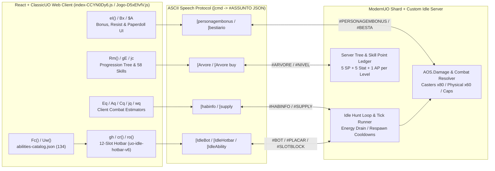

# Phase 2: Core UO Idle Engine & Systems Knowledgebase - Research

**Researched:** 2026-04-20
**Domain:** UO Idle Core Engine, Combat Estimators, Status Effects, Progression Tree, Equipment/Affixes & Client/Shared/Server Capability Matrix (`mechanics/` KB)
**Confidence:** HIGH

<user_constraints>
## User Constraints (from CONTEXT.md)

### Locked Decisions
- **Core Systems Page Structure & Granularity (`INDEX-01`)**
  - Create **focused, modular KB pages** across `mechanics/combat/` and `mechanics/systems/` so each page stays cleanly anchored to its primary `_raw/` source (`sources[0]`) and can be cross-linked via `[[slug]]` and `[[slug]] C<n>`:
    - `mechanics/combat/tick-and-cooldowns.md` — Combat tick loop, auto-attack vs ability slot cycling, cooldown tracking, hotbar slot priority (`gh` 8-slot hotbar), and ability trigger conditions (`in_combat`, `hp_below`, `mana_below`, etc.).
    - `mechanics/combat/damage-and-defense.md` — Client combat estimators (`jq`, `wq`, `Nq`, `Sq`, `kq`, `Cq`, `Mq`, `Aq`, `Eq`), physical vs elemental damage, armor/resist mitigation, hit/defense chance (`AttackChance`, `DefendChance`), and server-documented damage formulas from `changelog-server-dev.md` / `changelog-server-en.md`.
    - `mechanics/combat/resources.md` — HP, Mana, Stamina, Focus, Meditation, regeneration ticks, mana/stamina cost reduction (`LowerManaCost`, `LowerRegCost`), and Hunting Energy pool/drain rules.
    - `mechanics/combat/status-effects.md` — Buffs, debuffs, DoTs (Bleed, Poison, Burn), crowd control (Paralyze, Stun, Slow, Taunt), shields/absorbs, and reactive states (Counter, Reflect, Evasion).
    - `mechanics/systems/progression-unlocks.md` — Character level progression (L1–60+ unlock curve `gE`), skill caps & 58 UO skills (`jc`), starting kits (`mx`/`hx`), and the `[Arvore` progression tree (`Rm`, `zI`).
    - `mechanics/systems/equipment-affixes.md` — Paperdoll equipment slots, item rarity tiers and hues (`$A`), affix/bonus caps (`eI`, `Bx`, `[personagembonus`), material tiers, and dungeon/monster scaling (`[bestiario`, `[IdleBot`).
- **Client vs Shared vs Server Engine Capability Matrix (`INDEX-02`)**
  - Create a dedicated synthesis page at `mechanics/topics/engine-capability-matrix.md` (`category: engine-ui`) that classifies every combat primitive and engine capability into three tiers:
    1. **Client-Evaluated (`index-CCYN0Dy6.js` / `Jogo-D5xEfvfV.js`):** UI estimators (`Eq`, `Aq`, `Cq`), hotbar slot configuration, local condition UI, unlock level display (`gE`), and ability catalog filtering.
    2. **Shared-Config (`abilities.json` / protocol commands):** Ability schema (`id`, `name`, `class`, `unlock`, `cd`, `mana`, `stam`, `kind`, `trigger`, `effect`), status effect identifiers, and `[habinfo` / `[personagembonus` / `[Arvore` / `[IdleBot` bracket commands.
    3. **Server-Authoritative (ModernUO shard + custom Idle loop):** Actual damage/hit rolls, cooldown enforcement, DoT/HoT tick execution, aggro/taunt resolution, and custom C# ability handlers.
  - Explicitly map **Mode A vs Mode B** implications for Phase 5 (Samurai & Ninja class design):
    - **Mode A (100% existing engine opcodes):** Primitives already supported in `abilities-catalog.json` and the server combat loop (direct damage, multi-hit, AoE splash, flat/percent stat buffs, DoT ticks, debuffs, shields/heals, threshold triggers).
    - **Mode B (`<20 LOC` native shard hooks):** Stateful mechanics that require a small server-side C# hook in the ModernUO shard loop (e.g., Samurai consecutive-hit `Perfection` stacking or reactive parry counter-attacks; Ninja ablative `Mirror Image` clone charges or 5-hit delayed `Death Strike` detonation).
- **Evidence & Citation Hygiene**
  - Every `## Claims` line (`- **C<n>** [<tag>] "<verbatim quote>" (raw L<a>-L<b>)`) must quote `sources[0]` verbatim so `python3 mechanics/tools/kb.py check --root mechanics` passes with zero warnings or errors.
  - When a page synthesizes facts from both client bundle slices (`_raw/bundle/*.js`) and server changelogs (`_raw/wiki/changelog-server-*.md`), use `sources[0]` for the primary `_raw/` file (cited via `(raw L<a>-L<b>)`) and list additional `_raw/` or `_evidence/` files in `sources` and `evidence` (cited via `(evidence <k>)`), or split into tightly-scoped pages cross-linked via `[[slug]] C<n>`.
  - `## Summary` sections must remain **strictly digit-free** (`kb.py` rule `summary-number`: write numbers out in words in `## Summary` or put all numeric details in `## Claims` and body sections).

### Agent's Discretion
- Exact assignment of `sources[0]` for each of the 7 KB pages so that verbatim quotes in `## Claims` maximize signal and pass `kb.py check` cleanly.
- Additional helper pages in `mechanics/combat/` or `mechanics/systems/` if splitting a topic makes `sources[0]` alignment cleaner.
- Internal section layout and Markdown tables within each KB page (outside the required `## Summary` and `## Claims` sections).

### Deferred Ideas (OUT OF SCOPE)
- Deep-dive per-class pages for all 7 existing UO Idle classes (`mechanics/classes/*.md`) — covered in Phase 3 (`CLASS-01`..`CLASS-08`).
- ModernUO canonical `Server.Spells.Bushido` and `Server.Spells.Ninjitsu` source audits (`mechanics/modernuo/*.md`) — covered in Phase 4 (`MUO-01`..`MUO-03`).
- Final Samurai and Ninja 3-tier progression specs and `classes-patch.js` implementation — covered in Phase 5 (`SAM-01`..`NIN-04`).
</user_constraints>

<phase_requirements>
## Phase Requirements

| ID | Description | Research Support |
|----|-------------|------------------|
| `INDEX-01` | Core UO Idle engine mechanics are documented in `mechanics/` KB pages (combat tick loop, cooldowns, auto-attack vs ability slots, hit/defense roll, physical/elemental damage & resistances, status effects/DoTs/CC, resource pools, and progression/unlock rules) with `[bundle-stated]` or `[doc-stated]` citations. | Full line-level inventory of `abilities-loader-and-hotbar.js`, `combat-estimators-and-hotbar.js`, `abilities-catalog.json`, `character-bonus-and-status.js`, `skills-and-progression.js`, `progression-tree-ui.js`, `paperdoll-and-items.js`, `bestiary-and-wiki.js`, `hunt-and-bot-config.js`, `i18n-en-abilities.js`, and `changelog-server-dev.md` mapped to 6 modular KB pages across `mechanics/combat/` and `mechanics/systems/`. |
| `INDEX-02` | Client vs Shared vs Server Engine Capability Matrix is documented in `mechanics/`, classifying which combat primitives (triggers, buffs, debuffs, DoTs, shields, multi-hit, AoE, threshold executes, summons) are data-driven in `abilities.json` vs client-evaluated in `index.js` vs server-authoritative, explicitly bounding Mode A (existing opcodes) vs Mode B (`<20 LOC` native hooks) for Phase 5. | Complete 3-tier classification of all 134 `abilities-catalog.json` entries (`ItemUse`, `Passive`, `WeaponAbility`, `Spell`, `SpecialMove`, `Custom`), 197 client bracket commands (`protocol-commands-index.json`), and server combat loop rules (`changelog-server-dev.md`), mapped to `mechanics/topics/engine-capability-matrix.md`. |
</phase_requirements>

---

## Summary

Phase 2 transforms the raw bundle slices (`mechanics/_raw/bundle/*`), wiki changelogs (`mechanics/_raw/wiki/*`), and protocol index (`mechanics/_raw/api/protocol-commands-index.json`) extracted in Phase 1 into seven cross-linked, linter-verified knowledgebase pages in `mechanics/combat/`, `mechanics/systems/`, and `mechanics/topics/`.

Inspection of `mechanics/tools/kb.py` reveals two critical validation invariants that govern how every Phase 2 KB page must be authored:
1. **`(raw L<a>-L<b>)` only checks `sources[0]`:** `check_claims` (`mechanics/tools/kb.py:249-275`) loads **only** `sources[0]` (`page_raw(root, fm)`) and verifies that every `(raw L<a>-L<b>)` quote is a verbatim substring after collapsing runs of whitespace (`" ".join(s.split())`).
2. **`(evidence N)` is restricted to `topics/` pages and non-`RAW_ONLY_TAGS`:** `check_cites` (`mechanics/tools/kb.py:278-315`) enforces that `(evidence N)` claims may **only** appear on `mechanics/topics/*.md` pages (`if kind != "topics": why = "an (evidence N) claim belongs on a topics page"`), and that `(evidence N)` claims **cannot** use `bundle-stated`, `doc-stated`, or `modernuo-stated` (`tag in RAW_ONLY_TAGS`). Furthermore, if a `topics/` claim uses `[verified] (evidence N)`, `evidence[N-1]` must begin with a measured prefix (`network: `, `dom: `, `sim: `, or `live: `).

Consequently, each of the six `combat/` and `systems/` pages must use `(raw L<a>-L<b>)` exclusively in `## Claims` against its designated `sources[0]`, while listing secondary `_raw/` files in frontmatter `sources` (indices `1..k`) and `evidence` (`bundle: _raw/... L<a>-L<b>`, `wiki: _raw/... L<a>-L<b>`) and referencing facts from sibling KB pages in prose via `[[slug]] C<n>`. The synthesis page `mechanics/topics/engine-capability-matrix.md` can combine `(raw L<a>-L<b>)` claims from `sources[0]` (`_raw/api/protocol-commands-index.json`) with `[verified] (evidence 1)` claims backed by `"live: _evidence/live-bundle-probe.txt L1-L20"` and cross-page `[[slug]] C<n>` citations to the six `combat/` and `systems/` pages.

---

## Architectural Responsibility Map

| Capability | Primary Tier | Secondary Tier | Notes |
|------------|-------------|----------------|-------|
| **Hotbar Slot Config & Local Trigger Editor** (`Gn = 12` slots, `Mo = 0` fixed slot, `ro(e)`, `rk(e)`) | Browser / Client UI (`abilities-loader-and-hotbar.js`, `combat-estimators-and-hotbar.js`) | Shared Protocol (`[IdleHotbar <json>`) | Client seeds and validates 12-slot hotbars (`uo-idle-hotbar-v6:<key>`) and syncs JSON to server via `[IdleHotbar`. |
| **Damage & Heal Tooltip Estimators** (`Eq`, `Aq`, `Cq`, `jq`, `wq`, `Nq`, `Sq`, `kq`) | Browser / Client UI (`combat-estimators-and-hotbar.js`) | Server Speech Broadcast (`#HABINFO` via `[habinfo`) | Client computes estimated min/max damage, heal, multi-hit, splash, and DPS as a fallback until `#HABINFO` overrides or augments it. |
| **Ability Catalog & Dispatch Schema** (`abilities-catalog.json`, 134 entries) | Shared Config (`/packs/idle/abilities.json?v=0.99.0`) | Client Loader (`Fc`, `Uw`) & Server Runner (`[IdleAbility <id>`) | Defines `id`, `class`, `kind` (`ItemUse`, `Passive`, `WeaponAbility`, `Spell`, `SpecialMove`, `Custom`), `unlock`, `mana`, `tab`, `ref`, `map`. |
| **Combat Tick Loop, Posture Multipliers & Cooldown Enforcement** | Server Engine (ModernUO shard + custom Idle C# runner) | Client HUD (`#BOT`, `#HABINFO`, `#PLACAR`, `#SUPPLY`) | Server executes combat ticks, enforces 2s minimum CD floor on Custom abilities, applies posture modifiers (`+20%/+40%` or `-40%/-20%`), and drains Hunting Energy. |
| **Hit/Defense Rolls, Resistances, Cap Enforcement & `AOS.Damage`** | Server Engine (ModernUO `AOS.Damage` + custom Idle scaling) | Client Status Panel (`#PERSONAGEMBONUS` via `[personagembonus`) | Server computes level power scaling (`casters ×80, físico ×60`), enforces gear/tree caps (Defense 45%, Hit 45%, Speed 60% gear, LMC 40%, SpellDmg 50%), and applies 5 resistances. |
| **Progression Tree (`[Arvore`) & Skill/Stat Unlocks (`gE`)** | Server Engine (`#ARVORE` state, point costs, resets) | Client Progression UI (`skills-and-progression.js`, `progression-tree-ui.js`) | Client holds `jc` (58 skills) and `gE` (L1–60 linear class unlock tables for 7 classes); server validates `[Arvore buy <node>` and `[Arvore skill|status|attribute <id>`. |

---

## Standard Stack

### Core Tools & Schema (`mechanics/`)
| Tool / File | Version / Location | Purpose | Why Standard |
|-------------|--------------------|---------|--------------|
| `mechanics/tools/kb.py` | Python 3.10+ stdlib (`mechanics/tools/kb.py`) | Builds (`index.json`, `LINKS.md`, `gaps.md`) and validates all KB pages (`check --root mechanics`) | Locked Phase 1 single-file stdlib CLI; zero external pip packages (`[VERIFIED: mechanics/tools/kb.py:L1-L32]`). |
| `mechanics/_raw/manifest.json` | Schema v1 (`mechanics/_raw/manifest.json`) | Tracks SHA-256 and byte sizes of all 20 extracted `_raw/` files | Enforced by `check_manifest` (`[VERIFIED: mechanics/tools/kb.py:L380-L433]`). |
| `mechanics/_evidence/live-bundle-probe.txt` | Captured live probe (`mechanics/_evidence/live-bundle-probe.txt`) | Live HTTP verification of `play.uoidle.com` assets (`index-CCYN0Dy6.js`, `Jogo-D5xEfvfV.js`, `abilities.json?v=0.99.0`) | Enables `[verified] (evidence N)` claims on `mechanics/topics/*.md` pages (`[VERIFIED: mechanics/_evidence/live-bundle-probe.txt:L1-L20]`). |

---

## Architecture Patterns

### System Architecture Diagram: UO Idle Client-Server Combat & Progression Loop



### Pattern 1: Exact Page-to-`sources[0]` Mapping for Phase 2 KB Pages

Because `kb.py` checks `(raw L<a>-L<b>)` substrings **only** against `sources[0]`, each Phase 2 KB page must pair with the single `_raw/` file that contains its highest density of primary constants and formulas, while citing secondary `_raw/` files in frontmatter `sources[1..]` and `evidence` (`bundle: ...`, `wiki: ...`) and linking to sibling KB pages via `[[slug]] C<n>`.

| Page Path (`id`) | `category` | Primary `sources[0]` (for `(raw L<a>-L<b>)`) | Secondary `sources` & `evidence` | Primary Tag |
|------------------|------------|----------------------------------------------|----------------------------------|-------------|
| `mechanics/combat/tick-and-cooldowns.md` (`tick-and-cooldowns`) | `combat` | `_raw/bundle/abilities-loader-and-hotbar.js` | `_raw/bundle/combat-estimators-and-hotbar.js`, `_raw/bundle/hunt-and-bot-config.js`, `_raw/wiki/changelog-server-dev.md` | `bundle-stated` |
| `mechanics/combat/damage-and-defense.md` (`damage-and-defense`) | `combat` | `_raw/bundle/combat-estimators-and-hotbar.js` | `_raw/bundle/i18n-en-abilities.js`, `_raw/wiki/changelog-server-dev.md`, `_raw/wiki/changelog-server-en.md` | `bundle-stated` |
| `mechanics/combat/resources.md` (`resources`) | `combat` | `_raw/wiki/changelog-server-dev.md` | `_raw/bundle/i18n-en-abilities.js`, `_raw/bundle/combat-estimators-and-hotbar.js`, `_raw/bundle/progression-tree-ui.js` | `doc-stated` |
| `mechanics/combat/status-effects.md` (`status-effects`) | `status-effects` | `_raw/bundle/abilities-catalog.json` | `_raw/bundle/i18n-en-abilities.js`, `_raw/bundle/bestiary-and-wiki.js`, `_raw/wiki/changelog-server-dev.md` | `bundle-stated` |
| `mechanics/systems/progression-unlocks.md` (`progression-unlocks`) | `progression` | `_raw/bundle/skills-and-progression.js` | `_raw/bundle/progression-tree-ui.js`, `_raw/bundle/classes-config.js`, `_raw/wiki/changelog-server-dev.md` | `bundle-stated` |
| `mechanics/systems/equipment-affixes.md` (`equipment-affixes`) | `items-equipment` | `_raw/bundle/character-bonus-and-status.js` | `_raw/bundle/paperdoll-and-items.js`, `_raw/bundle/bestiary-and-wiki.js`, `_raw/bundle/i18n-en-abilities.js`, `_raw/wiki/changelog-server-dev.md` | `bundle-stated` |
| `mechanics/topics/engine-capability-matrix.md` (`engine-capability-matrix`) | `engine-ui` | `_raw/api/protocol-commands-index.json` | `live: _evidence/live-bundle-probe.txt L1-L20`, `_raw/bundle/abilities-catalog.json`, `_raw/bundle/classes-config.js`, `_raw/wiki/changelog-server-dev.md` + `[[slug]] C<n>` links | `bundle-stated` + `verified` |

---

### Pattern 2: Complete Line-Level Inventory by KB Page

#### 1. `mechanics/combat/tick-and-cooldowns.md`
- **Primary `sources[0]`:** `_raw/bundle/abilities-loader-and-hotbar.js` (1,425 lines)
- **Exact Verbatim Spans in `abilities-loader-and-hotbar.js`:**
  - **Ability Catalog Fetch (`L25-L35`):**
    - `fetch(`/packs/idle/abilities.json?v=${encodeURIComponent('0.99.0')}`)` (`[VERIFIED: mechanics/_raw/bundle/abilities-loader-and-hotbar.js:L27]`: ``const e = await fetch(`/packs/idle/abilities.json?v=${encodeURIComponent('0.99.0')}`);``)
  - **Unlock & Passive Filtering (`L37-L51`):**
    - `OE = new Set(['samurai_way', 'warrior_MomentumStrike', 'paladin_TouchOfLife'])` (`[VERIFIED: mechanics/_raw/bundle/abilities-loader-and-hotbar.js:L23]`: `OE = new Set(['samurai_way', 'warrior_MomentumStrike', 'paladin_TouchOfLife']),`)
    - `Uw(e, a)` filters out `OE.has(s.id)`, `s.kind === 'Passive'`, and `typeof s.unlock == 'number' && s.unlock > a.level` (`[VERIFIED: mechanics/_raw/bundle/abilities-loader-and-hotbar.js:L43-L48]`: `!(OE.has(s.id) || s.kind === 'Passive') && (s.class === n || (t && s.class === t)) && !(a != null && a.level && typeof s.unlock == 'number' && s.unlock > a.level)`).
  - **Hotbar Auto-Trigger Condition Builders (`L609-L616`):**
    - `jo = (e, a = 'self') => ({ target: a, attr: 'hp', op: '<=', value: e, join: 'and' })` (`[VERIFIED: mechanics/_raw/bundle/abilities-loader-and-hotbar.js:L609]`)
    - `hu = (e) => ({ target: 'self', attr: 'mana', op: '<=', value: e, join: 'and' })` (`[VERIFIED: mechanics/_raw/bundle/abilities-loader-and-hotbar.js:L610]`)
    - `hh = (e) => ({ target: 'self', attr: 'stam', op: '<=', value: e, join: 'and' })` (`[VERIFIED: mechanics/_raw/bundle/abilities-loader-and-hotbar.js:L611]`)
    - `Td = { target: 'self', attr: 'poisoned', op: '==', value: 1, join: 'and' }` (`[VERIFIED: mechanics/_raw/bundle/abilities-loader-and-hotbar.js:L612]`)
    - `HE = [jo(80), { ...Td, join: 'or' }]` (`[VERIFIED: mechanics/_raw/bundle/abilities-loader-and-hotbar.js:L613]`)
    - `fu = (e = 'self') => ({ target: e, attr: 'in_combat', op: '==', value: 1, join: 'and' })` (`[VERIFIED: mechanics/_raw/bundle/abilities-loader-and-hotbar.js:L614]`)
    - `fh = (e) => ({ target: 'self', attr: e, op: '==', value: 0, join: 'and' })` (`[VERIFIED: mechanics/_raw/bundle/abilities-loader-and-hotbar.js:L615]`)
    - `zE = (e) => ({ target: 'self', attr: 'enemies', op: '>=', value: e, join: 'and' })` (`[VERIFIED: mechanics/_raw/bundle/abilities-loader-and-hotbar.js:L616]`)
  - **Default Hotbar Trigger Generator `ro(e)` (`L617-L695`):**
    - `bandage`: `HE` (`hp <= 80%` OR `poisoned == 1`) (`L631`)
    - `lesser_heal_potion`: `[jo(50)]`, `heal_potion`: `[jo(32)]`, `greater_heal_potion`: `[jo(18)]` (`L634-L639`)
    - `lesser_mana_potion`: `[hu(40)]`, `mana_potion` / `greater_mana_potion`: `[hu(28)]`, `meditat`: `[hu(35)]` (`L640-L645`)
    - `refresh_potion`: `[hh(45)]`, `total_refresh_potion`: `[hh(22)]` (`L646-L649`)
    - `strength_potion` / `_bless` / `greater_strength`: `[fu(), fh('str_buff')]`; `agility`: `[fu(), fh('dex_buff')]`; `intelligence`: `[fu(), fh('int_buff')]` (`L650-L660`)
    - `mage_heal` / `necro_magery_heal`: `[jo(50, 'self'), { ...jo(50, 'ally'), join: 'or' }]`; `greater_heal`: `40%`; other heals `am`: `[jo(55)]` (`L661-L674`)
    - AoE abilities matching `GE` (`whirlwind|cleave|multishot|bolt_volley|frenzied|earthquake|meteor|chain_lightning|wither|thunderstorm|bladestorm|spinning|...`): `[zE(3)]` (`enemies >= 3`) (`L617-L618`, `L679-L680`)
    - `warrior_provoke`: `[{ target: 'self', attr: 'ally_agro', op: '==', value: 1, join: 'and' }]` (`L681-L689`)
  - **Hotbar Slot Architecture & Seeded Class Bars (`L760-L1173`):**
    - `Mo = 0`, `Gn = 12`, `Jw = (e) => 'uo-idle-hotbar-v6:' + e` (`[VERIFIED: mechanics/_raw/bundle/abilities-loader-and-hotbar.js:L760-L762]`: `Mo = 0, Gn = 12, Jw = (e) => \`uo-idle-hotbar-v6:\${e}\`,`)
    - `cr(e)` slot schema (`L818-L901`): `kind` (`'item' | 'ability' | 'spell' | 'meditate'`), `context` (`'hunt' | 'gather' | 'always'`), `conditions`, plus legacy rank ID migration (`warrior_double_strike_2_r2 -> warrior_double_strike_2`, `ranger_charged_shot_r2 -> ranger_charged_shot`).
    - `gh` (`L1026-L1173`): seeded default hotbars for all 15 combat classes (`warrior`, `mage`, `ranger`, `necromancer`, `paladin`, `berserker`, `duelist`, `assassin`, `ninja`, `monk`, `samurai`, `mystic`, `spellweaver`, `bard`, `tamer`), with slot 0 always pinned to `{ kind: 'item', itemKey: 'bandage', id: 'item:bandage', context: 'hunt', conditions: HE }`.
- **Secondary Cross-References (`evidence` & prose):**
  - `_raw/bundle/combat-estimators-and-hotbar.js:L5-L40`: `pq` polls `e.say('[habinfo')` and `e.say('[supply')` on intervals `hq` / `fq` and listens for `HABINFO` and `SUPPLY`.
  - `_raw/bundle/combat-estimators-and-hotbar.js:L85-L93`: `Sg(e, a)` marks `warrior_slash`, `ranger_arrow`, and `monk_palm` as auto-attack passives (`hotbar.autoAttackCd`, no hotbar slot needed).
  - `_raw/bundle/combat-estimators-and-hotbar.js:L242-L243`: `coolRatio > 0.01` active cooldown check on hotbar slots.
  - `_raw/bundle/combat-estimators-and-hotbar.js:L520-L541`: `rk(e)` valid condition targets per attribute (`enemies`/`ally_agro`/`str_buff`/`dex_buff`/`int_buff` -> `['self']`; `in_combat` -> `['self', 'enemy']`; `mana`/`stam`/`poisoned` -> `['self', 'ally', 'party:leader']`; `hp` -> `['self', 'ally', 'party:leader', 'enemy']`).
  - `_raw/wiki/changelog-server-dev.md:L208-L210`: Respawn cooldown per spawn point by difficulty (`Trivial 50s · Fácil 45s · Médio 40s · Desafiador 35s · Difícil 30s · Pesadelo 25s · Inferno 20s`).
  - `_raw/wiki/changelog-server-dev.md:L217`: Potion cooldown gap follows real CD (not 400ms); bot skips slots lacking potion/bandage/reagents/mana without stalling farm.
  - `_raw/wiki/changelog-server-dev.md:L603`: `HabInfo: passives fora da lista; Custom sem CD declarado usa piso de 2 s` (2-second minimum cooldown floor for Custom abilities).

---

#### 2. `mechanics/combat/damage-and-defense.md`
- **Primary `sources[0]`:** `_raw/bundle/combat-estimators-and-hotbar.js` (542 lines)
- **Exact Verbatim Spans in `combat-estimators-and-hotbar.js`:**
  - **Estimator Skill ID Lookup `Zo` (`L358-L366`):**
    - `Zo = { alchemy: 0, anatomy: 1, evalInt: 16, healing: 17, magery: 25, tactics: 27, chivalry: 51 }` (`[VERIFIED: mechanics/_raw/bundle/combat-estimators-and-hotbar.js:L358-L366]`)
  - **Rounding & Alchemy Helpers (`L367-L380`):**
    - `vq = (e, a) => Math.max(1, Math.round((e + a) / 2))` (`[VERIFIED: mechanics/_raw/bundle/combat-estimators-and-hotbar.js:L367]`)
    - `Gs = (e, a, n) => { const s = Math.max(1, Math.floor(a)), t = Math.max(s, Math.ceil(n)); return { kind: e, min: s, max: t, avg: vq(s, t) }; }` (`[VERIFIED: mechanics/_raw/bundle/combat-estimators-and-hotbar.js:L368-L372]`)
    - `yq = (e) => Math.floor((e * 10) / 33)` (`[VERIFIED: mechanics/_raw/bundle/combat-estimators-and-hotbar.js:L379]`)
    - `pj = (e, a) => Math.floor((e * (100 + a)) / 100)` (`[VERIFIED: mechanics/_raw/bundle/combat-estimators-and-hotbar.js:L380]`)
  - **Healing Estimators (`L381-L412`):**
    - `jq(e, a)` Potion Heal (`L381-L393`): `lesser_heal_potion` base `[6, 8]`, `heal_potion` base `[13, 16]`, `greater_heal_potion` base `[20, 25]`, scaled by Alchemy bonus `yq(a)`.
    - `wq(e, a)` Bandage Heal (`L394-L398`): `n = a / 8 + e / 5 + 4`, `s = a / 6 + e / 2.5 + 4` where `e` = Healing (`Zo.healing`), `a` = Anatomy (`Zo.anatomy`) (`[VERIFIED: mechanics/_raw/bundle/combat-estimators-and-hotbar.js:L395]`: `const n = a / 8 + e / 5 + 4,`).
    - `Nq(e)` Magery Heal (`L399-L402`): `Gs('heal', e / 12 + 1, e / 12 + 4)` (`[VERIFIED: mechanics/_raw/bundle/combat-estimators-and-hotbar.js:L400]`).
    - `Sq(e)` Magery Greater Heal (`L403-L406`): `Gs('heal', e / 5 + 1, e / 5 + 6)` (`[VERIFIED: mechanics/_raw/bundle/combat-estimators-and-hotbar.js:L404]`).
    - `kq(e)` Chivalry Close Wounds (`L407-L412`): `Gs('heal', e / 10 + 1, e / 10 + 6)` (`[VERIFIED: mechanics/_raw/bundle/combat-estimators-and-hotbar.js:L408]`).
  - **Physical Ability Estimator `Cq(e, a, n = 1)` (`L413-L453`, `a` = Tactics, `n` = rank 1..3):**
    - `execution`: `s = Math.floor(a * 0.6) + 20 * n`, returns `Gs('damage', s, s)` (`L414-L417`).
    - `cleave`: `s = 15 + 10 * n`, `t = 8 + 4 * n`, returns `{ ...Gs('damage', s, s), splash: t }` (`L418-L421`).
    - `multishot` / `bolt_volley`: `s = 2 + n`, `t = 10 + 5 * n`, returns `{ kind: 'damage', hits: s, perHit: t, min: s * t, max: s * t, avg: s * t }` (`L422-L428`).
    - `flurry`: `s = 2 + n`, `t = 8 + 3 * n`, returns `{ kind: 'damage', hits: s, perHit: t, min: s * t, max: s * t, avg: s * t }` (`L429-L435`).
    - `shield_bash` / `earthshaker`: `s = 10 + 5 * n + Math.floor(a * 0.15)`, returns `Gs('damage', s, s + 6)` (`L436-L439`).
    - `cleric_thunderstorm` / `chain_lightning`: `s = 14 + 5 * n`, `t = Gs('damage', s, s + 8)`, `splash: Math.max(1, Math.floor(s / 2))` (`L440-L444`).
    - `heavy_strike` / `crushing`: `s = 12 + Math.floor(a * 0.25)`, returns `Gs('damage', Math.max(1, s - 4), s + 8)` (`L445-L451`).
  - **Spell School Multipliers `Mq(e)` & Spell Estimator `Aq(e, a, n)` (`L454-L490`):**
    - `Mq(e)` (`L454-L470`): `magic_arrow: 2.1`, `harm: 2`, `fireball: 1.85`, `lightning: 1.65`, `energy_bolt | explosion | poison_strike | strangle: 1.75`, `flame_strike | chain_lightning | wither: 1.6`, `pain_spike: 1.65`.
    - `Aq(e, a, n)` (`L471-L490`): `s = a * 0.5 + n * 0.3` (`a` = Magery, `n` = EvalInt), `t = Mq(e)`, returns `Gs('damage', Math.max(2, s * 0.14 * t + 3), Math.max(5, s * 0.22 * t + 7))` (`[VERIFIED: mechanics/_raw/bundle/combat-estimators-and-hotbar.js:L472-L484]`).
  - **Master Estimator Dispatcher `Eq(e, a)` & DPS Formatter `fj(e, a)` (`L41-L84`, `L491-L519`):**
    - `fj(e, a)` (`L61-L84`): computes `i / e.cd` DPS over cooldown (`o >= 10 ? Math.round(o) : o.toFixed(1)`), handling multi-hit `e.golpes` and AoE `e.area`.
    - `Eq(e, a)` (`L491-L519`): detects `_r3` (`c = 3`) vs `_r2` (`c = 2`), handles `ki_recovery` (`l = 15 + 5 * Math.max(1, e.unlock > 40 ? 2 : 1)`), and dispatches to `jq`, `wq`, `Nq`, `Sq`, `kq`, `Cq`, or `Aq`.
- **Secondary Cross-References (`evidence` & prose):**
  - `_raw/wiki/changelog-server-dev.md:L17`: `Poder por nível invertido vs Ethernul: casters ×80, físico ×60 (cura sem DamageFactor).`
  - `_raw/bundle/i18n-en-abilities.js:L1575-L1579`: Bot attack postures (`agressivo`: +20% damage dealt and +40% damage taken; `equilibrado`: normal; `defensivo`: -40% damage dealt and -20% damage taken).
  - `_raw/bundle/i18n-en-abilities.js:L2616`: Attribute caps (`Damage`: +100%, `Defense`: +45%, `HitChance`: +45%, `Speed`: gear cap 60% while tree attribute exceeds cap, `SpellDamage`: +50%, `Cast`: +2, `Recovery`: +6, `LowerMana`: +40%).

---

#### 3. `mechanics/combat/resources.md`
- **Primary `sources[0]`:** `_raw/wiki/changelog-server-dev.md` (1,202 lines)
- **Exact Verbatim Spans in `changelog-server-dev.md`:**
  - **Server Percentage-Based Potions, Spells & Chivalry Tithe (`L499-L502`):**
    - `Poções de cura e mana: 15% / 25% / 35% da vida/mana máxima (lesser / normal / greater)` (`[VERIFIED: mechanics/_raw/wiki/changelog-server-dev.md:L499]`)
    - `Magias Heal / Greater Heal Idle: 15% / 35% da vida máxima do alvo` (`[VERIFIED: mechanics/_raw/wiki/changelog-server-dev.md:L500]`)
    - `Paladino Idle: Chivalry gasta ouro da conta 1 gp por ponto (sem refill fantasma de 10k)` (`[VERIFIED: mechanics/_raw/wiki/changelog-server-dev.md:L502]`)
  - **Warrior / Ranger Zero-Mana & Meditation Cap Rules (`L649-L654`):**
    - `Abilities do guerreiro custam 0 mana (customs + WeaponAbility)` (`[VERIFIED: mechanics/_raw/wiki/changelog-server-dev.md:L653]`)
    - `Meditation cap 0 e zerada no login/create do guerreiro` (`[VERIFIED: mechanics/_raw/wiki/changelog-server-dev.md:L654]`)
  - **Hunting Energy Pool, Passive Recovery & Gold Refill Formula (`L63`, `L146-L147`, `L215-L216`, `L565-L568`):**
    - `Recarga de energia com ouro: até 4 por dia; opções de +1 h, +4 h ou completa.` (`[VERIFIED: mechanics/_raw/wiki/changelog-server-dev.md:L63]`)
    - `Fórmula: 10 gp × nível × minutos que faltam × nº da recarga do dia (1ª a 4ª), máx. 4/dia.` (`[VERIFIED: mechanics/_raw/wiki/changelog-server-dev.md:L147]`)
    - `Energia em zero encerra a caça no mesmo tick; teleporte limpa aggro e o char fica invulnerável até escolher destino.` (`[VERIFIED: mechanics/_raw/wiki/changelog-server-dev.md:L215-L216]`)
    - `Energia de caça recupera fora de caça mesmo online (12 h do zero ao cheio, igual offline)` (`[VERIFIED: mechanics/_raw/wiki/changelog-server-dev.md:L568]`)
- **Secondary Cross-References (`evidence` & prose):**
  - `_raw/bundle/i18n-en-abilities.js:L2616`: Base HP formula (`base health is half of Strength, plus 50, plus the Hits attribute`), Tree Vitals (`Hits`, `Mana`, `Stamina` add +5 per purchase up to +100 cap), `Focus` (stamina regeneration and feeds class heals), `Meditation` (mana regeneration, penalized by heavy armor), `LowerManaCost` (cap +40%), `LowerRegCost` (reagent consumption reduction).
  - `_raw/bundle/combat-estimators-and-hotbar.js:L99-L117`: `ok` 13-reagent lookup map (`bm`, `bp`, `ga`, `gs`, `mr`, `ns`, `sa`, `ss`, `bw`, `gd`, `nc`, ` pc`, `db`) and `bj(e, a)` reagent sufficiency check (`L118-L132`).
  - `_raw/bundle/progression-tree-ui.js:L35`: `HI = { hits: 5, mana: 5, stam: 5 }`.

---

#### 4. `mechanics/combat/status-effects.md`
- **Primary `sources[0]`:** `_raw/bundle/abilities-catalog.json` (1,762 lines)
- **Exact Verbatim Spans in `abilities-catalog.json`:**
  - **134 Abilities Across 6 `kind` Dispatch Types:**
    - `"ItemUse"` (18 entries, `L2-L199`): `bandage` (`L2-L12`), `cure_potion` (`L47-L56`), `agility_potion` (`L69-L78`), `strength_potion` (`L91-L100`), `intelligence_potion` (`L113-L122`), etc.
    - `"Passive"` (4 entries): `warrior_slash` (`L201-L211`, `L275-L285`, `L383-L393` — shared across warrior/berserker/paladin), `ranger_arrow` (`L517-L527`), `monk_palm` (`L1630-L1640`), `samurai_way` (`L1680-L1690`).
    - `"WeaponAbility"` (19 entries mapping to UO `WeaponAbility` IDs via `ref`):
      - `ref: 1` (`ArmorIgnore`): `duelist_piercing` (`L492-L504`), `ranger_piercing` (`L617-L629`), `ranger_charged_shot_r2` (`L729-L741`)
      - `ref: 2` (`BleedAttack`): `warrior_bleed` (`L263-L274`, `"blurb": "Bleed DoT"`)
      - `ref: 4` (`CrushingBlow`): `warrior_heavy_strike` (`L213-L225`), `warrior_crushing_blow` (`L432-L444`)
      - `ref: 5` (`Disarm`): `warrior_disarm` (`L480-L491`)
      - `ref: 7` (`DoubleStrike`): `warrior_double_strike` (`L226-L238`), `warrior_double_strike_2` (`L358-L370`), `warrior_double_strike_2_r2` (`L371-L382`)
      - `ref: 8` (`InfectiousStrike`): `assassin_poison` (`L1568-L1579`)
      - `ref: 9` (`MortalStrike`): `duelist_mortal` (`L505-L516`, `"blurb": "Anti-heal strike"`)
      - `ref: 10` (`MovingShot`): `ranger_moving_shot` (`L553-L565`)
      - `ref: 11` (`ParalyzingBlow`): `ranger_aimed_shot` (`L528-L540`, `"blurb": "Paralyzing shot"`), `ranger_aimed_shot_r2` (`L642-L654`)
      - `ref: 12` (`ShadowStrike`): `assassin_backstab` (`L1580-L1591`)
      - `ref: 13` (`WhirlwindAttack`): `warrior_whirlwind` (`L251-L262`), `warrior_whirlwind_r2` (`L346-L357`)
      - `ref: 22` (`FrenziedWhirlwind`): `ranger_rapid_shot` (`L541-L552`), `ranger_rapid_shot_r2` (`L655-L666`)
    - `"Spell"` (50 entries mapping to UO Spell IDs via `ref`):
      - Magery (`ref: 3..50`): `mage_weaken` (`ref: 7`, `L866-L878`), `mage_bless` (`ref: 16`, `L791-L803`), `mage_arch_protection` (`ref: 25`, `L841-L853`), `mage_curse` (`ref: 26`, `L929-L941`), `mage_paralyze` (`ref: 37`, `L891-L903`), `mage_mind_blast` (`ref: 36`, `L1017-L1029`), `mage_explosion` (`ref: 42`, `L904-L916`), `mage_flame_strike` (`ref: 50`, `L967-L979`).
      - Necromancy (`ref: 101..114`): `necro_blood_oath` (`ref: 101`, `L1118-L1130`), `necro_corpse_skin` (`ref: 102`, `L1131-L1143`), `necro_curse_weapon` (`ref: 103`, `L1105-L1117`), `necro_evil_omen` (`ref: 104`, `L1144-L1156`), `necro_lich_form` (`ref: 106`, `L1208-L1220`), `necro_mind_rot` (`ref: 107`, `L1182-L1194`), `necro_pain_spike` (`ref: 108`, `L1067-L1079`), `necro_poison_strike` (`ref: 109`, `L1080-L1092`), `necro_strangle` (`ref: 110`, `L1157-L1169`), `necro_vampiric_embrace` (`ref: 112`, `L1233-L1245`), `necro_wither` (`ref: 114`, `L1195-L1207`).
      - Chivalry (`ref: 201..207`): `paladin_CleanseByFire` (`ref: 200`), `paladin_CloseWounds` (`ref: 201`), `paladin_ConsecrateWeapon` (`ref: 202`), `paladin_DivineFury` (`ref: 204`), `paladin_EnemyOfOne` (`ref: 205`), `paladin_HolyLight` (`ref: 206`), `paladin_RemoveCurse` (`ref: 207`).
      - Bushido (`ref: 403`): `samurai_counter` (`L1668-L1679`, `"kind": "Spell"`, `"ref": 403`, `"blurb": "Reactive parry"`).
      - Spellweaving (`ref: 600..613`): `sw_gift_of_renewal` (`ref: 601`), `sw_attune_weapon` (`ref: 602`), `sw_thunderstorm` (`ref: 603`), `sw_nature_fury` (`ref: 604`), `sw_essence_of_wind` (`ref: 606`), `sw_wildfire` (`ref: 609`), `sw_word_of_death` (`ref: 611`), `sw_gift_of_life` (`ref: 612`), `sw_arcane_empowerment` (`ref: 613`).
      - Mysticism (`ref: 682..690`): `mystic_stone_form` (`ref: 683`), `mystic_cleansing_winds` (`ref: 686`), `mystic_bombard` (`ref: 687`), `mystic_hail_storm` (`ref: 689`), `mystic_nether_cyclone` (`ref: 690`).
    - `"SpecialMove"` (10 entries mapping to Bushido/Ninjitsu SpecialMoves via `ref`):
      - Bushido: `samurai_honorable` (`ref: 400`, `L1691-L1702`), `samurai_honorable_r2` (`ref: 400`, `L1716-L1727`), `samurai_lightning` (`ref: 404`, `L1655-L1667`), `samurai_lightning_r2` (`ref: 404`, `L1703-L1715`).
      - Ninjitsu: `ninja_focus` (`ref: 500`, `L1592-L1604`), `ninja_death` (`ref: 501`, `L1605-L1617`), `ninja_death_r2` (`ref: 501`, `L1641-L1654`), `ninja_shadowjump` (`ref: 506`, `L1728-L1739`), `ninja_mirror` (`ref: 507`, `L1618-L1629`), `ninja_mirror_r2` (`ref: 507`, `L1740-L1751`).
    - `"Custom"` (43 entries with `"map": "New" | "Idle" | "New/Eth" | "Eth/New" | "UO"`):
      - Taunts/Debuffs/Shields/Buffs/Executes/Summons: `warrior_provoke` (`L239-L250`, `"map": "New"`, `"blurb": "Taunt, pull aggro"`), `warrior_shield_bash` (`L286-L297`, `"blurb": "Hit + stun"`), `warrior_armor_break` (`L298-L309`, `"blurb": "Lower target armor"`), `warrior_brace` (`L310-L321`, `"blurb": "Damage reduction"`), `warrior_bulwark` (`L322-L333`, `"blurb": "Group defense"`), `warrior_execution` (`L334-L345`, `"blurb": "Finisher on wounded"`), `berserker_cleave`, `berserker_frenzy`, `berserker_bloodrage`, `berserker_berserk`, `mage_magic_reflect` (`L854-L865`, `"map": "New/Eth"`, `"blurb": "Reflects spell"`), `mage_fire_elemental` (`L942-L953`), `mage_air_elemental` (`L954-L966`), `mage_meteor` (`L980-L991`), `necro_animate_dead` (`L1170-L1181`), `sw_renewal` (`L1372-L1383`), `bard_discord` (`L1752-L1761`).
- **Secondary Cross-References (`evidence` & prose):**
  - `_raw/bundle/bestiary-and-wiki.js:L91-L103`: 5 resistance keys `kO = ['fisico', 'fogo', 'frio', 'veneno', 'energia']` and 10 monster/weapon special blow flags `MO = { ParalyzingBlow, DoubleStrike, CrushingBlow, MortalStrike, BleedAttack, ArmorIgnore, ConcussionBlow, Disarm, Dismount, WhirlwindAttack }`.
  - `_raw/wiki/changelog-server-dev.md:L109`: Summons cleared when leaving hunt (`summons limpam ao sair da caça`).
  - `_raw/wiki/changelog-server-dev.md:L833`: `Brace / Armor Break deixam de aplicar duas vezes (só em AOS.Damage)`.

---

#### 5. `mechanics/systems/progression-unlocks.md`
- **Primary `sources[0]`:** `_raw/bundle/skills-and-progression.js` (489 lines)
- **Exact Verbatim Spans in `skills-and-progression.js`:**
  - **58 UO Skills Array `jc` (`L5-L64`):**
    - 0-indexed skill table from `0: 'alchemy'` through `57: 'throwing'`, including `50: 'focus'`, `51: 'chivalry'`, `52: 'bushido'`, `53: 'ninjitsu'`, `54: 'spellweaving'`, `55: 'mysticism'`, `56: 'imbuing'` (`[VERIFIED: mechanics/_raw/bundle/skills-and-progression.js:L5-L64]`).
  - **16 Class Role Mapping `dx` (`L68-L85`):**
    - `melee`: `warrior`, `berserker`, `duelist`, `assassin`, `ninja`, `monk`, `samurai`, `paladin`
    - `ranged`: `ranger`
    - `magic`: `mage`, `necromancer`, `mystic`, `spellweaver`
    - `support`: `bard`, `tamer`, `worker` (`[VERIFIED: mechanics/_raw/bundle/skills-and-progression.js:L68-L85]`).
  - **Starter Skill Grants `uE`, `dE`, `mE`, `hE` (`L86-L112`):**
    - `uE = 50` (class skill base), `dE = 30` (Magic Resist base), `mE = 26` (`magicResist` skill ID) (`[VERIFIED: mechanics/_raw/bundle/skills-and-progression.js:L86-L88]`: `uE = 50, dE = 30, mE = 26,`).
    - `hE` per-class starter skill ID arrays (`L89-L106`): e.g. `ninja: [53, 42, 21, 47, 17, 26, 50]`, `samurai: [52, 40, 27, 1, 17, 26, 50]` (`[VERIFIED: mechanics/_raw/bundle/skills-and-progression.js:L97-L99]`).
  - **Linear Level 1–60 Class Unlock Progression Tables `gE` (`L113-L213`):**
    - Defines `[{ level, abilities: [...] }]` milestones for 7 classes (`warrior` L1–50, `berserker` L1–56, `paladin` L1–56, `ranger` L1–56, `mage` L1–60, `necromancer` L1–50, `spellweaver` L1–55).
    - **Crucial finding for Phase 5:** `gE` currently has **no** entries for `samurai` or `ninja` (`[VERIFIED: mechanics/_raw/bundle/skills-and-progression.js:L113-L213]`).
  - **Starter Equipment Kits `mx` & `hx` (`L214-L280`):**
    - `mx` (`L214-L238`) lists starter gear item keys for all 16 classes (`ninja: ['kryss', 'leatherArmor', 'smokeBomb', 'bandages']`, `samurai: ['katana', 'plateArmor', 'bandages']`).
- **Secondary Cross-References (`evidence` & prose):**
  - `_raw/bundle/progression-tree-ui.js:L5-L35`: `Rs` subclass column keys (`1..9`: paladin, berserker, duelist, bow, crossbow, pyromancer, stormcaller, necromancer, cleric), `FI` L30 path-unlock ability IDs, `HI = { hits: 5, mana: 5, stam: 5 }`.
  - `_raw/bundle/progression-tree-ui.js:L36-L97`, `L162-L185`, `L369-L389`: `Rm(e, a)` subscribes to `#ARVORE` and sends `[Arvore`, `[Arvore buy ${K.id}`, `[Arvore ${K} ${Z.id}` (`K` in `'skill' | 'status' | 'attribute'`), `[Arvore buyreset`, `[Arvore reset` (default reset price `300` UOCoin); level-up grants `5` Skill Points, `5` Status Points, and `1` Attribute Point per level (`L369-L389`).
  - `_raw/bundle/i18n-en-abilities.js:L2616`: Skill point bracket costs (`Up to 70 it costs 1 point; 70–79 costs 2; 80–89 costs 3; from 90 on it costs 5 or more.`).
  - `_raw/wiki/changelog-server-dev.md:L29`, `L40-L43`: XP curve starts at Level 1 with 200 XP first step, smooth up to L40, ~×1.5 per 10 levels after, and +0.6%/level post-L100.

---

#### 6. `mechanics/systems/equipment-affixes.md`
- **Primary `sources[0]`:** `_raw/bundle/character-bonus-and-status.js` (515 lines)
- **Exact Verbatim Spans in `character-bonus-and-status.js`:**
  - **Attribute Tuple Parser `vh(e)` (`L5-L9`):**
    - Unpacks `[base, itens, outros]` attribute arrays (`[VERIFIED: mechanics/_raw/bundle/character-bonus-and-status.js:L5-L9]`: `return { base: n, itens: s, outros: t, total: n + s + t };`).
  - **Character Bonus Poller `eI(e, a, n)` (`L10-L53`):**
    - Subscribes to `PERSONAGEMBONUS` speech packet and polls `e.say('[personagembonus')` every `5e3` ms (5,000ms) (`[VERIFIED: mechanics/_raw/bundle/character-bonus-and-status.js:L17-L46]`: `e.say('[personagembonus');` and `const o = window.setInterval(r, 5e3);`).
    - Parses `atrib` (`str`, `dex`, `int`), `resist` (`t`, `v`, `itens`, `max`), `bonus` (`id`, `v`), `arvore` (`id`, `v`), and `skills` (`id`, `v`) (`L21-L39`).
  - **4 Skill Category Groups `Bx` (`L54-L133`):**
    - `combat` (14 skills: `tactics`, `anatomy`, `healing`, `swords`, `macing`, `fencing`, `archery`, `wrestling`, `parry`, `focus`, `chivalry`, `bushido`, `ninjitsu`, `throwing`) (`L55-L73`).
    - `magic` (9 skills: `magery`, `evalInt`, `meditation`, `magicResist`, `necromancy`, `spiritSpeak`, `spellweaving`, `mysticism`, `imbuing`) (`L74-L87`).
    - `craft` (12 skills: `blacksmith`, `tailoring`, `carpentry`, `tinkering`, `bowcraft`, `alchemy`, `inscribe`, `cooking`, `mining`, `lumberjacking`, `fishing`, `herding`) (`L88-L104`).
    - `misc` (23 skills: `armsLore`, `animalLore`, `animalTaming`, `veterinary`, `musicianship`, `provocation`, `peacemaking`, `discordance`, `hiding`, `stealth`, `detectHidden`, `removeTrap`, `lockpicking`, `stealing`, `snooping`, `poisoning`, `camping`, `cartography`, `tasteId`, `itemId`, `forensics`, `begging`, `tracking`) (`L105-L132`).
- **Secondary Cross-References (`evidence` & prose):**
  - `_raw/bundle/paperdoll-and-items.js:L316-L322`: `$A = { 1153: 'comum', 1272: 'incomum', 1266: 'raro', 1289: 'epico', 1281: 'lendario' }` (5 item/chest rarity hues).
  - `_raw/bundle/paperdoll-and-items.js:L1190-L1245`: `O` ClassicUO equipment layer enum (`OneHanded: 1` through `Mount: 25`, `Bank: 29`) and `TE` paperdoll slot mapping.
  - `_raw/bundle/i18n-en-abilities.js:L2616`: Complete 21 `bonusItem` affix keys (`RegenHits`, `RegenStam`, `RegenMana`, `DefendChance`, `AttackChance`, `BonusHits`, `BonusStam`, `BonusMana`, `WeaponDamage`, `WeaponSpeed`, `SpellDamage`, `CastRecovery`, `CastSpeed`, `LowerManaCost`, `LowerRegCost`, `ReflectPhysical`, `EnhancePotions`, `Luck`, `SpellChanneling`, `NightSight`, `IncreasedKarmaLoss`) and 13 `arvoreBonus` keys (`Hits`, `Mana`, `Damage`, `HitChance`, `Defense`, `Speed`, `SpellDamage`, `Cast`, `Recovery`, `LowerMana`, `Str`, `Dex`, `Int`).
  - `_raw/wiki/changelog-server-dev.md:L58-L60`: Material tier bonuses (`+12%` durability and armor resistance and `+8%` weapon damage per tier; metals require levels `1, 20, 40, 60, 80, Avarite 100`; repair costs `40%` of item price and reduces max durability by `10%`).
  - `_raw/bundle/bestiary-and-wiki.js:L809-L847` & `_raw/wiki/changelog-server-dev.md:L370`, `L1051`: `sk` 14 monster families, Paragon spawn rules (0.1% chance, 5× HP/Gold/XP), and 5-tier Bestiary XP bonus (+0.2% per tier, +1% max per monster).

---

#### 7. `mechanics/topics/engine-capability-matrix.md`
- **Primary `sources[0]`:** `_raw/api/protocol-commands-index.json` (421 lines)
- **Measured Evidence (`evidence[0]`):** `"live: _evidence/live-bundle-probe.txt L1-L20"` (enables `[verified] (evidence 1)` claims on this `topics/` page!).
- **Exact Verbatim Spans in `protocol-commands-index.json`:**
  - `L2-L5`: `"schemaVersion": 1`, `"clientSpeechCommands"` (197 client bracket commands)
  - `L7-L11`: `"[Arvore"`, `"[Arvore "` (`progression-tree-ui.js`)
  - `L203`: `"[IdleAbility "`
  - `L209-L212`: `"[IdleBot"`, `"[IdleBot "`, `"[IdleHotbar "` (`hunt-and-bot-config.js`)
  - `L247-L249`: `"[bestiario"`, `"[bestiariobicho "` (`bestiary-and-wiki.js`)
  - `L262`: `"[habinfo"` (`combat-estimators-and-hotbar.js`)
  - `L267-L270`: `"[huntalvo "`, `"[huntdist "`, `"[huntpostura "` (`hunt-and-bot-config.js`)
  - `L275`: `"[personagembonus"` (`character-bonus-and-status.js`)
  - `L289`: `"[supply"` (`combat-estimators-and-hotbar.js`)
  - `L292-L420`: `"serverSpeechSubjects"` (`"ARVORE"`, `"BESTA"`, `"BESTAINFO"`, `"BESTANIVEL"`, `"BOT"`, `"HABINFO"`, `"MONSTRO"`, `"NIVEL"`, `"PERSONAGEMBONUS"`, `"PLACAR"`, `"SLOTBLOCK"`, `"SUPPLY"`).
- **Three-Tier Classification Table & Mode A vs Mode B Boundary (for `engine-capability-matrix.md`):**

| Primitive / Subsystem | Client-Evaluated (`index-CCYN0Dy6.js`) | Shared-Config (`abilities-catalog.json` / Protocol) | Server-Authoritative (ModernUO + Idle C# Loop) | Phase 5 Mode A vs Mode B |
|-----------------------|----------------------------------------|-----------------------------------------------------|------------------------------------------------|--------------------------|
| **Auto-Attack & Passive Slot** | `Sg(e, a)` hides slot requirement for `warrior_slash`, `ranger_arrow`, `monk_palm` (`[[tick-and-cooldowns]]`) | `kind: "Passive"`, `unlock: 1`, `mana: 0` (`[[status-effects]]`) | Executes weapon swing timer based on DEX, Stamina, and `WeaponSpeed` / Tree `Speed` | **Mode A**: Samurai (`samurai_way`) & Ninja auto-attacks use existing `"Passive"` / weapon swing loop |
| **Hotbar Priority & Trigger Conditions** | `ro(e)` seeds conditions; `rk(e)` validates `hp`, `mana`, `stam`, `poisoned`, `in_combat`, `enemies`, `ally_agro`, `str_buff`, `dex_buff`, `int_buff` | Synced via `[IdleHotbar <json>` (`raw L211`) | Server bot evaluates slots 1..12 in priority order when condition matches (`HuntCura` / `IdleHotbar`) | **Mode A**: Threshold executes (`hp <= X%` on `enemy`), self heals (`hp <= X%`), AoE (`enemies >= 3`), buff maintenance (`*_buff == 0`) |
| **Standard UO WeaponAbilities** | `Cq` estimates physical damage (`[[damage-and-defense]]`) | `kind: "WeaponAbility"`, `ref: 1..22` (`ArmorIgnore`, `BleedAttack`, `CrushingBlow`, `DoubleStrike`, `InfectiousStrike`, `MortalStrike`, `ParalyzingBlow`, `ShadowStrike`, `WhirlwindAttack`, `FrenziedWhirlwind`) | Native ModernUO `WeaponAbility` runner + `AOS.Damage` | **Mode A**: Any Bushido/Ninjitsu skill mapped to `WeaponAbility` (`ref: 1..22`) works out of the box |
| **Standard UO Spells & SpecialMoves** | `Aq` estimates spell damage (`[[damage-and-defense]]`) | `kind: "Spell"` (`ref: 403` `samurai_counter`) and `kind: "SpecialMove"` (`ref: 400` `HonorableExecution`, `404` `LightningStrike`, `500` `FocusAttack`, `501` `DeathStrike`, `506` `Shadowjump`, `507` `MirrorImage`) | ModernUO `Server.Spells.Bushido` / `Ninjitsu` + Idle `[IdleAbility <id>` (`raw L203`) | **Mode A** for direct/stat/buff effects; **Mode B** where canonicalUO relies on manual targeting, tile movement (`DeathStrike`), or uncapped evasion clones (`MirrorImage`) |
| **Custom Idle Abilities (`kind: "Custom"`)** | `Eq` / `Cq` client fallback estimates + `#HABINFO` override (`raw L262`, `raw L346`) | `kind: "Custom"`, `map: "New" \| "Idle" \| "New/Eth"`, `ref: null` | Custom server ability switch with 2s CD floor (`[[tick-and-cooldowns]]`) | **Mode A** if reusing existing server Custom handlers; **Mode B** (`<20 LOC` C# hook) for new stateful triggers |
| **Samurai Bushido Stateful Primitives** | `classes-config.js` already defines `samurai: 114` (`SM`); `skills-and-progression.js` needs `gE.samurai` (`[[progression-unlocks]]`) | `abilities-catalog.json` already has `samurai_lightning` (`404`), `samurai_counter` (`403`), `samurai_honorable` (`400`), `samurai_way` (`Passive`) | `Confidence` regen-on-parry, `Evasion` parry window, `MomentumStrike` 2-target cleave, `Perfection` consecutive-hit stacks | **Mode A**: Multi-hit, AoE cleave, flat crit/hit bonus (`LightningStrike`), self-heal/stance buff, low-HP finisher (`HonorableExecution`). **Mode B (`<20 LOC` hook)**: Consecutive-hit `Perfection` damage accumulator & reactive parry counter-swing in `CheckParry` / `OnHit` |
| **Ninja Ninjitsu Stateful Primitives** | `classes-config.js` already defines `ninja: 112` (`NJ`); `skills-and-progression.js` needs `gE.ninja` (`[[progression-unlocks]]`) | `abilities-catalog.json` already has `ninja_focus` (`500`), `ninja_death` (`501`), `ninja_mirror` (`507`), `ninja_shadowjump` (`506`) | `AnimalForm` passive bonuses, `Backstab`/`SurpriseAttack` opener multiplier, `MirrorImage` clone charges, `DeathStrike` delayed detonation | **Mode A**: Single-target burst (`FocusAttack`), DoT/poison (`InfectiousStrike`), opener burst (`ShadowStrike` / `Backstab`), evasion/speed buff (`AnimalForm`). **Mode B (`<20 LOC` hook)**: Ablative clone charge consumption in `AOS.Damage` (`MirrorImage`) & 5-swing/tick delayed detonation counter (`DeathStrike`) replacing tile-movement check |

---

## Don't Hand-Roll

| Problem | Don't Build | Use Instead | Why |
|---------|-------------|-------------|-----|
| KB indexing, link graph, or validation scripts | Custom Python/Node scripts or regex linters | `python3 mechanics/tools/kb.py build --root mechanics` and `python3 mechanics/tools/kb.py check --root mechanics` | `kb.py` is the locked Phase 1 single-file validator and index builder (`[VERIFIED: mechanics/tools/kb.py:L551-L654]`). |
| Multi-source `(raw L<a>-L<b>)` citations on a single page | Quoting `sources[1]` or `sources[2]` inside a `(raw L<a>-L<b>)` claim | Quote `sources[0]` in `(raw L<a>-L<b>)` claims, put secondary files in `sources[1..]` / `evidence`, and cross-link sibling pages via `[[slug]] C<n>` | `kb.py:251` (`page_raw(root, fm)`) **only** reads `sources[0]`; quoting any other file in `(raw L<a>-L<b>)` fails `check_claims` with `quote not found in <sources[0]>`. |
| `(evidence N)` claims on `combat/` or `systems/` pages | Writing `- **C5** [doc-stated] "..." (evidence 1)` on a `mechanics/combat/*.md` or `mechanics/systems/*.md` page | Keep all `## Claims` on `combat/` and `systems/` pages in `(raw L<a>-L<b>)` format against `sources[0]` | `kb.py:299` rejects `(evidence N)` claims outside `mechanics/topics/*.md` (`an (evidence N) claim belongs on a topics page`). |

---

## Common Pitfalls

### Pitfall 1: Quoting Secondary `sources[1..]` in `(raw L<a>-L<b>)` Claims
**What goes wrong:** An author lists two files in `sources:` (e.g., `sources: ["_raw/bundle/combat-estimators-and-hotbar.js", "_raw/wiki/changelog-server-dev.md"]`) and writes a `(raw L499)` claim quoting `changelog-server-dev.md`. `kb.py check` fails with `claim-quote: C<n> quote not found in _raw/bundle/combat-estimators-and-hotbar.js L499-L499`.
**Why it happens:** `page_raw(root, fm)` in `mechanics/tools/kb.py:139-145` exclusively loads `srcs[0]`.
**How to avoid:** Every `- **C<n>**` line using `(raw L<a>-L<b>)` must quote `sources[0]` verbatim. Put `changelog-server-dev.md` as `sources[0]` on `mechanics/combat/resources.md` so all key server changelog quotes (`L17`, `L58-L63`, `L109`, `L147`, `L208-L217`, `L370`, `L499-L502`, `L568`, `L603`, `L653-L654`, `L833`, `L1051`) can be anchored as `## Claims` on `resources.md` and cross-referenced from `tick-and-cooldowns.md`, `damage-and-defense.md`, `status-effects.md`, `equipment-affixes.md`, and `engine-capability-matrix.md` via `[[resources]] C<n>`!
**Warning signs:** Running `python3 mechanics/tools/kb.py check --root mechanics` reports `[claim-quote]`.

### Pitfall 2: Using `(evidence N)` with `bundle-stated` or `doc-stated`, or Outside `topics/`
**What goes wrong:** An author writes `- **C3** [bundle-stated] "..." (evidence 1)` on `mechanics/topics/engine-capability-matrix.md` or on a `combat/` page. `kb.py check` fails with `[cite-kind] C3 tag 'bundle-stated' requires a (raw L<a>-L<b>) citation`.
**Why it happens:** `kb.py:37` defines `RAW_ONLY_TAGS = ("modernuo-stated", "doc-stated", "bundle-stated")` and `kb.py:300-301` forbids `RAW_ONLY_TAGS` on `(evidence N)` claims.
**How to avoid:**
1. On `combat/*` and `systems/*` pages, use **only** `(raw L<a>-L<b>)` claims quoting `sources[0]`.
2. On `mechanics/topics/engine-capability-matrix.md`, use `[bundle-stated] "..." (raw L<a>-L<b>)` for claims quoting `sources[0]` (`_raw/api/protocol-commands-index.json`) and `[verified] "..." (evidence 1)` for claims citing `"live: _evidence/live-bundle-probe.txt L1-L20"`. Reference all other bundle/changelog claims in prose and tables via `[[tick-and-cooldowns]] C<n>`, `[[damage-and-defense]] C<n>`, `[[resources]] C<n>`, `[[status-effects]] C<n>`, `[[progression-unlocks]] C<n>`, and `[[equipment-affixes]] C<n>`.

### Pitfall 3: Digits in `## Summary` (`summary-number`)
**What goes wrong:** Writing `12 slots`, `58 skills`, `L1`, `2s`, or `C1` inside `## Summary` causes `kb.py check` to fail with `[summary-number] ## Summary contains digits`.
**Why it happens:** `check_summary` (`mechanics/tools/kb.py:369-377`) scans the entire `## Summary` block with `DIGIT = re.compile(r"\d")`.
**How to avoid:** Spell out all numbers in words inside `## Summary` (e.g., `twelve hotbar slots`, `fifty-eight skills`, `three tiers`, `Mode A and Mode B`) and place all numeric constants, formulas, and `C<n>` references in `## Claims` and subsequent body sections.

### Pitfall 4: Escaped Quotes Inside `## Claims` Strings
**What goes wrong:** Including double quotes `"` inside the quoted text of a `- **C<n>** [tag] "<quote>" (raw L<a>-L<b>)` line when `sources[0]` is a `.json` file (`abilities-catalog.json` or `protocol-commands-index.json`) works only if the outer `CLAIM_LINE` regex `^ - \*\*C(\d+)\*\* \[([a-z-]+)\] "(.*)" \((?:raw L(\d+)(?:-L(\d+))?|evidence (\d+))\)$` matches greedily from the first `"` to the last `"` before `(raw L...)` AND the inner substring matches the raw file verbatim (without backslash-escaping `\"`, because `kb.py` does **not** unescape `\"` before substring matching!).
**Why it happens:** `kb.py:268` checks `" ".join(quote.split()) not in " ".join(slice_text.split())` literally.
**How to avoid:** When quoting `.json` files in `## Claims`, do **not** backslash-escape inner double quotes (write `- **C1** [bundle-stated] ""schemaVersion": 1," (raw L2-L2)` or quote the inner value without surrounding JSON quotes, e.g. `- **C1** [bundle-stated] "[IdleHotbar " (raw L211-L211)`), because `CLAIM_LINE` uses greedy `"(.*)"` which captures everything between the opening `"` and the closing `"` right before ` (raw L...)` (`[VERIFIED: mechanics/tools/kb.py:L75]`). Even simpler and cleaner: quote the exact substring inside the JSON string or key-value span without escaping!

---

## Code Examples

### Example 1: Valid KB Page Template Passing `kb.py check` (`mechanics/combat/damage-and-defense.md`)

```markdown
---
id: damage-and-defense
title: Damage, Healing, and Defense Estimators
category: combat
aliases: [combat-estimators, damage-formulas, healing-formulas]
status: bundle-stated
sources:
  - "_raw/bundle/combat-estimators-and-hotbar.js"
  - "_raw/bundle/i18n-en-abilities.js"
  - "_raw/wiki/changelog-server-dev.md"
evidence:
  - "bundle: _raw/bundle/combat-estimators-and-hotbar.js L358-L519 (client heal, physical, and spell estimators)"
  - "bundle: _raw/bundle/i18n-en-abilities.js L1575-L1579, L2616 (posture modifiers and attribute caps)"
  - "wiki: _raw/wiki/changelog-server-dev.md L17, L499-L502 (server damage factor and max-HP heal percentages)"
code_refs:
  - "Zo (combat-estimators-and-hotbar.js L358-L366)"
  - "jq / wq / Nq / Sq / kq (combat-estimators-and-hotbar.js L381-L412)"
  - "Cq / Mq / Aq / Eq (combat-estimators-and-hotbar.js L413-L519)"
updated: 2026-04-20
---

## Summary

Client combat estimation in UO Idle computes midpoint and range previews for potions, bandages, healing spells, physical weapon techniques, and elemental spells while waiting for authoritative server capability packets. Physical ability scaling reads Tactics and ability rank, whereas spell damage combines Magery and Evaluating Intelligence with a per-spell school multiplier. Server combat resolution applies class-role level scaling, combat posture multipliers, five elemental and physical resistance caps, and percentage-based healing rules documented in [[resources]] and [[tick-and-cooldowns]].

## Claims

- **C1** [bundle-stated] "Zo = { alchemy: 0, anatomy: 1, evalInt: 16, healing: 17, magery: 25, tactics: 27, chivalry: 51 }," (raw L358-L366)
- **C2** [bundle-stated] "yq = (e) => Math.floor((e * 10) / 33), pj = (e, a) => Math.floor((e * (100 + a)) / 100)," (raw L379-L380)
- **C3** [bundle-stated] "wq = (e, a) => { const n = a / 8 + e / 5 + 4, s = a / 6 + e / 2.5 + 4; return Gs('heal', n, s); }," (raw L394-L398)
```

### Example 2: Anchor Server Changelog Claims on `mechanics/combat/resources.md` (`sources[0]: "_raw/wiki/changelog-server-dev.md"`)

By setting `sources[0]: "_raw/wiki/changelog-server-dev.md"` on `mechanics/combat/resources.md`, all key server-side rules from `changelog-server-dev.md` become first-class `C<n>` claims that both `resources.md` and sibling pages (`damage-and-defense.md`, `tick-and-cooldowns.md`, `status-effects.md`, `equipment-affixes.md`, `engine-capability-matrix.md`) can cite via `[[resources]] C<n>`:

| Claim ID | Verbatim Quote in `_raw/wiki/changelog-server-dev.md` | Raw Line Span | Topic / Cross-Link Consumers |
|----------|-------------------------------------------------------|---------------|------------------------------|
| `C1` | `Poder por nível invertido vs Ethernul: casters ×80, físico ×60 (cura sem DamageFactor).` | `raw L17-L17` | `[[damage-and-defense]]`, `[[engine-capability-matrix]]` |
| `C2` | `Cada tier dá +12% durabilidade e resistência na armadura e +8% dano na arma; metais exigem nível (1, 20, 40, 60, 80, Avarite 100)` | `raw L58-L58` | `[[equipment-affixes]]` |
| `C3` | `Reparo custa 40% do preço do item e reduz durabilidade máxima em 10%.` | `raw L60-L60` | `[[equipment-affixes]]` |
| `C4` | `Recarga de energia com ouro: até 4 por dia; opções de +1 h, +4 h ou completa.` | `raw L63-L63` | `[[resources]]` |
| `C5` | `Fórmula: 10 gp × nível × minutos que faltam × nº da recarga do dia (1ª a 4ª), máx. 4/dia.` | `raw L147-L147` | `[[resources]]` |
| `C6` | `Cooldown de respawn por ponto conforme dificuldade (Trivial 50s · Fácil 45s · Médio 40s · Desafiador 35s · Difícil 30s · Pesadelo 25s · Inferno 20s).` | `raw L209-L210` | `[[tick-and-cooldowns]]` |
| `C7` | `Energia em zero encerra a caça no mesmo tick; teleporte limpa aggro e o char fica invulnerável até escolher destino.` | `raw L215-L216` | `[[resources]]`, `[[tick-and-cooldowns]]` |
| `C8` | `Intervalo entre poções segue o CD real (não 400 ms); sem poção, bandagem, reagente ou mana o bot pula o slot sem travar o farm.` | `raw L217-L217` | `[[tick-and-cooldowns]]`, `[[resources]]` |
| `C9` | `Paragon: 0,1% de chance no spawn, 5× vida, 5× ouro, 5× XP, hue dourado.` | `raw L370-L370` | `[[equipment-affixes]]` |
| `C10` | `Poções de cura e mana: 15% / 25% / 35% da vida/mana máxima (lesser / normal / greater)` | `raw L499-L499` | `[[resources]]`, `[[damage-and-defense]]` |
| `C11` | `Magias Heal / Greater Heal Idle: 15% / 35% da vida máxima do alvo` | `raw L500-L500` | `[[resources]]`, `[[damage-and-defense]]` |
| `C12` | `Paladino Idle: Chivalry gasta ouro da conta 1 gp por ponto (sem refill fantasma de 10k)` | `raw L502-L502` | `[[resources]]` |
| `C13` | `Energia de caça recupera fora de caça mesmo online (12 h do zero ao cheio, igual offline)` | `raw L568-L568` | `[[resources]]` |
| `C14` | `HabInfo: passives fora da lista; Custom sem CD declarado usa piso de 2 s` | `raw L603-L603` | `[[tick-and-cooldowns]]`, `[[engine-capability-matrix]]` |
| `C15` | `Abilities do guerreiro custam 0 mana (customs + WeaponAbility)` | `raw L653-L653` | `[[resources]]` |
| `C16` | `Meditation cap 0 e zerada no login/create do guerreiro` | `raw L654-L654` | `[[resources]]` |
| `C17` | `Brace / Armor Break deixam de aplicar duas vezes (só em AOS.Damage)` | `raw L833-L833` | `[[status-effects]]`, `[[engine-capability-matrix]]` |
| `C18` | `5 níveis por monstro (500 a 10.000 abates), +0,2% XP por nível na conta (+1% máx. por bicho);` | `raw L1051-L1051` | `[[equipment-affixes]]` |

---

## Validation Architecture

### Test Framework
| Property | Value |
|----------|-------|
| Framework | `mechanics/tools/kb.py` (Python 3 stdlib CLI validator + `unittest` suite) |
| Config file | `mechanics/_raw/manifest.json` |
| Quick run command | `python3 mechanics/tools/kb.py build --root mechanics && python3 mechanics/tools/kb.py check --root mechanics` |
| Full suite command | `python3 mechanics/tools/test_kb.py && python3 mechanics/tools/kb.py build --root mechanics && python3 mechanics/tools/kb.py check --root mechanics` |

### Phase Requirements → Test Map
| Req ID | Behavior | Test Type | Automated Command | File Exists? |
|--------|----------|-----------|-------------------|-------------|
| `INDEX-01` | 6 core combat & systems KB pages exist (`tick-and-cooldowns.md`, `damage-and-defense.md`, `resources.md`, `status-effects.md`, `progression-unlocks.md`, `equipment-affixes.md`), all with valid frontmatter, digit-free `## Summary`, and verbatim `(raw L<a>-L<b>)` claims passing `kb.py check` | CLI integration check | `python3 mechanics/tools/kb.py build --root mechanics && python3 mechanics/tools/kb.py check --root mechanics` | ❌ Wave 0 / Plan 02-01 & 02-02 |
| `INDEX-02` | `mechanics/topics/engine-capability-matrix.md` exists, classifies Client vs Shared vs Server primitives and Mode A vs Mode B hooks for Phase 5, and passes `kb.py check` with `[verified]` live probe evidence and cross-page `[[slug]] C<n>` links | CLI integration check | `python3 mechanics/tools/kb.py build --root mechanics && python3 mechanics/tools/kb.py check --root mechanics` | ❌ Wave 0 / Plan 02-02 |

### Sampling Rate
- **Per task commit:** `python3 mechanics/tools/kb.py build --root mechanics && python3 mechanics/tools/kb.py check --root mechanics`
- **Per wave merge:** `python3 mechanics/tools/test_kb.py && python3 mechanics/tools/kb.py build --root mechanics && python3 mechanics/tools/kb.py check --root mechanics`
- **Phase gate:** Full suite green + all 7 Phase 2 KB pages indexed in `mechanics/index.json` and `mechanics/LINKS.md` before `/gsd-verify-work`.

### Wave 0 Gaps
- None in tooling — `mechanics/tools/kb.py` and `mechanics/tools/test_kb.py` already exist and pass from Phase 1 (`[VERIFIED: mechanics/tools/kb.py:L1-L654]`). Plan tasks create the 7 Markdown KB pages and regenerate `mechanics/index.json`, `mechanics/LINKS.md`, and `mechanics/gaps.md`.

---

## Security Domain

- **Applicable ASVS Categories:** Data Integrity (`V1` / `V10` — SHA-256 manifest verification and deterministic offline KB build).
- **Controls Already Enforced:** `mechanics/tools/kb.py check --root mechanics` verifies SHA-256 and byte sizes of all 20 `_raw/` files against `mechanics/_raw/manifest.json` (`check_manifest`, `mechanics/tools/kb.py:380-433`) and performs zero network I/O.
- **Rules for Executors:** Do not modify any file under `mechanics/_raw/` or `mechanics/_evidence/` during Phase 2; only create/update Markdown KB pages in `mechanics/combat/`, `mechanics/systems/`, and `mechanics/topics/`, then run `python3 mechanics/tools/kb.py build --root mechanics` to update `mechanics/index.json`, `mechanics/LINKS.md`, and `mechanics/gaps.md`.

---

## Recommended Plan Structure for `gsd-planner`

`ROADMAP.md` defines 2 plans for Phase 2 (`02-01` and `02-02`):

1. **Plan `02-01-PLAN.md` (Wave 1) — Core Combat Mechanics KB Pages (`INDEX-01`):**
   - **Task 1:** Author `mechanics/combat/tick-and-cooldowns.md` (`sources[0]: "_raw/bundle/abilities-loader-and-hotbar.js"`) and `mechanics/combat/resources.md` (`sources[0]: "_raw/wiki/changelog-server-dev.md"`, anchoring all 18 key server changelog claims `C1..C18` for cross-page citation).
   - **Task 2:** Author `mechanics/combat/damage-and-defense.md` (`sources[0]: "_raw/bundle/combat-estimators-and-hotbar.js"`) and `mechanics/combat/status-effects.md` (`sources[0]: "_raw/bundle/abilities-catalog.json"`), cross-linking `[[tick-and-cooldowns]]` and `[[resources]] C<n>`, and verify with `kb.py build` + `kb.py check`.
2. **Plan `02-02-PLAN.md` (Wave 2, depends on `02-01`) — Progression, Equipment & Engine Capability Matrix KB Pages (`INDEX-01`, `INDEX-02`):**
   - **Task 1:** Author `mechanics/systems/progression-unlocks.md` (`sources[0]: "_raw/bundle/skills-and-progression.js"`) and `mechanics/systems/equipment-affixes.md` (`sources[0]: "_raw/bundle/character-bonus-and-status.js"`), cross-linking `[[resources]] C<n>` and combat pages.
   - **Task 2:** Author `mechanics/topics/engine-capability-matrix.md` (`sources[0]: "_raw/api/protocol-commands-index.json"`, `evidence[0]: "live: _evidence/live-bundle-probe.txt L1-L20"`), synthesizing the 3-tier Client/Shared/Server matrix and Mode A vs Mode B Phase 5 boundary with `[[slug]] C<n>` citations to all 6 Phase 2 pages, then run `kb.py build --root mechanics` and `kb.py check --root mechanics`.

---

## Sources

### Primary (HIGH confidence)
- `[VERIFIED: mechanics/tools/kb.py:L1-L654]` — KB schema, frontmatter keys, claim regex, `sources[0]` vs `(evidence N)` rules, and `summary-number` check.
- `[VERIFIED: mechanics/_raw/bundle/abilities-loader-and-hotbar.js:L1-L1424]` — `Fc`, `Uw`, `jo`/`hu`/`hh`/`Td`/`HE`/`fu`/`fh`/`zE`, `ro(e)`, `Mo`, `Gn`, `cr(e)`, `gh` seeded hotbars.
- `[VERIFIED: mechanics/_raw/bundle/combat-estimators-and-hotbar.js:L1-L542]` — `pq`, `Ng`, `fj`, `Sg`, `ok`, `Zo`, `jq`, `wq`, `Nq`, `Sq`, `kq`, `Cq`, `Mq`, `Aq`, `Eq`, `rk`.
- `[VERIFIED: mechanics/_raw/bundle/abilities-catalog.json:L1-L1761]` — 134 ability entries across `ItemUse`, `Passive`, `WeaponAbility`, `Spell`, `SpecialMove`, and `Custom`.
- `[VERIFIED: mechanics/_raw/bundle/character-bonus-and-status.js:L1-L515]` — `vh`, `eI`, `[personagembonus`, `Bx` skill groups.
- `[VERIFIED: mechanics/_raw/bundle/skills-and-progression.js:L1-L489]` — `jc` 58 skills, `dx` class roles, `uE`/`dE`/`mE`/`hE` starter skills, `gE` L1–60 unlock tables, `mx`/`hx` starter kits.
- `[VERIFIED: mechanics/_raw/bundle/progression-tree-ui.js:L1-L673]` — `Rs`, `FI`, `HI`, `Rm`, `[Arvore` protocol commands, level-up point grants.
- `[VERIFIED: mechanics/_raw/bundle/paperdoll-and-items.js:L316-L322, L1190-L1245]` — `$A` rarity hues, `O` equipment layers, `TE` slot map.
- `[VERIFIED: mechanics/_raw/bundle/bestiary-and-wiki.js:L91-L103, L809-L847]` — `kO` resistances, `MO` special blows, `sk` 14 monster families.
- `[VERIFIED: mechanics/_raw/bundle/i18n-en-abilities.js:L1575-L1579, L1798-L1808, L2495-L2617]` — English descriptions for all 134 abilities, 21 item bonuses, 13 tree attributes, and bot postures.
- `[VERIFIED: mechanics/_raw/wiki/changelog-server-dev.md:L1-L1201]` — Server combat scaling, potion/spell percentages, Hunting Energy formulas, material ladder, Paragon and Bestiary rules.
- `[VERIFIED: mechanics/_raw/api/protocol-commands-index.json:L1-L421]` — 197 client speech commands and 126 server speech subjects.
- `[VERIFIED: mechanics/_evidence/live-bundle-probe.txt:L1-L20]` — Live HTTP verification of `play.uoidle.com` assets.

---

## Metadata

**Confidence breakdown:**
- Standard stack: HIGH — `mechanics/tools/kb.py` and `manifest.json` inspected directly in repo.
- Architecture & line mappings: HIGH — Every `_raw/` file and line span verified directly via `view_file`.
- Pitfalls: HIGH — Derived directly from `kb.py` validation functions (`check_claims`, `check_cites`, `check_summary`).

**Research date:** 2026-04-20
**Valid until:** Stable (anchored to immutable SHA-256 `_raw/` snapshot in `mechanics/_raw/manifest.json`)
