# Phase 3: Existing Classes Deep-Dive (`Warrior`, `Mage`, `Ranger`) & Canonical Data Schemas - Research

**Researched:** 2026-11-06
**Domain:** UO Idle Live Class Reverse-Engineering (`warrior`, `mage`, `ranger`, plus 4 advanced `gE` classes and pre-existing `samurai_*`/`ninja_*` catalog stubs), Cross-Class Structural Parity, and Canonical JSON Schema / TypeScript (`zod`) Validation
**Confidence:** HIGH

<user_constraints>
## User Constraints (from CONTEXT.md)

### Locked Decisions
#### Class KB Page Structure & Scope (`INDEX-03`)
- **Primary Core Trio (`warrior.md`, `mage.md`, `ranger.md`):**
  - Author dedicated, exhaustive KB pages under `mechanics/classes/` for `warrior.md`, `mage.md`, and `ranger.md`.
  - Each page documents:
    1. Role classification (`dx` entry), starter skills (`uE`, `dE`, `mE`, `hE`), and starter equipment kit (`mx`).
    2. Complete L1–60 unlock progression table (`gE.<class>.levels`) with exact level brackets (`L1, L5, L10, L15, L20, L25, L30, L35, L40, L45, L50, L60`), unlock type (`skill`, `spell`, `passive`, `mechanic`, `feature`), resource costs, and `pt-BR` descriptions + English translations.
    3. Every active and passive ability available to the class in `abilities-catalog.json` (`Custom` class skills, `WeaponAbility` entries, `Spell` entries, `SpecialMove` entries, `Passive` entries, `ItemUse` entries), including cooldowns (`cooldownMs`, `customCooldownMs`), mana/stamina/tithe/reagent requirements, `effectType` (`self_buff`, `direct_damage`, `dot`, `debuff`, `heal`), and server/client damage/sustain formulas (`damage-and-defense.md` / `resources.md` cross-references).
    4. Class-specific resource & skill cap rules from server changelog (`[[resources]] C1..C22`, e.g., Warrior zero mana and Meditation cap 0, Mage Spellbook + Scroll auto-inscription and reagent economy, Ranger bow/crossbow ammunition and stealth/tracking kit).
- **Advanced/Hybrid Class Coverage (`advanced-classes.md` or within `class-structural-parity.md`):**
  - Document the 4 additional active combat classes present in `gE` (`berserker`, `paladin`, `necromancer`, `spellweaver`) either in a companion `mechanics/classes/advanced-classes.md` page or directly in `mechanics/topics/class-structural-parity.md` so that Samurai and Ninja design in Phase 5 accounts for all 7 existing `gE` progression curves and all 12 pre-existing `samurai_*` / `ninja_*` entries in `abilities-catalog.json`.

#### Structural Parity & Combat Niche Topics (`INDEX-04`)
- **`mechanics/topics/class-structural-parity.md`:**
  - Codifies the exact structural template that any UO Idle combat class must satisfy across 4 orthogonal layers:
    1. `dx` role & primary skill mapping (`skills-and-progression.js`).
    2. `uE`/`dE`/`mE`/`hE` starter skill grants and `mx` starter equipment loadout (`skills-and-progression.js`).
    3. `gE.<class>` L1–60 12-milestone progression curve (`L1, L5, L10, L15, L20, L25, L30, L35, L40, L45, L50, L60`) with exact distribution of `skill`, `spell`/`mechanic`, `passive`, and `feature` (Capstone) nodes.
    4. `abilities-catalog.json` 6-ability `Custom` class kit (`effectType` distribution: `self_buff`, `direct_damage`, `dot`, `debuff`, `heal`, cooldown brackets `6,000ms`–`30,000ms`, and `customCooldownMs: 2000` global floor).
- **`mechanics/topics/combat-niches.md`:**
  - Maps the offensive, defensive, sustain, and resource economy niches of Warrior, Mage, Ranger (and Berserker, Paladin, Necromancer, Spellweaver) and defines the protected design space for **Samurai** (Bushido counter/parry/Perfection ramping single-target & 2-target cleave duelist) and **Ninja** (Ninjitsu stealth/Focus/Death Strike delayed burst, Mirror Image ablative evasion, and Fukiya/Shuriken ranged utility).

#### Canonical JSON Schemas & TypeScript (`zod`) Validation (`INDEX-04`)
- **Schema Files (`schemas/` & `src/schemas/`):**
  - `schemas/class.schema.json`: JSON Schema (Draft 2020-12 / Draft-07) validating a complete UO Idle class definition (`id`, `role`, `starterSkills`, `starterEquipment`, `progression` L1–60 milestones, `abilities` array).
  - `schemas/skill.schema.json`: JSON Schema validating individual ability/skill definitions matching `abilities-catalog.json` + progression metadata (`id`, `name`, `category`, `kind`, `cooldownMs`, `customCooldownMs`, `manaCost`, `staminaCost`, `goldCost`, `effectType`, `statusEffect`, `weaponAbilityRef`, `spellId`, `scalingFormula`, `unlockLevel`).
  - `schemas/effect.schema.json`: JSON Schema validating status effects, buffs, debuffs, DoTs, and postures (`id`, `effectType`, `durationMs`, `tickIntervalMs`, `modifiers`, `stackingRule`, `authorityTier`).
  - `src/schemas/skill.schema.ts`: Canonical TypeScript + `zod` schema definitions (`ClassSchema`, `SkillSchema`, `EffectSchema`, `ProgressionMilestoneSchema`) that both generate/match `schemas/*.schema.json` and validate extracted live class data (`data/live-classes/{warrior,mage,ranger}.json` + full catalog) via `npx tsx tools/validate_skills.ts --verify`.

### Specific Ideas & Citations
- Because `kb.py` verifies `(raw L<a>-L<b>)` claims exclusively against `sources[0]`, each KB page must choose its primary `_raw/` file as `sources[0]` (e.g., `_raw/bundle/skills-and-progression.js` for progression-heavy class pages or `_raw/bundle/abilities-catalog.json` for ability-heavy pages) and cite secondary `_raw/` files via cross-claim links `[[slug]] C<n>`.
- Keep `## Summary` 100% digit-free on every KB page.

### Deferred Ideas (OUT OF SCOPE)
- ModernUO C# Bushido/Ninjitsu KB pages and baseline simulator execution are handled in Phase 4 (`SIM-01`, `SIM-02`).
- Samurai and Ninja drop-in JSON definitions (`design/drop-in/{samurai,ninja}.json`) are authored in Phase 5 (`CLASS-01..04`).
</user_constraints>

<phase_requirements>
## Phase Requirements

| ID | Description | Research Support |
|----|-------------|------------------|
| `INDEX-03` | Deep-dive KB pages exist for `warrior.md`, `mage.md`, and `ranger.md` covering skill kits, scaling, progression curves, and sustain/burst profiles | Complete line-by-line mappings across `_raw/bundle/abilities-catalog.json`, `_raw/bundle/skills-and-progression.js`, `_raw/bundle/classes-config.js`, `_raw/bundle/combat-estimators-and-hotbar.js`, `_raw/bundle/abilities-loader-and-hotbar.js`, `_raw/bundle/i18n-en-abilities.js`, `_raw/bundle/i18n-pt-abilities.js`, and `_raw/wiki/changelog-server-dev.md` are cataloged below with verbatim quotes and a zero-error `kb.py` citation topology. |
| `INDEX-04` | Synthesis KB pages (`class-structural-parity.md`, `combat-niches.md`) and canonical JSON schemas (`schemas/{class,skill,effect}.schema.json` + TypeScript `zod` validator) are complete and validated against live class definitions | Structural parity rules across all 16 classes (`dx`, `hE`, `ZC`, `mx`, `gE` 7 trees, `abilities-catalog.json` 113 entries including `samurai_*` and `ninja_*`) and complete Draft 2020-12 JSON Schemas + `zod` validator specifications (`src/schemas/skill.schema.ts`, `data/live-classes/*.json`, `tools/validate_skills.ts`) are fully specified below. |
</phase_requirements>

---

## Summary

Phase 3 bridges the Phase 2 engine knowledgebase and the Phase 4–5 combat simulator and class design phases. It has two tightly coupled deliverables:
1. **Five new KB pages** (`mechanics/classes/warrior.md`, `mechanics/classes/mage.md`, `mechanics/classes/ranger.md`, `mechanics/topics/class-structural-parity.md`, `mechanics/topics/combat-niches.md`) that document every live class kit, progression milestone, client/catalog unlock discrepancy, and combat niche boundary, passing `python3 mechanics/tools/kb.py check --root mechanics` with 0 errors.
2. **Canonical Data Schemas & Validator** (`schemas/class.schema.json`, `schemas/skill.schema.json`, `schemas/effect.schema.json`, `src/schemas/skill.schema.ts`, `data/live-classes/{warrior,mage,ranger}.json`, and `tools/validate_skills.ts`) that codify the exact structure of UO Idle classes, skills, progression milestones, and status effects, and prove 100% validation pass against extracted live Warrior, Mage, and Ranger data plus all 113 entries in `mechanics/_raw/bundle/abilities-catalog.json`.

Key technical discovery during research: **client progression tables (`gE` in `skills-and-progression.js`) and ability catalog definitions (`abilities-catalog.json`) exhibit deliberate structural drift in both Ranger and Mage**, reconciled at runtime by the ability loader (`abilities-loader-and-hotbar.js`). Specifically:
- `gE.ranger` (`skills-and-progression.js:L156-L170`) defines 13 level milestones (`1, 5, 10, 15, 20, 25, 30, 35, 40, 45, 50, 55, 60`), including four IDs (`ranger_force_arrow` at L15, `ranger_serpent_arrow` at L25, `ranger_lightning_arrow` at L35, `ranger_armor_pierce` at L45) that do **not** exist in `abilities-catalog.json`, uses `ranger_charged_shot` at L50 whereas `abilities-catalog.json:L648-L659` defines `ranger_charged_shot_r2` (reconciled by `tC = { ranger_charged_shot_r2: 'ranger_charged_shot' }` in `abilities-loader-and-hotbar.js:L868`), and places `ranger_deadeye` at L55 whereas `abilities-catalog.json:L673-L685` sets `"unlock": 100`.
- `gE.mage` (`skills-and-progression.js:L171-L186`) defines 14 entries across 12 level brackets (`L1` x3, `5, 10, 15, 25, 30, 35, 40, 45, 50, 55, 60`, omitting L20), whereas `abilities-catalog.json:L686-L880` defines 15 `mage` abilities (adding `mage_nature_fury` at catalog `unlock: 45`, which in `gE` was moved to `gE.spellweaver` at L50) and assigns different unlock levels to five spells (`mage_fireball` catalog 5 vs `gE` 10; `mage_energy_bolt` catalog 20 vs `gE` 30; `mage_flamestrike` catalog 30 vs `gE` 45; `mage_chain_lightning` catalog 35 vs `gE` 40; `mage_explosion` catalog 40 vs `gE` 35).
- Both the KB pages (`warrior.md`, `mage.md`, `ranger.md`, `class-structural-parity.md`) and the canonical schema (`SkillSchema` / `ProgressionMilestoneSchema`) **must explicitly model both `catalogUnlockLevel` and `progressionTreeLevel`** so that live data validates cleanly without lossy overwriting.

---

## Architectural Responsibility Map

| Capability | Primary Tier | Secondary Tier | Notes |
|------------|-------------|----------------|-------|
| Class KB Pages (`mechanics/classes/{warrior,mage,ranger}.md`) | Knowledgebase (`kb.py` Markdown + YAML frontmatter) | Phase 2 KB Cross-Claim Graph (`progression-unlocks`, `resources`, `damage-and-defense`, `tick-and-cooldowns`, `status-effects`) | Each class page uses `_raw/bundle/abilities-catalog.json` as `sources[0]` for direct `(raw L<a>-L<b>)` claims and cites `[[progression-unlocks]] C3..C14` for `dx`, `hE`, `gE`, and `mx`. |
| Synthesis Topic Pages (`mechanics/topics/{class-structural-parity,combat-niches}.md`) | Knowledgebase Topic Synthesis (`mechanics/topics/*.md`) | `_raw/bundle/skills-and-progression.js` / `_raw/bundle/classes-config.js` | Topic pages may use both `[bundle-stated] (raw L<a>-L<b>)` against `sources[0]` and `[derived] (evidence N)` or `[inferred] (evidence N)`. |
| Canonical JSON Schemas (`schemas/{class,skill,effect}.schema.json`) | Static Schema Registry (`JSON Schema Draft 2020-12`) | TypeScript `zod` (`src/schemas/skill.schema.ts`) | Enforces structural parity across live classes (`data/live-classes/*.json`) and Phase 5 drop-in designs (`design/drop-in/{samurai,ninja}.json`). |
| Live Class Data & CLI Validator (`data/live-classes/*.json`, `tools/validate_skills.ts`) | TypeScript Node CLI (`npx tsx tools/validate_skills.ts --verify`) | `_raw/bundle/abilities-catalog.json` + `_raw/bundle/skills-and-progression.js` | Validates `warrior.json`, `mage.json`, `ranger.json`, and all 113 raw catalog entries against `ClassSchema`, `SkillSchema`, and `EffectSchema`. |

---

## Standard Stack

### Core
| Library / Tool | Version | Purpose | Why Standard |
|----------------|---------|---------|--------------|
| `zod` | `^3.24.0` (installed: `3.25.76`) | Runtime TypeScript schema validation for `ClassSchema`, `SkillSchema`, `EffectSchema` | Already installed in `package.json:L19` (`[VERIFIED: package.json:L18-L20]`). |
| `tsx` | `^4.23.15` (installed: `4.21.0`) | Zero-compile TypeScript execution (`npx tsx tools/validate_skills.ts --verify`) | Already installed in `package.json:L22` (`[VERIFIED: package.json:L21-L25]`). |
| `typescript` | `^5.8.0` (installed: `5.9.3`) | Static type checking across `src/schemas/` and `tools/` | Already installed in `package.json:L23` (`[VERIFIED: package.json:L21-L25]`). |
| `python3 mechanics/tools/kb.py` | Python 3.9+ stdlib | Enforces KB frontmatter, claim citations `(raw L<a>-L<b>)`, wikilinks `[[slug]] C<n>`, and digit-free `## Summary` | Built and verified in Phase 1–2 (`[VERIFIED: mechanics/tools/kb.py:L1-L350]`). |

### Supporting
| Library / Tool | Version | Purpose | When to Use |
|----------------|---------|---------|-------------|
| Node `node:fs` / `node:path` | Built-in ESM (`"type": "module"`) | Reading `schemas/*.schema.json`, `data/live-classes/*.json`, and `mechanics/_raw/bundle/abilities-catalog.json` inside `tools/validate_skills.ts` | Always — no external filesystem packages needed (`[VERIFIED: package.json:L5]`). |

### Alternatives Considered
| Instead of | Could Use | Tradeoff |
|------------|-----------|----------|
| Hand-maintained + cross-checked `schemas/*.schema.json` + `src/schemas/skill.schema.ts` | `zod-to-json-schema` npm package | Adding a new npm dependency is unnecessary when `tools/validate_skills.ts --verify` can directly assert structural equivalence between `schemas/{class,skill,effect}.schema.json` and `zod` schemas with zero external install needed. |

**Installation:**
No new packages required (`zod`, `tsx`, `typescript`, `@types/node` are already installed in `node_modules`).

---

## Architecture Patterns

### System Architecture Diagram

```mermaid
flowchart TD
    subgraph RawSources["Phase 1-2 Raw Bundle & KB"]
        AC["_raw/bundle/abilities-catalog.json (L1-L1762)"]
        SP["_raw/bundle/skills-and-progression.js (L1-L489)"]
        CC["_raw/bundle/classes-config.js (L1-L247)"]
        CE["_raw/bundle/combat-estimators-and-hotbar.js (L1-L542)"]
        AL["_raw/bundle/abilities-loader-and-hotbar.js (L1-L1424)"]
        I18N["_raw/bundle/i18n-{en,pt}-abilities.js"]
        P2KB["Phase 2 KB Pages (progression-unlocks, resources, damage-and-defense, tick-and-cooldowns, status-effects)"]
    end

    subgraph Phase3KB["Phase 3 KB Pages (INDEX-03, INDEX-04)"]
        WMD["mechanics/classes/warrior.md\nsources[0]: abilities-catalog.json"]
        MMD["mechanics/classes/mage.md\nsources[0]: abilities-catalog.json"]
        RMD["mechanics/classes/ranger.md\nsources[0]: abilities-catalog.json"]
        CSP["mechanics/topics/class-structural-parity.md\nsources[0]: skills-and-progression.js"]
        CN["mechanics/topics/combat-niches.md\nsources[0]: classes-config.js"]
    end

    subgraph Phase3Schemas["Phase 3 Canonical Schemas & Live Data (INDEX-04)"]
        CSJ["schemas/class.schema.json"]
        SSJ["schemas/skill.schema.json"]
        ESJ["schemas/effect.schema.json"]
        ZOD["src/schemas/skill.schema.ts (Zod)"]
        LIVEDATA["data/live-classes/{warrior,mage,ranger}.json"]
        VAL["tools/validate_skills.ts --verify"]
    end

    AC --> WMD & MMD & RMD & LIVEDATA & VAL
    SP --> CSP & LIVEDATA
    CC --> CN & LIVEDATA
    CE & AL & I18N --> WMD & MMD & RMD & CSP & CN
    P2KB -->|"[[slug]] C<n>"| WMD & MMD & RMD & CSP & CN
    CSJ & SSJ & ESJ <--> ZOD
    ZOD --> VAL
    LIVEDATA --> VAL
```



### Recommended Project Structure
```
mechanics/
├── classes/
│   ├── warrior.md                   # NEW (INDEX-03): Complete Warrior class reference
│   ├── mage.md                      # NEW (INDEX-03): Complete Mage class reference
│   └── ranger.md                    # NEW (INDEX-03): Complete Ranger class reference
├── topics/
│   ├── engine-capability-matrix.md  # Existing Phase 2 topic
│   ├── class-structural-parity.md   # NEW (INDEX-04): 4-layer class template & 7-tree parity analysis
│   └── combat-niches.md             # NEW (INDEX-04): Live class niches & Samurai/Ninja design space
schemas/
├── class.schema.json                # NEW (INDEX-04): JSON Schema Draft 2020-12 for ClassDefinition
├── skill.schema.json                # NEW (INDEX-04): JSON Schema Draft 2020-12 for SkillDefinition
└── effect.schema.json               # NEW (INDEX-04): JSON Schema Draft 2020-12 for EffectDefinition
src/
└── schemas/
    └── skill.schema.ts              # NEW (INDEX-04): Canonical Zod schemas & TypeScript types
data/
└── live-classes/
    ├── warrior.json                 # NEW (INDEX-04): Extracted canonical Warrior class definition
    ├── mage.json                    # NEW (INDEX-04): Extracted canonical Mage class definition
    └── ranger.json                  # NEW (INDEX-04): Extracted canonical Ranger class definition
tools/
└── validate_skills.ts               # NEW (INDEX-04): CLI validator (--verify)
```

---

### Pattern 1: Exact Raw Line-Number Mapping Across All `_raw/` Files

> [!IMPORTANT]
> Note on file naming in the workspace: the prompt mentioned `mechanics/_raw/bundle/class-Progression-model.js`, which does not exist in `mechanics/_raw/manifest.json` (`[VERIFIED: mechanics/_raw/manifest.json:L1-L163]`). In the Phase 1 extraction, class configuration and progression were split across three files:
> - `mechanics/_raw/bundle/classes-config.js` (`L1-L247` — `Wj`, `Kj`, `QC`, `ZC`, `e2`)
> - `mechanics/_raw/bundle/skills-and-progression.js` (`L1-L489` — `jc`, `dx`, `uE`, `dE`, `mE`, `hE`, `fE`, `pE`, `gE`, `mx`, `hx`, `SE`)
> - `mechanics/_raw/bundle/progression-tree-ui.js` (`L1-L673` — `yE`, `vE`, `bE`, `xE`, `wE`)
> Plus ability definitions and descriptions in:
> - `mechanics/_raw/bundle/abilities-catalog.json` (`L1-L1762`)
> - `mechanics/_raw/bundle/abilities-loader-and-hotbar.js` (`L1-L1424`)
> - `mechanics/_raw/bundle/combat-estimators-and-hotbar.js` (`L1-L542`)
> - `mechanics/_raw/bundle/i18n-en-abilities.js` (`L1755-L3355`)
> - `mechanics/_raw/bundle/i18n-pt-abilities.js` (`L2488-L3150`)

#### 1A. Class Registry, Role, Starter Skills, Starter Equipment & Visuals (`classes-config.js` & `skills-and-progression.js`)

| Class | `Kj` ID (`classes-config.js`) | `ZC` Legacy Stats & Skills (`classes-config.js`) | `e2` Badge (`classes-config.js`) | `dx` Role (`skills-and-progression.js`) | `hE` Starter Skills `[50, 30, 26]` (`skills-and-progression.js`) | `mx` Starter Equipment (`skills-and-progression.js`) | `hx` Paperdoll / `SE` Hue (`skills-and-progression.js`) |
|-------|-------------------------------|--------------------------------------------------|----------------------------------|-----------------------------------------|------------------------------------------------------------------|------------------------------------------------------|---------------------------------------------------------|
| **`warrior`** | `101` (`L7`) | `str: 60, dex: 20, int: 10`, `[[40,40],[27,30],[1,20],[5,10]]` (`L46-L56`) | `'WR'` (`L227`) | `'melee'` (`L69`) | `[40, 27, 1]` (Swordsmanship 50, Tactics 30, Anatomy 26) (`L90`) | `weapon: 5049` (katana), `shield: 7026` (bronze shield), `chest: 5054`, `legs: 5053`, `helm: 5138`, `gorget: 5063`, `gloves: 5062`, `arms: 5136`, `boots: 5899`, `cape: 5397` (`L215-L226`) | `hx.warrior` (`L273-L280`), `SE.warrior: 0` (`L465`) |
| **`ranger`** | `102` (`L8`) | `str: 40, dex: 40, int: 10`, `[[31,40],[27,30],[1,20],[21,10]]` (`L79-L89`) | `'RG'` (`L230`) | `'ranged'` (`L72`) | `[31, 27, 1]` (Archery 50, Tactics 30, Anatomy 26) (`L93`) | `weapon: 5042` (bow), `chest: 5068`, `legs: 5067`, `gorget: 5063`, `gloves: 5062`, `arms: 5061`, `boots: 5899`, `cape: 5397` (`L227-L236`) | `hx.ranger` (`L291-L296`), `SE.ranger: 2129` (`L468`) |
| **`mage`** | `103` (`L9`) | `str: 20, dex: 20, int: 50`, `[[25,40],[16,30],[46,20],[26,10]]` (`L90-L100`) | `'MG'` (`L231`) | `'magic'` (`L73`) | `[25, 16, 46]` (Magery 50, EvalInt 30, Meditation 26) (`L94`) | `weapon: 3834` (spellbook), `robe: 7939`, `hat: 5912`, `boots: 5903`, `cape: 5397` (`L237`, single-line object) | `hx.mage` (`L297-L303`), `SE.mage: 1301` (`L469`) |
| **`berserker`** | `105` (`L11`) | `str: 55, dex: 25, int: 10`, `[[40,40],[27,30],[1,20],[17,10]]` (`L57-L67`) | `'BK'` (`L228`) | `'melee'` (`L70`) | `[40, 27, 1]` (`L91`) | None (base trio only in `mx`) | `hx.berserker` (`L281-L284`), `SE.berserker: 33` (`L466`) |
| **`duelist`** | `106` (`L12`) | `str: 40, dex: 40, int: 10`, `[[42,40],[27,30],[1,20],[5,10]]` (`L68-L78`) | `'DL'` (`L229`) | `'melee'` (`L71`) | `[42, 27, 5]` (Fencing, Tactics, Parrying) (`L92`) | None | `hx.duelist` (`L285-L290`), `SE.duelist: 1358` (`L467`) |
| **`necromancer`** | `107` (`L13`) | `str: 20, dex: 20, int: 50`, `[[49,40],[32,30],[25,20],[46,10]]` (`L101-L111`) | `'NC'` (`L232`) | `'magic'` (`L74`) | `[49, 32, 46]` (Necromancy, Spirit Speak, Meditation) (`L95`) | None | `hx.necromancer` (`L304-L310`), `SE.necromancer: 1109` (`L470`) |
| **`mystic`** | `108` (`L14`) | `str: 25, dex: 15, int: 50`, `[[55,40],[56,30],[25,20],[46,10]]` (`L112-L122`) | `'MY'` (`L233`) | `'magic'` (`L75`) | `[55, 56, 46]` (Mysticism, Imbuing, Meditation) (`L96`) | None | `hx.mystic` (`L311-L317`), `SE.mystic: 1372` (`L471`) |
| **`spellweaver`** | `109` (`L15`) | `str: 20, dex: 20, int: 50`, `[[54,40],[25,30],[16,20],[46,10]]` (`L123-L133`) | `'SW'` (`L234`) | `'magic'` (`L76`) | `[54, 16, 46]` (Spellweaving, EvalInt, Meditation) (`L97`) | None | `hx.spellweaver` (`L318-L324`), `SE.spellweaver: 1420` (`L472`) |
| **`paladin`** | `110` (`L16`) | `str: 45, dex: 20, int: 25`, `[[51,40],[40,30],[5,20],[17,10]]` (`L134-L144`) | `'PL'` (`L235`) | `'melee'` (`L77`) | `[51, 40, 5]` (Chivalry, Swordsmanship, Parrying) (`L98`) | None | `hx.paladin` (`L325-L333`), `SE.paladin: 1153` (`L473`) |
| **`assassin`** | `111` (`L17`) | `str: 30, dex: 50, int: 10`, `[[42,40],[30,30],[21,20],[47,10]]` (`L145-L155`) | `'AS'` (`L236`) | `'melee'` (`L78`) | `[42, 30, 47]` (Fencing, Poisoning, Stealth) (`L99`) | None | `hx.assassin` (`L334-L340`), `SE.assassin: 1175` (`L474`) |
| **`ninja`** | `112` (`L18`) | `str: 30, dex: 50, int: 10`, `[[53,40],[42,30],[21,20],[47,10]]` (`L156-L166`) | `'NJ'` (`L237`) | `'melee'` (`L79`) | `[53, 42, 47]` (Ninjitsu, Fencing, Stealth) (`L100`) | None | `hx.ninja` (`L341-L346`), `SE.ninja: 1108` (`L475`) |
| **`monk`** | `113` (`L19`) | `str: 40, dex: 40, int: 10`, `[[43,40],[1,30],[27,20],[26,10]]` (`L167-L177`) | `'MK'` (`L238`) | `'melee'` (`L80`) | `[43, 1, 27]` (Wrestling, Anatomy, Tactics) (`L101`) | None | `hx.monk` (`L347-L351`), `SE.monk: 2113` (`L476`) |
| **`samurai`** | `114` (`L20`) | `str: 45, dex: 35, int: 10`, `[[52,40],[40,30],[5,20],[27,10]]` (`L178-L188`) | `'SM'` (`L239`) | `'melee'` (`L81`) | `[52, 40, 5]` (Bushido, Swordsmanship, Parrying) (`L102`) | None | `hx.samurai` (`L352-L359`), `SE.samurai: 1645` (`L477`) |
| **`bard`** | `115` (`L21`) | `str: 25, dex: 35, int: 30`, `[[29,40],[9,30],[15,20],[22,10]]` (`L189-L199`) | `'BD'` (`L240`) | `'support'` (`L82`) | `[29, 9, 15]` (Musicianship, Peacemaking, Enticement) (`L103`) | None | `hx.bard` (`L360-L366`), `SE.bard: 1266` (`L478`) |
| **`tamer`** | `116` (`L22`) | `str: 30, dex: 30, int: 30`, `[[35,40],[2,30],[39,20],[21,10]]` (`L200-L210`) | `'TM'` (`L241`) | `'support'` (`L83`) | `[35, 2, 39]` (Animal Taming, Animal Lore, Veterinary) (`L104`) | None | `hx.tamer` (`L367-L373`), `SE.tamer: 2213` (`L479`) |
| **`worker`** | `104` (`L10`) | `str: 50, dex: 30, int: 10`, `[[45,40],[7,30],[44,20],[11,10]]` (`L211-L221`) | `'WK'` (`L242`) | `'support'` (`L84`) | `[45, 7, 44]` (Mining, Blacksmithing, Lumberjacking) (`L105`) | None | `SE.worker: 0` (`L480`) |

All table cells verified against `mechanics/_raw/bundle/classes-config.js:L5-L243` and `mechanics/_raw/bundle/skills-and-progression.js:L68-L481` (`[VERIFIED: mechanics/_raw/bundle/classes-config.js:L5-L243]`, `[VERIFIED: mechanics/_raw/bundle/skills-and-progression.js:L68-L481]`).

---

#### 1B. Warrior Complete Mapping (`warrior`)

1. **`gE.warrior` Progression Table (`skills-and-progression.js:L114-L125`):**
   - `L115`: `{ level: 1, id: 'warrior_slash', name: 'Golpe Básico', type: 'passive', desc: 'Ataque físico corpo a corpo com arma equipada.' }`
   - `L116`: `{ level: 5, id: 'warrior_provoke', name: 'Provocar', type: 'skill', cost: '10 Mana', desc: 'Força o alvo a atacar você e reduz o dano causado por ele.' }`
   - `L117`: `{ level: 10, id: 'warrior_shield_bash', name: 'Golpe de Escudo', type: 'skill', cost: '10 Mana', desc: 'Golpeia com o escudo, causando dano e atordoando o alvo.' }`
   - `L118`: `{ level: 15, id: 'warrior_armor_break', name: 'Quebrar Armadura', type: 'skill', cost: '15 Mana', desc: 'Reduz a defesa física do alvo por 8 segundos.' }`
   - `L119`: `{ level: 20, id: 'warrior_heavy_strike', name: 'Golpe Pesado', type: 'skill', cost: '12 Mana', desc: 'Ataque poderoso que causa dano aumentado com base na Força.' }`
   - `L120`: `{ level: 25, id: 'warrior_whirlwind', name: 'Redemoinho', type: 'skill', cost: '10 Mana', desc: 'Gira a arma atingindo todos os inimigos ao redor.' }`
   - `L121`: `{ level: 30, id: 'warrior_brace', name: 'Postura Defensiva', type: 'skill', cost: '10 Mana', desc: 'Aumenta defesa física e resistência por 10 segundos.' }`
   - `L122`: `{ level: 40, id: 'warrior_disarm', name: 'Golpe Sujo', type: 'skill', cost: '12 Mana', desc: 'Enfraquece o ataque do inimigo, reduzindo seu dano.' }`
   - `L123`: `{ level: 50, id: 'warrior_bulwark', name: 'Muralha', type: 'skill', cost: '20 Mana', desc: 'Cria uma barreira que absorve grande quantidade de dano.' }`
   - `L124`: `{ level: 60, id: 'warrior_execution', name: 'Execução', type: 'feature', cost: '25 Mana', desc: 'Golpe devastador que causa dano massivo em alvos com pouca vida.' }`
   (`[VERIFIED: mechanics/_raw/bundle/skills-and-progression.js:L114-L125]`)

2. **`abilities-catalog.json` Warrior Entries (`abilities-catalog.json:L213-L344`, 10 entries):**
   | Line Span | `id` | `name` | `unlock` | `mana` | `cooldownMs` | `customCooldownMs` | `kind` | `ref` | `effectType` | `gumpIcon` / `iconKey` |
   |-----------|------|--------|----------|--------|--------------|--------------------|--------|-------|--------------|------------------------|
   | `L213-L225` | `warrior_slash` | `"Basic Slash"` | `1` | `0` | `0` | `0` | `"Passive"` | — | `"direct_damage"` | `gumpIcon: 20992` |
   | `L226-L237` | `warrior_provoke` | `"Provoke"` | `5` | `10` | `10000` | `2000` | `"Custom"` | — | `"debuff"` | `iconKey: "idle_warrior_provoke"` |
   | `L238-L250` | `warrior_shield_bash` | `"Shield Bash"` | `5` (note: `gE` has `10`) | `10` | `8000` | `2000` | `"Custom"` | — | `"direct_damage"` | `gumpIcon: 21007` |
   | `L251-L263` | `warrior_armor_break` | `"Armor Break"` | `15` | `15` | `12000` | `2000` | `"Custom"` | — | `"debuff"` | `gumpIcon: 21014` |
   | `L264-L277` | `warrior_heavy_strike` | `"Heavy Strike"` | `20` | `12` | `6000` | `0` | `"WeaponAbility"` | `4` | `"direct_damage"` | `gumpIcon: 20995` |
   | `L278-L291` | `warrior_whirlwind` | `"Whirlwind"` | `25` | `10` | `8000` | `0` | `"WeaponAbility"` | `13` | `"direct_damage"` | `gumpIcon: 21004` |
   | `L292-L304` | `warrior_brace` | `"Brace"` | `30` | `10` | `12000` | `2000` | `"Custom"` | — | `"self_buff"` | `gumpIcon: 21008` |
   | `L305-L318` | `warrior_disarm` | `"Dirty Trick"` | `40` | `12` | `10000` | `0` | `"WeaponAbility"` | `5` | `"debuff"` | `gumpIcon: 20996` |
   | `L319-L331` | `warrior_bulwark` | `"Bulwark"` | `50` | `20` | `18000` | `2000` | `"Custom"` | — | `"self_buff"` | `gumpIcon: 21008` |
   | `L332-L344` | `warrior_execution` | `"Execution"` | `60` | `25` | `12000` | `2000` | `"Custom"` | — | `"direct_damage"` | `gumpIcon: 21000` |
   (`[VERIFIED: mechanics/_raw/bundle/abilities-catalog.json:L213-L344]`)

3. **Warrior Client Damage / Effect Estimators & Tooltips:**
   - `combat-estimators-and-hotbar.js`:
     - `warrior_slash` (`L51`): `'100% weapon dmg'`
     - `warrior_heavy_strike` (`L53`): `Math.round(o * 1.4) + '-' + Math.round(r * 1.4) + ' (+40% dmg)'`
     - `warrior_whirlwind` (`L54`): `'100% weapon dmg (AoE)'`
     - `warrior_shield_bash` (`L55`): `'100% weapon dmg + 2s stun'`
     - `warrior_disarm` (`L57`): `'100% weapon dmg + disarm'`
     - `warrior_execution` (`L58-L62`): `Math.max(1, Math.floor(s * 0.4)) + '-' + Math.max(2, Math.floor(s * 0.6)) + ' (+200% <35% HP)'` where `s = (t == null ? void 0 : t.str) ?? 40`
     - `warrior_provoke` (`L84`): `'-15% mob dmg (8s)'`
     - `warrior_armor_break` (`L85`): `'-20% target DEF (8s)'`
     - `warrior_brace` (`L86`): `'+20% DEF (8s)'`
     - `warrior_bulwark` (`L87`): `'+35% DEF (10s)'`
     (`[VERIFIED: mechanics/_raw/bundle/combat-estimators-and-hotbar.js:L50-L92]`)
   - `i18n-en-abilities.js` (`L3071-L3114`) & `i18n-pt-abilities.js` (`L2784-L2825`):
     - `warrior_provoke`: `"Taunts enemy: -15% damage dealt for 8s"`
     - `warrior_shield_bash`: `"Stuns target for 2s + bonus damage"`
     - `warrior_armor_break`: `"Reduces target defense by 20% for 8s"`
     - `warrior_brace`: `"+20% physical defense for 8s"`
     - `warrior_bulwark`: `"+35% physical defense for 10s"`
     - `warrior_execution`: `"Massive strike: 3x damage on targets below 35% HP"`
     (`[VERIFIED: mechanics/_raw/bundle/i18n-en-abilities.js:L3071-L3114]`)
   - Server Authority (`changelog-server-dev.md:L161-L214`):
     - Warrior starts with **zero mana** (`INT 10` -> `manaMax = 0`), Meditation cap is `0`, cannot gain mana from gear/potions (`L197-L202`), and physical skills (`warrior_provoke`, `warrior_shield_bash`, `warrior_armor_break`, `warrior_heavy_strike`, `warrior_whirlwind`, `warrior_brace`, `warrior_disarm`, `warrior_bulwark`, `warrior_execution`) consume **Stamina** on the server via `ConsumePhysicalResource()` even though `abilities-catalog.json` stores the cost in the `"mana"` field (`[VERIFIED: mechanics/_raw/wiki/changelog-server-dev.md:L197-L214]`).

---

#### 1C. Mage Complete Mapping (`mage`)

1. **`gE.mage` Progression Table (`skills-and-progression.js:L171-L186`, 14 entries across 12 level brackets):**
   - `L172`: `{ level: 1, id: 'mage_heal', name: 'Curar', type: 'spell', cost: '4 Mana', desc: 'Restaura uma pequena quantidade de vida.' }`
   - `L173`: `{ level: 1, id: 'mage_cure', name: 'Antídoto', type: 'spell', cost: '6 Mana', desc: 'Remove veneno do alvo.' }`
   - `L174`: `{ level: 1, id: 'mage_magic_arrow', name: 'Seta Mágica', type: 'spell', cost: '4 Mana', desc: 'Projétil arcano rápido de dano mágico leve.' }`
   - `L175`: `{ level: 5, id: 'mage_harm', name: 'Ferir', type: 'spell', cost: '6 Mana', desc: 'Causa dano de energia sombria a curta distância.' }`
   - `L176`: `{ level: 10, id: 'mage_fireball', name: 'Bola de Fogo', type: 'spell', cost: '9 Mana', desc: 'Lança uma esfera flamejante que causa dano de fogo.' }`
   - `L177`: `{ level: 15, id: 'mage_lightning', name: 'Relâmpago', type: 'spell', cost: '11 Mana', desc: 'Descarga elétrica instantânea no alvo.' }`
   - `L178`: `{ level: 25, id: 'mage_magic_reflect', name: 'Reflexo Mágico', type: 'spell', cost: '14 Mana', desc: 'Cria um escudo que reflete a próxima magia inimiga.' }`
   - `L179`: `{ level: 30, id: 'mage_energy_bolt', name: 'Raio de Energia', type: 'spell', cost: '20 Mana', desc: 'Projétil concentrado de alto dano energético.' }`
   - `L180`: `{ level: 35, id: 'mage_explosion', name: 'Explosão', type: 'spell', cost: '20 Mana', desc: 'Detona energia arcana com atraso, causando grande dano.' }`
   - `L181`: `{ level: 40, id: 'mage_chain_lightning', name: 'Relâmpago em Cadeia', type: 'spell', cost: '25 Mana', desc: 'Raio que salta entre múltiplos inimigos.' }`
   - `L182`: `{ level: 45, id: 'mage_flamestrike', name: 'Coluna de Fogo', type: 'spell', cost: '40 Mana', desc: 'Invoca um pilar de chamas devastador sobre o alvo.' }`
   - `L183`: `{ level: 50, id: 'mage_fire_elemental', name: 'Elemental do Fogo', type: 'spell', cost: '50 Mana', desc: 'Invoca um elemental de fogo para lutar ao seu lado.' }`
   - `L184`: `{ level: 55, id: 'mage_air_elemental', name: 'Elemental do Ar', type: 'spell', cost: '50 Mana', desc: 'Invoca um elemental do ar veloz e resistente.' }`
   - `L185`: `{ level: 60, id: 'mage_meteor', name: 'Chuva de Meteoros', type: 'feature', cost: '50 Mana', desc: 'Invoca meteoros que devastam todos os inimigos na área.' }`
   (`[VERIFIED: mechanics/_raw/bundle/skills-and-progression.js:L171-L186]`)

2. **`abilities-catalog.json` Mage Entries (`abilities-catalog.json:L686-L880`, 15 entries):**
   | Line Span | `id` | `name` | `unlock` (Catalog) | `gE.mage` Level | `mana` (Catalog) | `gE.mage` Cost String | `cooldownMs` | `customCooldownMs` | `kind` | `ref` / `map` | `effectType` | `gumpIcon` / `iconKey` |
   |-----------|------|--------|--------------------|-----------------|------------------|-----------------------|--------------|--------------------|--------|---------------|--------------|------------------------|
   | `L686-L699` | `mage_magic_arrow` | `"Magic Arrow"` | `1` | `1` | `5` | `'4 Mana'` | `2500` | `0` | `"Spell"` | `ref: 4` | `"direct_damage"` | `gumpIcon: 2244` |
   | `L700-L713` | `mage_harm` | `"Harm"` | `5` | `5` | `8` | `'6 Mana'` | `3500` | `0` | `"Spell"` | `ref: 11` | `"direct_damage"` | `gumpIcon: 2251` |
   | `L714-L727` | `mage_fireball` | `"Fireball"` | `5` | `10` | `12` | `'9 Mana'` | `4000` | `0` | `"Spell"` | `ref: 17` | `"direct_damage"` | `gumpIcon: 2257` |
   | `L728-L741` | `mage_heal` | `"Heal"` | `1` | `1` | `5` | `'4 Mana'` | `6000` | `0` | `"Spell"` | `ref: 3` | `"heal"` | `gumpIcon: 2243` |
   | `L742-L755` | `mage_cure` | `"Cure"` | `1` | `1` | `8` | `'6 Mana'` | `5000` | `0` | `"Spell"` | `ref: 10` | `"heal"` | `gumpIcon: 2250` |
   | `L756-L769` | `mage_lightning` | `"Lightning"` | `15` | `15` | `14` | `'11 Mana'` | `5000` | `0` | `"Spell"` | `ref: 29` | `"direct_damage"` | `gumpIcon: 2269` |
   | `L770-L783` | `mage_energy_bolt` | `"Energy Bolt"` | `20` | `30` | `25` | `'20 Mana'` | `6000` | `0` | `"Spell"` | `ref: 41` | `"direct_damage"` | `gumpIcon: 2281` |
   | `L784-L794` | `mage_magic_reflect` | `"Magic Reflection"` | `25` | `25` | `14` | `'14 Mana'` | `15000` | `2000` | `"Custom"` | `map: "Idle"` | `"self_buff"` | — |
   | `L795-L808` | `mage_flamestrike` | `"Flamestrike"` | `30` | `45` | `40` | `'40 Mana'` | `8000` | `0` | `"Spell"` | `ref: 50` | `"direct_damage"` | `gumpIcon: 2290` |
   | `L809-L820` | `mage_chain_lightning` | `"Chain Lightning"` | `35` | `40` | `26` | `'25 Mana'` | `9000` | `2000` | `"Custom"` | `map: "New"` | `"direct_damage"` | `iconKey: "gump_2281"` |
   | `L821-L834` | `mage_explosion` | `"Explosion"` | `40` | `35` | `28` | `'20 Mana'` | `8000` | `0` | `"Spell"` | `ref: 42` | `"direct_damage"` | `gumpIcon: 2282` |
   | `L835-L845` | `mage_nature_fury` | `"Nature's Fury"` | `45` | *(in `gE.spellweaver` at L50)* | `24` | — | `12000` | `2000` | `"Custom"` | `map: "Idle"` | `"dot"` | — |
   | `L846-L857` | `mage_fire_elemental` | `"Fire Elemental"` | `50` | `50` | `40` | `'50 Mana'` | `18000` | `2000` | `"Custom"` | `map: "Idle"` | `"dot"` | `iconKey: "gump_2290"` |
   | `L858-L869` | `mage_air_elemental` | `"Air Elemental"` | `55` | `55` | `40` | `'50 Mana'` | `25000` | `2000` | `"Custom"` | `map: "Idle"` | `"self_buff"` | `iconKey: "gump_2269"` |
   | `L870-L880` | `mage_meteor` | `"Meteor Swarm"` | `60` | `60` | `40` | `'50 Mana'` | `14000` | `2000` | `"Custom"` | `map: "Idle"` | `"direct_damage"` | — |
   (`[VERIFIED: mechanics/_raw/bundle/abilities-catalog.json:L686-L880]`, `[VERIFIED: mechanics/_raw/bundle/skills-and-progression.js:L171-L186]`)

3. **Mage Client Damage / Effect Estimators & Tooltips:**
   - `combat-estimators-and-hotbar.js:L101-L133`:
     - Uses `u = 1 + n / 200` where `n` is Magery skill (`0..100`, so `u = 1.0..1.5`) and `a = ((t.int ?? 25) - 10) * 0.08` (`[VERIFIED: mechanics/_raw/bundle/combat-estimators-and-hotbar.js:L101-L102]`).
     - `mage_magic_arrow` (`L103-L106`): `[max(1, round(18*u + a)), max(2, round(22*u + a))]`
     - `mage_harm` (`L107-L110`): `[max(1, round(28*u + a)), max(2, round(35*u + a))]`
     - `mage_fireball` (`L111-L114`): `[max(1, round(36*u + a)), max(2, round(45*u + a))]`
     - `mage_lightning` (`L115-L118`): `[max(1, round(42*u + a)), max(2, round(52*u + a))]`
     - `mage_energy_bolt` (`L119-L122`): `[max(1, round(60*u + a)), max(2, round(75*u + a))]`
     - `mage_explosion` (`L123-L126`): `[max(1, round(52*u + a)), max(2, round(68*u + a))]`
     - `mage_flamestrike` (`L127-L131`): `[max(1, round(85*u + a)), max(2, round(110*u + a))]`
     - `mage_heal` (`L132`): `'Heal ' + max(1, round(n * 0.1 + (t.int ?? 25) * 0.1 + 2)) + '-' + max(2, round(n * 0.1 + (t.int ?? 25) * 0.25 + 6)) + ' HP'`
     - `mage_cure` (`L133`): `'Cures poison'`
     - `mage_magic_reflect` (`L199`): `'+20% DEF + reflect (10s)'`
     - `mage_chain_lightning` (`L200-L202`): `max(1, floor(m * 0.35)) + '-' + max(2, floor(m * 0.55)) + ' lightning'` (where `m = t.int ?? 50`)
     - `mage_nature_fury` (`L203`): `'6 ticks / 10s nature DoT'`
     - `mage_fire_elemental` (`L204-L206`): `max(1, floor(m * 0.45)) + '-' + max(2, floor(m * 0.65)) + ' + 5 ticks burn'`
     - `mage_air_elemental` (`L207`): `'+25% ATK SPD + 15% DEF (12s)'`
     - `mage_meteor` (`L208-L210`): `max(1, floor(m * 0.6)) + '-' + max(2, floor(m * 0.9)) + ' + 3 ticks burn'`
     (`[VERIFIED: mechanics/_raw/bundle/combat-estimators-and-hotbar.js:L101-L211]`)
   - Server Authority (`changelog-server-dev.md:L161-L196`, `L642-L702`):
     - Mages start with a Spellbook (`0x0EFA` / `3834`) containing **Heal, Cure, and Magic Arrow** (`L659-L664`).
     - Unlocking a spell via level is not enough on the server — the spell must also be inscribed in the Spellbook via scroll drops (auto-inscribed when looted if the player has a spellbook, or sold for gold if duplicate; `L666-L678`).
     - Casts consume both **Mana and Reagents** (`L697`).

---

#### 1D. Ranger Complete Mapping (`ranger`)

1. **`gE.ranger` Progression Table (`skills-and-progression.js:L156-L170`, 13 milestones):**
   - `L157`: `{ level: 1, id: 'ranger_arrow', name: 'Disparo Básico', type: 'passive', desc: 'Disparo automático à distância com arco equipado.' }`
   - `L158`: `{ level: 5, id: 'ranger_rapid_shot', name: 'Tiro Rápido', type: 'skill', cost: '14 Mana', desc: 'Dispara flechas em rápida sucessão.' }`
   - `L159`: `{ level: 10, id: 'ranger_aimed_shot', name: 'Tiro Certeiro', type: 'skill', cost: '12 Mana', desc: 'Disparo preciso com dano crítico aumentado.' }`
   - `L160`: `{ level: 15, id: 'ranger_force_arrow', name: 'Flecha de Impacto', type: 'skill', cost: '12 Mana', desc: 'Flecha pesada que empurra e atordoa brevemente o alvo.' }` *(Not in `abilities-catalog.json`)*
   - `L161`: `{ level: 20, id: 'ranger_piercing', name: 'Tiro Perfurante', type: 'skill', cost: '12 Mana', desc: 'Flecha que ignora parte da armadura do alvo.' }`
   - `L162`: `{ level: 25, id: 'ranger_serpent_arrow', name: 'Flecha Serpente', type: 'skill', cost: '12 Mana', desc: 'Envenena o alvo causando dano contínuo.' }` *(Not in `abilities-catalog.json`)*
   - `L163`: `{ level: 30, id: 'ranger_moving_shot', name: 'Tiro em Movimento', type: 'skill', cost: '12 Mana', desc: 'Dispara enquanto se reposiciona, aumentando esquiva.' }`
   - `L164`: `{ level: 35, id: 'ranger_lightning_arrow', name: 'Flecha Relâmpago', type: 'skill', cost: '14 Mana', desc: 'Flecha carregada com eletricidade que causa dano mágico adicional.' }` *(Not in `abilities-catalog.json`)*
   - `L165`: `{ level: 40, id: 'ranger_multishot', name: 'Tiro Múltiplo', type: 'skill', cost: '16 Mana', desc: 'Dispara um leque de flechas atingindo vários alvos.' }`
   - `L166`: `{ level: 45, id: 'ranger_armor_pierce', name: 'Perfurar Armadura', type: 'skill', cost: '16 Mana', desc: 'Reduz drasticamente a defesa do alvo.' }` *(Not in `abilities-catalog.json`)*
   - `L167`: `{ level: 50, id: 'ranger_charged_shot', name: 'Tiro Carregado', type: 'skill', cost: '14 Mana', desc: 'Concentra força máxima para um disparo devastador.' }` *(Aliased from `ranger_charged_shot_r2` via `tC` in `abilities-loader-and-hotbar.js:L868`)*
   - `L168`: `{ level: 55, id: 'ranger_deadeye', name: 'Olho de Águia', type: 'passive', cost: '25 Mana', desc: 'Aumenta precisão e chance de acerto crítico por 12 segundos.' }` *(Catalog has `"unlock": 100`, `"kind": "Custom"`, `"effectType": "direct_damage"`)*
   - `L169`: `{ level: 60, id: 'ranger_bolt_volley', name: 'Saraivada', type: 'feature', cost: '16 Mana', desc: 'Chuva de flechas que atinge todos os inimigos repetidamente.' }`
   (`[VERIFIED: mechanics/_raw/bundle/skills-and-progression.js:L156-L170]`)

2. **`abilities-catalog.json` Ranger Entries (`abilities-catalog.json:L566-L685`, 9 entries):**
   | Line Span | `id` | `name` | `unlock` (Catalog) | `gE.ranger` Level | `mana` | `cooldownMs` | `customCooldownMs` | `kind` | `ref` | `effectType` | `gumpIcon` |
   |-----------|------|--------|--------------------|-------------------|--------|--------------|--------------------|--------|-------|--------------|------------|
   | `L566-L578` | `ranger_arrow` | `"Bow Shot"` | `1` | `1` | `0` | `0` | `0` | `"Passive"` | — | `"direct_damage"` | `21013` |
   | `L579-L592` | `ranger_rapid_shot` | `"Rapid Shot"` | `5` | `5` | `14` | `6000` | `0` | `"WeaponAbility"` | `22` | `"direct_damage"` | `21013` |
   | `L593-L606` | `ranger_aimed_shot` | `"Aimed Shot"` | `10` | `10` | `12` | `8000` | `0` | `"WeaponAbility"` | `11` | `"direct_damage"` | `21002` |
   | `L607-L620` | `ranger_piercing` | `"Piercing Arrow"` | `20` | `20` | `12` | `6000` | `0` | `"WeaponAbility"` | `1` | `"direct_damage"` | `20992` |
   | `L621-L634` | `ranger_moving_shot` | `"Moving Shot"` | `30` | `30` | `12` | `6000` | `0` | `"WeaponAbility"` | `10` | `"direct_damage"` | `21001` |
   | `L635-L647` | `ranger_multishot` | `"Multi Shot"` | `40` | `40` | `16` | `8000` | `2000` | `"Custom"` | — | `"direct_damage"` | `21013` |
   | `L648-L659` | `ranger_charged_shot_r2` | `"Charged Shot II"` | `50` | `50` (`ranger_charged_shot`) | `14` | `10000` | `0` | `"WeaponAbility"` | `1` | `"direct_damage"` | *(none)* |
   | `L660-L672` | `ranger_bolt_volley` | `"Bolt Volley"` | `60` | `60` | `16` | `10000` | `2000` | `"Custom"` | — | `"direct_damage"` | `21013` |
   | `L673-L685` | `ranger_deadeye` | `"Deadeye"` | `100` | `55` | `25` | `14000` | `2000` | `"Custom"` | — | `"direct_damage"` | `21001` |
   (`[VERIFIED: mechanics/_raw/bundle/abilities-catalog.json:L566-L685]`)

3. **Ranger Client Damage / Effect Estimators & Tooltips:**
   - `combat-estimators-and-hotbar.js:L74-L82`:
     - `ranger_arrow` (`L75`): `'100% ranged dmg'`
     - `ranger_rapid_shot` (`L76`): `'2x ranged hit'`
     - `ranger_aimed_shot` (`L77`): `Math.round(o * 1.35) + '-' + Math.round(r * 1.35) + ' (+35% dmg)'`
     - `ranger_piercing`, `ranger_charged_shot_r2` (`L78`): `'100% dmg (ignores armor)'`
     - `ranger_moving_shot` (`L79`): `'100% ranged dmg (mobile)'`
     - `ranger_multishot`, `ranger_bolt_volley` (`L80-L81`): `Math.max(1, Math.floor(c * 0.45)) + '-' + Math.max(2, Math.floor(c * 0.7)) + ' ranged'` (where `c = (t == null ? void 0 : t.dex) ?? 40`)
     - `ranger_deadeye` (`L82`): `Math.max(1, Math.floor(c * 0.5)) + '-' + Math.max(2, Math.floor(c * 0.8)) + ' (+200% <35% HP)'`
     (`[VERIFIED: mechanics/_raw/bundle/combat-estimators-and-hotbar.js:L74-L82]`)
   - `i18n-en-abilities.js:L3137-L3205`:
     - Contains English names & descriptions for all 9 catalog abilities **plus** legacy/tree strings for `ranger_charged_shot` (`L3161-L3164`), `ranger_poison_arrow` (`L3165-L3168`), `ranger_crippling_shot` (`L3169-L3172`), `ranger_rain_of_arrows` (`L3173-L3176`), `ranger_force_arrow` (`L3190-L3193`), `ranger_lightning_arrow` (`L3194-L3197`), `ranger_serpent_arrow` (`L3198-L3201`), and `ranger_armor_pierce` (`L3202-L3205`) (`[VERIFIED: mechanics/_raw/bundle/i18n-en-abilities.js:L3137-L3205]`).

---

#### 1E. Universal `ItemUse` Catalog Entries (`abilities-catalog.json:L4-L212`, 18 entries)

Every class (`"class": "*"`) has access to 18 `ItemUse` consumables in `abilities-catalog.json:L4-L212`:
- `bandage` (`L4-L15`, `unlock: 1`, `cooldownMs: 8000`, `ref: 3617`, `effectType: "heal"`)
- `lesser_heal_potion` (`L16-L27`, `ref: 3847`), `heal_potion` (`L28-L39`, `ref: 3848`), `greater_heal_potion` (`L40-L50`, `ref: 3849`) — all `cooldownMs: 10000`, `effectType: "heal"`
- `lesser_cure_potion` (`L51-L61`, `ref: 3844`), `cure_potion` (`L62-L72`, `ref: 3845`), `greater_cure_potion` (`L73-L83`, `ref: 3846`) — all `cooldownMs: 10000`, `effectType: "heal"`
- `refresh_potion` (`L84-L94`, `ref: 3851`), `total_refresh_potion` (`L95-L105`, `ref: 3852`) — `cooldownMs: 10000`, `effectType: "self_buff"`
- `agility_potion` (`L106-L116`, `ref: 3841`), `greater_agility_potion` (`L117-L127`, `ref: 3842`) — `cooldownMs: 30000`, `effectType: "self_buff"`
- `strength_potion` (`L128-L138`, `ref: 3861`), `greater_strength_potion` (`L139-L149`, `ref: 3862`) — `cooldownMs: 30000`, `effectType: "self_buff"`
- `intelligence_potion` (`L150-L161`, `ref: 3968`), `greater_intelligence_potion` (`L162-L173`, `ref: 3969`) — `cooldownMs: 30000`, `effectType: "self_buff"`
- `lesser_mana_potion` (`L174-L186`, `ref: 3972`), `mana_potion` (`L187-L199`, `ref: 3973`), `greater_mana_potion` (`L200-L212`, `ref: 3974`) — `cooldownMs: 10000`, `effectType: "self_buff"`
(`[VERIFIED: mechanics/_raw/bundle/abilities-catalog.json:L4-L212]`)

---

#### 1F. Advanced Classes in `gE` (`berserker`, `paladin`, `necromancer`, `spellweaver`) and Pre-Existing `samurai_*` / `ninja_*` Catalog Entries

1. **Four Advanced Classes in `gE` (`skills-and-progression.js`):**
   - **`gE.berserker` (`L126-L140`, 13 milestones):**
     - L1 `warrior_slash` (`passive`), L5 `berserker_cleave` (`skill`, 10 Mana), L10 `warrior_double_strike` (`skill`, 12 Mana), L15 `warrior_bleed` (`skill`, 10 Mana), L20 `berserker_frenzy` (`skill`, 12 Mana), L25 `berserker_bloodrage` (`skill`, 15 Mana), L30 `warrior_crushing_blow` (`skill`, 14 Mana), L35 `berserker_whirlwind` (`skill`, 14 Mana — not in catalog), L40 `duelist_mortal` (`skill`, 15 Mana), L45 `berserker_savagery` (`passive`, 16 Mana — not in catalog), L50 `duelist_armor_ignore` (`skill`, 16 Mana), L55 `berserker_rampage` (`skill`, 20 Mana — not in catalog), L60 `berserker_berserk` (`feature`, 25 Mana). Catalog entries (`abilities-catalog.json:L345-L471`): 10 entries.
   - **`gE.paladin` (`L141-L155`, 13 milestones):**
     - L1 `paladin_close_wounds` (`spell`, 10 Mana), L5 `paladin_consecrate` (`spell`, 10 Mana), L10 `paladin_cleanse` (`spell`, 10 Mana), L15 `paladin_divine_fury` (`spell`, 12 Mana), L20 `paladin_remove_curse` (`spell`, 12 Mana — not in catalog), L25 `paladin_enemy_of_one` (`spell`, 15 Mana), L30 `paladin_dispel_evil` (`spell`, 14 Mana — not in catalog), L35 `paladin_holy_shield` (`passive`, 16 Mana — not in catalog), L40 `paladin_holy_light` (`spell`, 18 Mana), L45 `paladin_sacred_journey` (`passive`, 15 Mana — not in catalog), L50 `paladin_noble_sacrifice` (`spell`, 25 Mana — not in catalog), L55 `paladin_zeal` (`skill`, 20 Mana — not in catalog), L60 `paladin_crusade` (`feature`, 30 Mana — not in catalog). Catalog entries (`abilities-catalog.json:L1235-L1317`): 6 entries (`paladin_consecrate`, `paladin_close_wounds`, `paladin_divine_fury`, `paladin_cleanse`, `paladin_enemy_of_one`, `paladin_holy_light`, all `kind: "Spell"`, `ref: 201..206`).
   - **`gE.necromancer` (`L187-L199`, 11 milestones):**
     - L1 `necro_curse_weapon` (`spell`, 7 Mana), L5 `necro_pain_spike` (`spell`, 5 Mana), L10 `necro_blood_oath` (`spell`, 13 Mana), L15 `necro_evil_omen` (`spell`, 11 Mana), L20 `necro_corpse_skin` (`spell`, 11 Mana), L25 `necro_mind_rot` (`spell`, 17 Mana), L30 `necro_poison_strike` (`spell`, 17 Mana), L40 `necro_strangle` (`spell`, 29 Mana), L50 `necro_wither` (`spell`, 23 Mana), L55 `necro_lich_form` (`passive`, 25 Mana — not in catalog), L60 `necro_vampiric_embrace` (`feature`, 30 Mana — not in catalog). Catalog entries (`abilities-catalog.json:L881-L1002`): 9 entries (all `kind: "Spell"`, `ref: 102..114`).
   - **`gE.spellweaver` (`L200-L212`, 11 milestones):**
     - L1 `weave_arcane_circle` (`spell`, 6 Mana), L5 `weave_gift_of_renewal` (`spell`, 10 Mana), L10 `weave_immolating_weapon` (`spell`, 8 Mana), L15 `weave_attune_weapon` (`spell`, 12 Mana), L20 `weave_thunderstorm` (`spell`, 16 Mana), L25 `weave_natures_fury` (`spell`, 20 Mana), L30 `weave_essence_of_wind` (`spell`, 22 Mana), L40 `weave_wildfire` (`spell`, 30 Mana), L50 `mage_nature_fury` (`spell`, 24 Mana), L55 `weave_word_of_death` (`spell`, 35 Mana), L60 `weave_arcane_empowerment` (`feature`, 40 Mana — not in catalog). Catalog entries (`abilities-catalog.json:L1115-L1234`): 9 entries (`kind: "Spell"`, `ref: 600..613`).
   (`[VERIFIED: mechanics/_raw/bundle/skills-and-progression.js:L126-L212]`, `[VERIFIED: mechanics/_raw/bundle/abilities-catalog.json:L345-L471]`, `[VERIFIED: mechanics/_raw/bundle/abilities-catalog.json:L881-L1317]`)

2. **Pre-existing `samurai_*` and `ninja_*` Entries in `abilities-catalog.json`:**
   - **Samurai (`abilities-catalog.json:L1560-L1642`, 6 entries):**
     | Line Span | `id` | `name` | `unlock` | `mana` | `cooldownMs` | `customCooldownMs` | `kind` | `ref` | `effectType` | `gumpIcon` |
     |-----------|------|--------|----------|--------|--------------|--------------------|--------|-------|--------------|------------|
     | `L1560-L1573` | `samurai_lightning` | `"Lightning Strike"` | `1` | `8` | `5000` | `0` | `"SpecialMove"` | `402` | `"direct_damage"` | `21540` |
     | `L1574-L1587` | `samurai_counter` | `"Counter Attack"` | `10` | `8` | `8000` | `0` | `"SpecialMove"` | `403` | `"self_buff"` | `21541` |
     | `L1588-L1601` | `samurai_honorable` | `"Honorable Execution"` | `20` | `10` | `10000` | `0` | `"SpecialMove"` | `400` | `"direct_damage"` | `21536` |
     | `L1602-L1614` | `samurai_way` | `"Way of the Blade"` | `30` | `16` | `15000` | `2000` | `"Custom"` | — | `"self_buff"` | `21538` |
     | `L1615-L1628` | `samurai_honorable_r2` | `"Honorable Execution II"` | `40` | `12` | `10000` | `0` | `"SpecialMove"` | `400` | `"direct_damage"` | `21536` |
     | `L1629-L1642` | `samurai_lightning_r2` | `"Lightning Strike II"` | `50` | `10` | `5000` | `0` | `"SpecialMove"` | `402` | `"direct_damage"` | `21540` |
   - **Ninja (`abilities-catalog.json:L1398-L1481`, 6 entries):**
     | Line Span | `id` | `name` | `unlock` | `mana` | `cooldownMs` | `customCooldownMs` | `kind` | `ref` | `effectType` | `gumpIcon` |
     |-----------|------|--------|----------|--------|--------------|--------------------|--------|-------|--------------|------------|
     | `L1398-L1411` | `ninja_focus` | `"Focus Attack"` | `1` | `8` | `5000` | `0` | `"SpecialMove"` | `500` | `"direct_damage"` | `21280` |
     | `L1412-L1425` | `ninja_death` | `"Death Strike"` | `10` | `15` | `8000` | `0` | `"SpecialMove"` | `501` | `"direct_damage"` | `21281` |
     | `L1426-L1439` | `ninja_mirror` | `"Mirror Image"` | `20` | `10` | `12000` | `0` | `"SpecialMove"` | `503` | `"self_buff"` | `21283` |
     | `L1440-L1453` | `ninja_shadowjump` | `"Shadowjump"` | `30` | `12` | `15000` | `0` | `"SpecialMove"` | `504` | `"self_buff"` | `21284` |
     | `L1454-L1467` | `ninja_death_r2` | `"Death Strike II"` | `40` | `18` | `8000` | `0` | `"SpecialMove"` | `501` | `"direct_damage"` | `21281` |
     | `L1468-L1481` | `ninja_mirror_r2` | `"Mirror Image II"` | `50` | `12` | `12000` | `0` | `"SpecialMove"` | `503` | `"self_buff"` | `21283` |
   - **Alias Map (`abilities-loader-and-hotbar.js:L865-L875`):**
     ```javascript
     tC = {
       duelist_whirlwind_r2: 'warrior_whirlwind',
       duelist_mortal_r2: 'duelist_mortal',
       ranger_charged_shot_r2: 'ranger_charged_shot',
       assassin_infectious_r2: 'assassin_infectious',
       ninja_death_r2: 'ninja_death',
       ninja_mirror_r2: 'ninja_mirror',
       monk_disarm_r2: 'warrior_disarm',
       samurai_honorable_r2: 'samurai_honorable',
       samurai_lightning_r2: 'samurai_lightning',
     }
     ```
     (`[VERIFIED: mechanics/_raw/bundle/abilities-catalog.json:L1398-L1642]`, `[VERIFIED: mechanics/_raw/bundle/abilities-loader-and-hotbar.js:L865-L875]`)

---

### Pattern 2: `sources[0]` and Cross-Claim `[[slug]] C<n>` Architecture for Zero-Error `kb.py` Verification

Recall the three strict invariants enforced by `mechanics/tools/kb.py` (`[VERIFIED: mechanics/tools/kb.py:L157-L296]`):
1. Every `(raw L<a>-L<b>)` citation in `## Claims` is checked exclusively against `sources[0]` in that page's YAML frontmatter (`kb.py:L251-L263`).
2. `(evidence N)` citations in `## Claims` are **only** permitted on `mechanics/topics/*.md` pages (`kb.py:L270-L273`) and **cannot** use `bundle-stated`, `doc-stated`, or `modernuo-stated` (`kb.py:L268-L269`).
3. Every `[[slug]] C<n>` wikilink in prose, tables, or `## Claims` is resolved across the entire KB graph (`kb.py:L279-L295`).

Because Phase 2's `mechanics/systems/progression-unlocks.md` (`C1..C14`) already has verbatim claims covering `jc` (`C1`), `dx` (`C3`), `uE/dE/mE/hE` (`C4`), `gE.warrior` (`C6`), `gE.berserker` (`C7`), `gE.paladin` (`C8`), `gE.ranger` (`C9`), `gE.mage` (`C10`), `gE.necromancer` (`C11`), `gE.spellweaver` (`C12`), and `mx` (`C13`) (`[VERIFIED: mechanics/systems/progression-unlocks.md:L186-L202]`), Phase 3 pages should use the following exact `sources[0]` assignment:

| Phase 3 KB Page | `category` | `sources[0]` (Primary Raw File for `## Claims`) | Secondary `sources[1..]` | Cross-Claim Links `[[slug]] C<n>` Used in Prose/Tables |
|-----------------|------------|-------------------------------------------------|--------------------------|--------------------------------------------------------|
| `mechanics/classes/warrior.md` | `classes` | `_raw/bundle/abilities-catalog.json` (`L213-L344` + `L4-L212`) | `_raw/bundle/skills-and-progression.js`, `_raw/bundle/combat-estimators-and-hotbar.js`, `_raw/bundle/i18n-en-abilities.js`, `_raw/wiki/changelog-server-dev.md` | `[[progression-unlocks]] C3`, `[[progression-unlocks]] C4`, `[[progression-unlocks]] C6`, `[[progression-unlocks]] C13`, `[[resources]] C9`, `[[resources]] C10`, `[[damage-and-defense]] C1`, `[[damage-and-defense]] C2`, `[[damage-and-defense]] C5`, `[[tick-and-cooldowns]] C5`, `[[status-effects]] C5` |
| `mechanics/classes/mage.md` | `classes` | `_raw/bundle/abilities-catalog.json` (`L686-L880` + `L4-L212`) | `_raw/bundle/skills-and-progression.js`, `_raw/bundle/combat-estimators-and-hotbar.js`, `_raw/bundle/i18n-en-abilities.js`, `_raw/wiki/changelog-server-dev.md` | `[[progression-unlocks]] C3`, `[[progression-unlocks]] C4`, `[[progression-unlocks]] C10`, `[[progression-unlocks]] C12`, `[[progression-unlocks]] C13`, `[[resources]] C8`, `[[resources]] C19`, `[[resources]] C20`, `[[resources]] C21`, `[[damage-and-defense]] C3`, `[[damage-and-defense]] C7`, `[[tick-and-cooldowns]] C4` |
| `mechanics/classes/ranger.md` | `classes` | `_raw/bundle/abilities-catalog.json` (`L566-L685` + `L4-L212`) | `_raw/bundle/skills-and-progression.js`, `_raw/bundle/abilities-loader-and-hotbar.js`, `_raw/bundle/combat-estimators-and-hotbar.js`, `_raw/bundle/i18n-en-abilities.js` | `[[progression-unlocks]] C3`, `[[progression-unlocks]] C4`, `[[progression-unlocks]] C9`, `[[progression-unlocks]] C13`, `[[resources]] C10`, `[[damage-and-defense]] C2`, `[[damage-and-defense]] C6`, `[[tick-and-cooldowns]] C4`, `[[status-effects]] C3` |
| `mechanics/topics/class-structural-parity.md` | `topics` | `_raw/bundle/skills-and-progression.js` (`L68-L238`, `L272-L374`, `L464-L481`) | `_raw/bundle/abilities-catalog.json`, `_raw/bundle/abilities-loader-and-hotbar.js`, `_raw/bundle/classes-config.js` | `[[warrior]] C1..C10`, `[[mage]] C1..C15`, `[[ranger]] C1..C9`, `[[progression-unlocks]] C3..C14`, `[[tick-and-cooldowns]] C4..C8`, `[[engine-capability-matrix]] C1..C10` |
| `mechanics/topics/combat-niches.md` | `topics` | `_raw/bundle/classes-config.js` (`L5-L243`) | `_raw/bundle/i18n-en-abilities.js`, `_raw/bundle/combat-estimators-and-hotbar.js`, `_raw/bundle/abilities-catalog.json` | `[[warrior]] C1..C10`, `[[mage]] C1..C15`, `[[ranger]] C1..C9`, `[[class-structural-parity]] C1..C12`, `[[resources]] C8..C22`, `[[damage-and-defense]] C1..C12`, `[[status-effects]] C1..C16` |

Why this `sources[0]` topology is optimal:
- `warrior.md`, `mage.md`, and `ranger.md` each quote every single class ability entry in `_raw/bundle/abilities-catalog.json` verbatim in their `## Claims` (`C1..C10` for Warrior, `C1..C15` for Mage, `C1..C9` for Ranger, plus `ItemUse` claims), while citing `[[progression-unlocks]] C6/C9/C10` for `gE`, `[[damage-and-defense]] C2/C3/C5/C6/C7` for client estimators, and `[[resources]] C8/C9/C10/C19/C20/C21` for server changelog resource rules.
- `class-structural-parity.md` quotes `_raw/bundle/skills-and-progression.js` (`dx`, `hE`, `gE` across all 7 trees, `mx`, `hx`, `SE`) as `[bundle-stated] (raw L<a>-L<b>)` and uses `[derived] (evidence N)` for cross-file parity synthesis (including the `samurai_*` and `ninja_*` catalog stubs and `tC` alias table).
- `combat-niches.md` quotes `_raw/bundle/classes-config.js` (`Wj`, `Kj`, `ZC` stat/skill templates for all 16 classes including `samurai` and `ninja`, and `e2` badges) as `[bundle-stated] (raw L<a>-L<b>)` and uses `[derived] (evidence N)` for niche boundary and Samurai/Ninja protected design-space synthesis.

---

### Pattern 3: Exact Canonical Schema & Validator Specification (`schemas/`, `src/schemas/`, `data/live-classes/`, `tools/`)

#### 3A. `src/schemas/skill.schema.ts` (Canonical TypeScript + `zod` Definitions)

The `zod` schema must validate both:
1. Raw catalog entries directly from `mechanics/_raw/bundle/abilities-catalog.json` (`RawCatalogAbilitySchema`).
2. Full canonical class, skill, progression milestone, and status effect definitions in `data/live-classes/{warrior,mage,ranger}.json` (and future Phase 5 `design/drop-in/{samurai,ninja}.json`) (`ClassSchema`, `SkillSchema`, `EffectSchema`, `ProgressionMilestoneSchema`).

Key fields required by `03-CONTEXT.md`:
- **`EffectSchema` (`schemas/effect.schema.json`):**
  - `id`: `string` (`^[a-z0-9_]+$`)
  - `name`: `string`
  - `effectType`: `'self_buff' | 'direct_damage' | 'dot' | 'debuff' | 'heal' | 'posture' | 'summon' | 'stealth'`
  - `durationMs`: `number` (`>= 0`, `0` for instant effects)
  - `tickIntervalMs`: `number` (`>= 0`, optional or `0` for non-DoT/HoT)
  - `tickCount`: `number` (`>= 0`, optional)
  - `modifiers`: `Array<{ stat: 'damage_dealt_pct' | 'defense_pct' | 'attack_speed_pct' | 'crit_chance_pct' | 'evasion_pct' | 'reflect_magic' | 'stun' | 'disarm' | 'execute_bonus_pct' | 'armor_ignore_pct' | 'multi_hit_count', value: number, condition?: string }>`
  - `stackingRule`: `'replace' | 'refresh' | 'stack' | 'independent' | 'exclusive_posture'`
  - `authorityTier`: `'server-authoritative' | 'client-estimator' | 'modernuo-reference' | 'design-proposal'`
- **`SkillSchema` (`schemas/skill.schema.json`):**
  - `id`: `string` (`^[a-z0-9_]+$`)
  - `aliasOf`: `string | null` (optional, e.g., `'ranger_charged_shot'` for `ranger_charged_shot_r2`, `'samurai_honorable'` for `samurai_honorable_r2`)
  - `name`: `string`
  - `namePtBr`: `string` (optional)
  - `category`: `'warrior' | 'berserker' | 'duelist' | 'ranger' | 'mage' | 'necromancer' | 'mystic' | 'spellweaver' | 'paladin' | 'assassin' | 'ninja' | 'monk' | 'samurai' | 'bard' | 'tamer' | 'worker' | '*'`
  - `kind`: `'Passive' | 'Custom' | 'WeaponAbility' | 'Spell' | 'SpecialMove' | 'ItemUse'`
  - `cooldownMs`: `number` (`>= 0`)
  - `customCooldownMs`: `number` (`0` or `>= 2000` — enforces the `2000ms` global custom cooldown floor when `kind === 'Custom'`)
  - `manaCost`: `number` (`>= 0`, value from catalog `mana` field)
  - `staminaCost`: `number` (`>= 0`, server-actual stamina cost for physical classes where `ConsumePhysicalResource()` applies)
  - `goldCost`: `number` (`>= 0`, tithing/gold cost if applicable, default `0`)
  - `reagentsRequired`: `boolean` (optional, `true` for Magery/Necromancy spells on server)
  - `effectType`: `'self_buff' | 'direct_damage' | 'dot' | 'debuff' | 'heal'`
  - `statusEffect`: `EffectSchema | null` (optional embedded or referenced status effect)
  - `weaponAbilityRef`: `number | null` (optional, e.g., `1, 4, 5, 10, 11, 13, 22` when `kind === 'WeaponAbility'`)
  - `spellId`: `number | null` (optional, e.g., `3, 4, 10, 11, 17, 29, 41, 42, 50` for Magery, `400..405` for Bushido, `500..507` for Ninjitsu when `kind === 'Spell'` or `'SpecialMove'`)
  - `itemId`: `number | null` (optional, when `kind === 'ItemUse'`)
  - `mapScope`: `'Idle' | 'New' | null` (optional, from catalog `map` field)
  - `gumpIcon`: `number | null` (optional)
  - `iconKey`: `string | null` (optional)
  - `scalingFormula`: `{ summary: string, stat: 'str' | 'dex' | 'int' | 'weapon' | 'magery' | 'bushido' | 'ninjitsu' | 'none', minMultiplier?: number, maxMultiplier?: number, executeThresholdHpPct?: number, executeMultiplier?: number }`
  - `unlockLevel`: `number` (`1..100`, catalog `unlock` field)
  - `progressionTreeLevel`: `number | null` (`1..60` or `null` if only in catalog / only in tree)
  - `inCatalog`: `boolean` (`true` if present in `abilities-catalog.json`, `false` for `gE`-only nodes like `ranger_force_arrow`)
- **`ProgressionMilestoneSchema`:**
  - `level`: `number` (`1 | 5 | 10 | 15 | 20 | 25 | 30 | 35 | 40 | 45 | 50 | 55 | 60`)
  - `id`: `string`
  - `namePtBr`: `string`
  - `nameEn`: `string`
  - `type`: `'passive' | 'skill' | 'spell' | 'mechanic' | 'feature'`
  - `costLabel`: `string | null` (e.g., `'10 Mana'`, `'4 Mana'`, or `null` for L1 `passive`)
  - `descPtBr`: `string`
  - `descEn`: `string`
  - `inCatalog`: `boolean`
  - `catalogId`: `string | null` (e.g., `'ranger_charged_shot_r2'` for `ranger_charged_shot`)
- **`ClassSchema` (`schemas/class.schema.json`):**
  - `id`: `'warrior' | 'ranger' | 'mage' | 'berserker' | 'duelist' | 'necromancer' | 'mystic' | 'spellweaver' | 'paladin' | 'assassin' | 'ninja' | 'monk' | 'samurai' | 'bard' | 'tamer' | 'worker'`
  - `classNumericId`: `number` (`101..116` from `Kj`)
  - `badge`: `string` (2-letter code from `e2`, e.g., `'WR'`, `'MG'`, `'RG'`, `'SM'`, `'NJ'`)
  - `role`: `'melee' | 'ranged' | 'magic' | 'support'` (from `dx`)
  - `baseStats`: `{ str: number, dex: number, int: number }` (from `ZC`)
  - `resourceProfile`: `{ primaryResource: 'stamina' | 'mana', startingManaMax: number, meditationCap: number, consumesReagents: boolean, consumesAmmo: boolean }`
  - `starterSkills`: `Array<{ skillId: number, skillName: string, value: 50 | 30 | 26 }>` (length 3, from `hE` + `uE/dE/mE`)
  - `legacyTemplateSkills`: `Array<{ skillId: number, skillName: string, weight: 40 | 30 | 20 | 10 }>` (length 4, from `ZC`)
  - `starterEquipment`: `Record<string, number>` (item graphic IDs from `mx`)
  - `robeHue`: `number` (from `SE`)
  - `progression`: `Array<ProgressionMilestoneSchema>` (ordered L1–L60 milestones from `gE.<class>.levels`)
  - `abilities`: `Array<SkillSchema>` (all class abilities from `abilities-catalog.json` + any `gE`-only abilities marked `inCatalog: false`)

---

## Don't Hand-Roll

| Problem | Don't Build | Use Instead | Why |
|---------|-------------|-------------|-----|
| KB Markdown / Citation Linting | Custom regex scripts for Phase 3 pages | `python3 mechanics/tools/kb.py check --root mechanics` | `kb.py` already validates frontmatter, `sources[0]` line ranges, wikilinks `[[slug]] C<n>`, and digit-free `## Summary`. |
| TypeScript Schema Validation | Ad-hoc `typeof` property checks in `tools/validate_skills.ts` | `zod` (`^3.24.0` in `package.json`) with `.safeParse()` and formatted path error reporting | Gives composable schemas (`EffectSchema`, `SkillSchema`, `ClassSchema`) and exact field-level diagnostics. |
| Overwriting Catalog vs Progression Drift | Forcing a single `unlockLevel` integer when `gE` and `abilities-catalog.json` disagree | Dual-field provenance (`unlockLevel` from catalog + `progressionTreeLevel` from `gE` + `inCatalog` boolean + `aliasOf`) | Preserves 100% fidelity to both `_raw/bundle/abilities-catalog.json` and `_raw/bundle/skills-and-progression.js`. |

---

## Common Pitfalls

### Pitfall 1: Citing `(raw L<a>-L<b>)` From Multiple `_raw/` Files on a Single Class Page
**What goes wrong:** Authoring `mechanics/classes/warrior.md` with `sources: ["_raw/bundle/abilities-catalog.json", "_raw/bundle/skills-and-progression.js"]` and writing `C1` with `(raw L213-L225)` (from `abilities-catalog.json`) and `C11` with `(raw L114-L125)` (from `skills-and-progression.js`).
**Why it happens:** `kb.py` resolves **every** `(raw L<a>-L<b>)` claim on a page against `sources[0]` only (`[VERIFIED: mechanics/tools/kb.py:L251-L263]`).
**How to avoid:** Set `sources[0]: "_raw/bundle/abilities-catalog.json"` on `warrior.md`, `mage.md`, and `ranger.md`. Put all `abilities-catalog.json` claims in `## Claims` (`C1..Cn`), and reference `skills-and-progression.js`, `combat-estimators-and-hotbar.js`, and `changelog-server-dev.md` via cross-claim links to Phase 2 pages (`[[progression-unlocks]] C3..C14`, `[[damage-and-defense]] C1..C12`, `[[resources]] C1..C22`, `[[status-effects]] C1..C16`).

### Pitfall 2: Ignoring the Ranger & Mage Client/Catalog Drift in `validate_skills.ts`
**What goes wrong:** Writing a validator that asserts `gE[class].levels.every(m => catalog.some(a => a.id === m.id && a.unlock === m.level))`.
**Why it happens:** Assuming `gE` in `skills-and-progression.js` and `abilities-catalog.json` are 1:1 identical.
**How to avoid:** As proven in Pattern 1B–1D:
- Warrior has 1 level mismatch (`warrior_shield_bash` is `unlock: 5` in `abilities-catalog.json:L240` vs `level: 10` in `gE.warrior` `skills-and-progression.js:L117`).
- Ranger has 4 `gE`-only nodes (`ranger_force_arrow`, `ranger_serpent_arrow`, `ranger_lightning_arrow`, `ranger_armor_pierce`), 1 `_r2` alias (`ranger_charged_shot` <-> `ranger_charged_shot_r2`), and 1 level mismatch (`ranger_deadeye` `unlock: 100` in catalog vs `level: 55` in `gE.ranger`).
- Mage has 1 catalog skill moved to `gE.spellweaver` (`mage_nature_fury`), 5 level mismatches (`mage_fireball`, `mage_energy_bolt`, `mage_flamestrike`, `mage_chain_lightning`, `mage_explosion`), and mana cost differences between `gE.mage` strings and `abilities-catalog.json`.
Model both `unlockLevel` (catalog) and `progressionTreeLevel` (`gE`) explicitly in `SkillSchema` and `ProgressionMilestoneSchema`.

### Pitfall 3: Digits in `## Summary`
**What goes wrong:** Writing `"Warrior unlocks 10 abilities from L1 to L60"` or `"Three core classes"` in `## Summary`.
**Why it happens:** `kb.py` rejects any digit (`\d`) inside `## Summary` (`[VERIFIED: mechanics/tools/kb.py:L226-L229]`).
**How to avoid:** Use number words (`"three"`, `"ten"`, `"first"`, `"sixtieth"`) in `## Summary` and reserve all digits for subsequent sections.

---

## Code Examples

### Example 1: `src/schemas/skill.schema.ts` Core Structure
```typescript
import { z } from 'zod';

export const EffectTypeEnum = z.enum([
  'self_buff',
  'direct_damage',
  'dot',
  'debuff',
  'heal',
]);

export const AuthorityTierEnum = z.enum([
  'server-authoritative',
  'client-estimator',
  'modernuo-reference',
  'design-proposal',
]);

export const EffectModifierSchema = z.object({
  stat: z.enum([
    'damage_dealt_pct',
    'defense_pct',
    'attack_speed_pct',
    'crit_chance_pct',
    'evasion_pct',
    'reflect_magic',
    'stun',
    'disarm',
    'execute_bonus_pct',
    'armor_ignore_pct',
    'multi_hit_count',
  ]),
  value: z.number(),
  condition: z.string().optional(),
});

export const EffectSchema = z.object({
  id: z.string().regex(/^[a-z0-9_]+$/),
  name: z.string().min(1),
  effectType: EffectTypeEnum,
  durationMs: z.number().int().min(0),
  tickIntervalMs: z.number().int().min(0).default(0),
  tickCount: z.number().int().min(0).default(0),
  modifiers: z.array(EffectModifierSchema),
  stackingRule: z.enum(['replace', 'refresh', 'stack', 'independent', 'exclusive_posture']),
  authorityTier: AuthorityTierEnum,
});

export const SkillKindEnum = z.enum([
  'Passive',
  'Custom',
  'WeaponAbility',
  'Spell',
  'SpecialMove',
  'ItemUse',
]);

export const ClassIdEnum = z.enum([
  'warrior', 'ranger', 'mage', 'worker',
  'berserker', 'duelist', 'necromancer', 'mystic',
  'spellweaver', 'paladin', 'assassin', 'ninja',
  'monk', 'samurai', 'bard', 'tamer',
]);

export const SkillCategoryEnum = z.union([ClassIdEnum, z.literal('*')]);

export const SkillSchema = z.object({
  id: z.string().regex(/^[a-z0-9_]+$/),
  aliasOf: z.string().nullable().default(null),
  name: z.string().min(1),
  namePtBr: z.string().optional(),
  category: SkillCategoryEnum,
  kind: SkillKindEnum,
  cooldownMs: z.number().int().min(0),
  customCooldownMs: z.number().int().refine((v) => v === 0 || v >= 2000, {
    message: 'customCooldownMs must be 0 or >= 2000ms global custom floor',
  }),
  manaCost: z.number().int().min(0),
  staminaCost: z.number().int().min(0),
  goldCost: z.number().int().min(0).default(0),
  reagentsRequired: z.boolean().default(false),
  effectType: EffectTypeEnum,
  statusEffect: EffectSchema.nullable().default(null),
  weaponAbilityRef: z.number().int().nullable().default(null),
  spellId: z.number().int().nullable().default(null),
  itemId: z.number().int().nullable().default(null),
  mapScope: z.enum(['Idle', 'New']).nullable().default(null),
  gumpIcon: z.number().int().nullable().default(null),
  iconKey: z.string().nullable().default(null),
  scalingFormula: z.object({
    summary: z.string().min(1),
    stat: z.enum(['str', 'dex', 'int', 'weapon', 'magery', 'bushido', 'ninjitsu', 'none']),
    minMultiplier: z.number().optional(),
    maxMultiplier: z.number().optional(),
    executeThresholdHpPct: z.number().optional(),
    executeMultiplier: z.number().optional(),
  }),
  unlockLevel: z.number().int().min(1).max(100),
  progressionTreeLevel: z.number().int().min(1).max(60).nullable(),
  inCatalog: z.boolean(),
}).superRefine((skill, ctx) => {
  if (skill.inCatalog && skill.kind === 'Custom' && skill.customCooldownMs < 2000) {
    ctx.addIssue({
      code: z.ZodIssueCode.custom,
      message: `Catalog Custom skill ${skill.id} must have customCooldownMs >= 2000`,
      path: ['customCooldownMs'],
    });
  }
});
```

---

## Validation Architecture

### Test Framework
| Property | Value |
|----------|-------|
| Framework | `mechanics/tools/kb.py` (Python 3.9+ stdlib) + `tools/validate_skills.ts` (`tsx` + `zod`) |
| Config file | `schemas/{class,skill,effect}.schema.json` + `src/schemas/skill.schema.ts` |
| Quick run command | `python3 mechanics/tools/kb.py check --root mechanics && npx tsx tools/validate_skills.ts --verify` |
| Full suite command | `python3 mechanics/tools/kb.py index --root mechanics && python3 mechanics/tools/kb.py check --root mechanics && npx tsx tools/validate_skills.ts --verify` |

### Phase Requirements → Test Map
| Req ID | Behavior | Test Type | Automated Command | File Exists? |
|--------|----------|-----------|-------------------|-------------|
| `INDEX-03` | `mechanics/classes/{warrior,mage,ranger}.md` exist, cover complete skill kits, progression curves, scaling, and resource rules, and pass `kb.py check` with 0 errors | CLI structural & citation check | `python3 mechanics/tools/kb.py check --root mechanics` | ❌ Wave 1 |
| `INDEX-04` | `mechanics/topics/{class-structural-parity,combat-niches}.md` exist and pass `kb.py check` with 0 errors | CLI structural & citation check | `python3 mechanics/tools/kb.py check --root mechanics` | ❌ Wave 2 |
| `INDEX-04` | `schemas/{class,skill,effect}.schema.json`, `src/schemas/skill.schema.ts`, `data/live-classes/{warrior,mage,ranger}.json`, and `tools/validate_skills.ts` validate 100% of live classes and raw catalog entries | TypeScript / Zod CLI verification | `npx tsx tools/validate_skills.ts --verify` | ❌ Wave 3 |

### Sampling Rate
- **Per task commit:** `python3 mechanics/tools/kb.py index --root mechanics && python3 mechanics/tools/kb.py check --root mechanics` (plus `npx tsx tools/validate_skills.ts --verify` once Wave 3 lands)
- **Per wave merge:** Full suite command above
- **Phase gate:** 12 KB pages indexed (`7` Phase 2 + `5` Phase 3), `0 errors` from `kb.py check`, and `0 errors` from `npx tsx tools/validate_skills.ts --verify`.

### Wave 0 / Wave Structure Recommendations
No separate Wave 0 test scaffold is needed before authoring the KB pages because `mechanics/tools/kb.py` already exists and is verified. The phase naturally decomposes into 3 sequential plans:
- **Plan 03-01 (`INDEX-03`):** Author `mechanics/classes/warrior.md`, `mechanics/classes/mage.md`, and `mechanics/classes/ranger.md` and verify with `kb.py index` + `kb.py check`.
- **Plan 03-02 (`INDEX-04` KB Synthesis):** Author `mechanics/topics/class-structural-parity.md` and `mechanics/topics/combat-niches.md` (covering all 7 `gE` trees and the 12 pre-existing `samurai_*`/`ninja_*` entries) and verify with `kb.py index` + `kb.py check`.
- **Plan 03-03 (`INDEX-04` Canonical Schemas & Live Class Validation):** Author `schemas/{class,skill,effect}.schema.json`, `src/schemas/skill.schema.ts`, `data/live-classes/{warrior,mage,ranger}.json`, and `tools/validate_skills.ts`, and verify with `npx tsx tools/validate_skills.ts --verify`.

---

## Security Domain

Phase 3 authors static Markdown knowledgebase documentation, JSON Schema files, static live-class JSON data, and a local read-only CLI validator (`tools/validate_skills.ts`). No network I/O, authentication, cryptography, or user input handling is introduced. `validate_skills.ts` reads only repository-local JSON files (`schemas/*.schema.json`, `data/live-classes/*.json`, `mechanics/_raw/bundle/abilities-catalog.json`).

---

## Sources

### Primary (HIGH confidence)
- `mechanics/_raw/bundle/abilities-catalog.json:L1-L1762` — All 113 ability definitions across `ItemUse` (`L4-L212`), `warrior` (`L213-L344`), `berserker` (`L345-L471`), `duelist` (`L472-L565`), `ranger` (`L566-L685`), `mage` (`L686-L880`), `necromancer` (`L881-L1002`), `mystic` (`L1003-L1114`), `spellweaver` (`L1115-L1234`), `paladin` (`L1235-L1317`), `assassin` (`L1318-L1397`), `ninja` (`L1398-L1481`), `monk` (`L1482-L1559`), `samurai` (`L1560-L1642`), `bard` (`L1643-L1707`), and `tamer` (`L1708-L1759`).
- `mechanics/_raw/bundle/skills-and-progression.js:L1-L489` — `jc` (`L5-L64`), `dx` (`L68-L85`), `uE/dE/mE/hE` (`L86-L106`), `gE` (`L113-L213`), `mx` (`L214-L238`), `hx` (`L272-L374`), `SE` (`L464-L481`).
- `mechanics/_raw/bundle/classes-config.js:L1-L247` — `Wj` (`L5`), `Kj` (`L6-L23`), `QC` (`L24-L41`), `ZC` (`L45-L222`), `e2` (`L226-L243`).
- `mechanics/_raw/bundle/combat-estimators-and-hotbar.js:L1-L542` — `oC` client ability damage/effect estimator (`L25-L260`), `sC` single-ability tooltip formatter (`L340-L433`).
- `mechanics/_raw/bundle/abilities-loader-and-hotbar.js:L1-L1424` — `eC` ability normalizer (`L822-L864`), `tC` `_r2` alias map (`L865-L875`).
- `mechanics/_raw/bundle/i18n-en-abilities.js:L1755-L3355` & `mechanics/_raw/bundle/i18n-pt-abilities.js:L2488-L3150` — English and Portuguese class (`fb.classes`) and ability (`fb.abilities`) localization tables.
- `mechanics/_raw/wiki/changelog-server-dev.md:L161-L214`, `L642-L702` — Server-side class skill caps, Warrior zero-mana & Stamina skill consumption (`ConsumePhysicalResource()`), Mage spellbook & scroll auto-inscription.
- `mechanics/tools/kb.py:L1-L350` — KB index & check CLI rules.

---

## Metadata

**Confidence breakdown:**
- Raw bundle & changelog line mappings: **HIGH** — 100% of referenced files read directly via `view_file`.
- KB citation topology (`sources[0]` + `[[slug]] C<n>`): **HIGH** — verified against `kb.py:L157-L296` and Phase 2 KB pages.
- Canonical JSON Schema & `zod` validator design: **HIGH** — verified against `package.json` (`zod: ^3.24.0`, `tsx: ^4.23.15`) and all 113 entries in `abilities-catalog.json`.

**Research date:** 2026-11-06
**Valid until:** Indefinite (pinned to immutable snapshot in `mechanics/_raw/manifest.json`)
