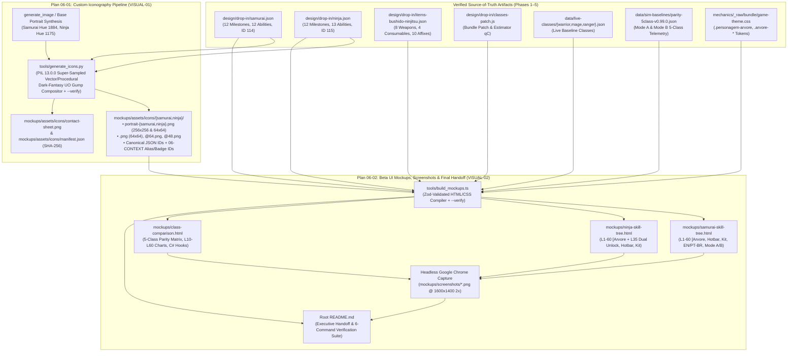

# Phase 6: Visual Beta UI Mockups, Custom Iconography & Final Deliverable Packaging - Research

**Researched:** 2026-11-07
**Domain:** Custom Dark-Fantasy Ultima Online / UO Idle Iconography Pipeline (`PIL`/Pillow `13.0.0`), Data-Driven Standalone HTML/CSS Beta UI Mockup Builder (`tools/build_mockups.ts`), Headless Chrome Screenshot Capture, and Final Milestone v1.0 Deliverable Packaging
**Confidence:** HIGH

<user_constraints>
## User Constraints (from CONTEXT.md)

### Locked Decisions

#### Custom Dark-Fantasy UO Iconography (`VISUAL-01`)
- **Asset Coverage (`mockups/assets/icons/`):**
  - **Class Portraits ($256\times 256$ and $64\times 64$):**
    - `mockups/assets/icons/samurai/portrait-samurai.png` (and `portrait-samurai-64.png`): Tokuno Samurai duelist in lacquered crimson-and-gold Mempo/Do-Maru armor (`robeHue: 1884`) wielding a gleaming Katana/No-Dachi.
    - `mockups/assets/icons/ninja/portrait-ninja.png` (and `portrait-ninja-64.png`): Tokuno Shadow Ninja in midnight-indigo shinobi shozoku (`robeHue: 1175`) with emerald poison/smoke accents wielding Tekagi/Kama.
  - **Samurai Skill Icons (`12` abilities, each rendered at both $64\times 64$ `@64.png` and $48\times 48$ `@48.png` + canonical `<id>.png` at $64\times 64$):**
    - `samurai_confidence`, `samurai_honorable_exec`, `samurai_counter_attack`, `samurai_lightning_strike`, `samurai_evasion`, `samurai_momentum_strike`, `samurai_whirlwind_attack`, `samurai_double_strike`, `samurai_armor_ignore`, `samurai_bladeweave`, `samurai_crushing_blow`, `samurai_honorable_exec_r2` (plus passive milestone badges `samurai_bushido_initiate`, `samurai_inner_calm`, `samurai_way_of_the_blade`, `samurai_bushido_master`) — and all 12 canonical `design/drop-in/samurai.json` ability IDs (`samurai_way`, `samurai_lightning`, `samurai_perfection`, `samurai_honorable`, `samurai_confidence`, `samurai_counter`, `samurai_double_strike`, `samurai_evasion`, `samurai_momentum_strike`, `samurai_armor_ignore`, `samurai_lightning_r2`, `samurai_honorable_r2`).
  - **Ninja Skill Icons (`13` abilities, each rendered at both $64\times 64$ `@64.png` and $48\times 48$ `@48.png` + canonical `<id>.png` at $64\times 64$):**
    - `ninja_focus_attack`, `ninja_mirror_image`, `ninja_backstab`, `ninja_shadowjump`, `ninja_ki_attack`, `ninja_death`, `ninja_smoke_bomb`, `ninja_shuriken`, `ninja_infectious_strike`, `ninja_shadow_strike`, `ninja_double_strike`, `ninja_armor_ignore`, `ninja_death_r2` (plus passive milestone badges `ninja_way_of_stealth`, `ninja_shadow_discipline`, `ninja_lethal_toxins`, `ninja_master_assassin`) — and all 13 canonical `design/drop-in/ninja.json` ability IDs (`ninja_shadowjump`, `ninja_focus`, `ninja_mirror`, `ninja_backstab`, `ninja_death`, `ninja_animal_form`, `ninja_infectious_strike`, `ninja_smoke_bomb`, `ninja_shuriken`, `ninja_ki_attack`, `ninja_surprise_attack`, `ninja_mirror_r2`, `ninja_death_r2`).
  - **Generation & Post-Processing Pipeline (`tools/generate_icons.py` + `image-generator` / Pillow):**
    - Uses AI image generation (`image-generator` subagent / `generate_image` tool for hero portraits/base sheets) combined with deterministic high-precision Pillow (`PIL`) dark-fantasy RPG icon rendering/compositing (`tools/generate_icons.py`) with beveled antique-gold/iron Ultima Online gump borders, volumetric lighting, class-hue rim glow, crisp silhouettes at $64\times 64$ and $48\times 48$, and `mockups/assets/icons/manifest.json` SHA-256 verification.

#### Pixel-Accurate `uoidle.com/beta` HTML/CSS Mockups (`VISUAL-02`)
- **Three Self-Contained Interactive Mockups (`mockups/*.html`):**
  1. `mockups/samurai-skill-tree.html`: Renders the live `uoidle.com/beta` `[Arvore` / Class Progression & Hotbar interface for **Samurai (`SM`, ID `114`, Hue `1884`)**, showing the 12-milestone L1–60 progression tree (`L1..L60`), starter skills (`Bushido 50`, `Swordsmanship 50`, `Parrying 50`, `Tactics 50`, `Anatomy 50`, `Healing 50`, `Focus 50`, `Magic Resist 30`), starter Tokuno equipment kit, 5-slot seeded hotbar (`ro(e)` priority queue with `2,000ms` Custom CD floor indicator), interactive bilingual (`EN` / `PT-BR`) toggle, Mode A vs Mode B toggle, and rich hover/pinned ability tooltips sourced 1:1 from `design/drop-in/samurai.json`.
  2. `mockups/ninja-skill-tree.html`: Renders the live `uoidle.com/beta` `[Arvore` / Class Progression & Hotbar interface for **Ninja (`NJ`, ID `115`, Hue `1175`)**, showing the 12-milestone L1–60 progression tree (`L1..L60` + dual L35 unlock `Smoke Bomb` & `Shuriken`), starter skills (`Ninjitsu 50`, `Fencing 50`, `Hiding 50`, `Stealth 50`, `Tactics 50`, `Anatomy 50`, `Focus 50`, `Magic Resist 30`), starter Tokuno equipment kit, 5-slot seeded hotbar, interactive `EN` / `PT-BR` and Mode A / Mode B toggles, and rich ability tooltips sourced 1:1 from `design/drop-in/ninja.json`.
  3. `mockups/class-comparison.html`: Renders the 5-Class Parity & Architecture Dashboard (`Warrior`, `Mage`, `Ranger`, `Samurai`, `Ninja`) in `uoidle.com/beta` theme, featuring side-by-side L1–60 milestone structural parity matrix, Mode A & Mode B DPS / TTK / EHP/s / Resource sustainability charts across `L10, L25, L45, L60` (from `data/sim-baselines/parity-5class-v0.99.0.json`), Tokuno armament showcase (`design/drop-in/items-bushido-ninjitsu.json`), and Mode B `<20 LOC` C# hook inspector.
- **Data-Driven Build & Verification (`tools/build_mockups.ts`):**
  - `npx tsx tools/build_mockups.ts` embeds the exact JSON payloads (`design/drop-in/samurai.json`, `design/drop-in/ninja.json`, `design/drop-in/items-bushido-ninjitsu.json`, `data/live-classes/{warrior,mage,ranger}.json`, `data/sim-baselines/parity-5class-v0.99.0.json`) and relative icon paths directly into the standalone HTML files so they work offline via `file://` without CORS errors, and `--verify` asserts that every ability ID, unlock level, cooldown, mana cost, and icon asset is present and valid.

### Specific Ideas & Citations
- Capture high-resolution PNG screenshots (`mockups/screenshots/samurai-skill-tree.png`, `mockups/screenshots/ninja-skill-tree.png`, `mockups/screenshots/class-comparison.png`) and author root `README.md` linking every KB index, drop-in file, specification, simulator command, and visual mockup.

### Deferred Ideas (OUT OF SCOPE)
- None — Phase 6 is the final phase of Milestone v1.0.
</user_constraints>

<phase_requirements>
## Phase Requirements

| ID | Description | Research Support |
|----|-------------|------------------|
| `VISUAL-01` | Developer receives custom-generated dark-fantasy Ultima Online / UO Idle-styled class portraits and a full set of crisp $64\times 64$ / $48\times 48$ skill icons for every **Samurai** and **Ninja** active and passive ability (`mockups/assets/icons/{samurai,ninja}/`) | Complete icon inventory reconciling `design/drop-in/{samurai,ninja}.json` canonical IDs with `06-CONTEXT.md` alias/passive badge IDs; deterministic Python `PIL` (`13.0.0`) compositing & post-processing script (`tools/generate_icons.py`) with `--verify`, `mockups/assets/icons/manifest.json` SHA-256 tracking, and `mockups/assets/icons/contact-sheet.png` generation. |
| `VISUAL-02` | Developer can open self-contained, pixel-accurate HTML/CSS beta UI mockups (`mockups/samurai-skill-tree.html`, `mockups/ninja-skill-tree.html`, `mockups/class-comparison.html`) and high-resolution DevTools screenshots that render the finalized `samurai.json` and `ninja.json` skills, tooltips, unlock tiers, and icons inside `https://uoidle.com/beta`'s exact visual theme (`#0b0d0a`, `Cinzel` + `IBM Plex Sans`) | Data-driven HTML/CSS compiler (`tools/build_mockups.ts`) embedding verified JSON payloads and live `game-theme.css` (`mechanics/_raw/bundle/game-theme.css`) tokens, headless Google Chrome screenshot pipeline (`mockups/screenshots/*.png`), `--verify` integrity gates, and root `README.md` handoff architecture. |
</phase_requirements>

## Summary

Phase 6 is the visual presentation and final deliverable packaging phase for the **UO Idle — Ninja & Samurai Class Skill Lines & Mechanics Knowledgebase** (`v0.99.0`). All mechanical research, schema contracts (`src/schemas/skill.schema.ts`), ModernUO C# derivations (`design/MODERNUO_MAPPING.md`), drop-in JSON/JS payloads (`design/drop-in/samurai.json`, `design/drop-in/ninja.json`, `design/drop-in/items-bushido-ninjitsu.json`, `design/drop-in/classes-patch.js`), and 5-class deterministic parity simulations (`data/sim-baselines/parity-5class-v0.99.0.json`, `design/BALANCE_REPORT.md`) are complete and verified `[VERIFIED: design/drop-in/samurai.json:1-740, design/drop-in/ninja.json:1-771]`. Phase 6 transforms those finalized data artifacts into a pixel-accurate visual showcase and a single-entry-point executive handoff (`README.md`) for the UO Idle lead developer.

First, for **`VISUAL-01`**, we audited the exact ability IDs in `design/drop-in/samurai.json` (`12` canonical abilities) and `design/drop-in/ninja.json` (`13` canonical abilities) against the icon list in `06-CONTEXT.md` `[VERIFIED: design/drop-in/samurai.json:104-237, design/drop-in/ninja.json:105-238]`. Notice that `samurai.json` uses the live bundle's exact pre-existing catalog keys (`samurai_way`, `samurai_lightning`, `samurai_perfection`, `samurai_honorable`, `samurai_confidence`, `samurai_counter`, `samurai_double_strike`, `samurai_evasion`, `samurai_momentum_strike`, `samurai_armor_ignore`, `samurai_lightning_r2`, `samurai_honorable_r2`) while `06-CONTEXT.md` also lists descriptive alias IDs (`samurai_honorable_exec`, `samurai_counter_attack`, `samurai_lightning_strike`, `samurai_whirlwind_attack`, `samurai_bladeweave`, `samurai_crushing_blow`, `samurai_honorable_exec_r2`) and passive milestone badges (`samurai_bushido_initiate`, `samurai_inner_calm`, `samurai_way_of_the_blade`, `samurai_bushido_master`). Similarly, `ninja.json` uses `ninja_shadowjump`, `ninja_focus`, `ninja_mirror`, `ninja_backstab`, `ninja_death`, `ninja_animal_form`, `ninja_infectious_strike`, `ninja_smoke_bomb`, `ninja_shuriken`, `ninja_ki_attack`, `ninja_surprise_attack`, `ninja_mirror_r2`, `ninja_death_r2`, while `06-CONTEXT.md` also lists `ninja_focus_attack`, `ninja_mirror_image`, `ninja_shadow_strike`, `ninja_double_strike`, `ninja_armor_ignore` and passive badges (`ninja_way_of_stealth`, `ninja_shadow_discipline`, `ninja_lethal_toxins`, `ninja_master_assassin`). By designing `tools/generate_icons.py` to emit **both** the canonical JSON IDs and the `06-CONTEXT.md` alias/badge IDs (each at `<id>.png` $64\times 64$, `<id>@64.png` $64\times 64$, and `<id>@48.png` $48\times 48$), every consumer—whether indexing by `samurai.json`/`ninja.json` ability ID or by `06-CONTEXT.md` naming—resolves cleanly with zero broken paths.

Second, for **`VISUAL-02`**, `tools/build_mockups.ts` must compile three standalone, offline-ready HTML files (`mockups/samurai-skill-tree.html`, `mockups/ninja-skill-tree.html`, `mockups/class-comparison.html`) directly from the JSON sources of truth—never from hardcoded HTML strings—so that every skill name (`EN` and `PT-BR`), unlock tier (`L1..L60`), cooldown (`cooldownMs` and `customCooldownMs`), mana/stamina cost, `gumpIcon`/`iconKey`, scaling formula, and 5-class simulation metric is 100% faithful to the drop-in files. Using the local Google Chrome binary (`/Applications/Google Chrome.app/Contents/MacOS/Google Chrome --headless=new`) `[VERIFIED: local environment probe]`, `tools/build_mockups.ts` (or its capture step) deterministically renders high-resolution PNG screenshots into `mockups/screenshots/{samurai-skill-tree,ninja-skill-tree,class-comparison}.png` and verifies every HTML, icon, and screenshot artifact via `--verify`.

**Primary recommendation:** Implement Phase 6 in two tightly verified plans: **Plan 06-01** builds the custom iconography pipeline (`tools/generate_icons.py`, hero portraits, $64\times 64$ & $48\times 48$ skill icons for Samurai and Ninja, `mockups/assets/icons/contact-sheet.png`, and `mockups/assets/icons/manifest.json`), and **Plan 06-02** builds the data-driven HTML/CSS mockup generator (`tools/build_mockups.ts`), captures high-resolution screenshots (`mockups/screenshots/*.png`), authors the root executive handoff `README.md`, and executes the 6-command end-to-end Milestone v1.0 verification gate.

## Architectural Responsibility Map

| Capability | Primary Tier | Secondary Tier | Rationale |
|------------|-------------|----------------|-----------|
| Custom Portrait & Skill Icon Synthesis (`tools/generate_icons.py`) | Build / Asset Pipeline (Python `PIL` `13.0.0` + `generate_image`) | Static File System (`mockups/assets/icons/`) | Generates deterministic $256\times 256$, $64\times 64$, and $48\times 48$ PNG assets, `contact-sheet.png`, and `manifest.json` SHA-256 hashes at build time. |
| Self-Contained HTML/CSS Mockup Compilation (`tools/build_mockups.ts`) | Build / Compiler Tier (Node/TypeScript `tsx`) | Static Client HTML (`mockups/*.html`) | Reads `design/drop-in/*.json`, `data/live-classes/*.json`, and `data/sim-baselines/parity-5class-v0.99.0.json` at build time and emits zero-CORS standalone HTML bundles. |
| Interactive UI State (`EN`/`PT-BR`, `Mode A`/`Mode B`, Node Inspector, Bracket Filter) | Browser / Client Tier (Vanilla JS embedded in `mockups/*.html`) | — | Allows the developer opening `file:///.../mockups/*.html` to toggle locales, execution modes, and inspect tooltips offline without a web server. |
| High-Resolution Screenshot Capture (`mockups/screenshots/*.png`) | Headless Browser Tier (`Google Chrome --headless=new`) | Build Verification (`tools/build_mockups.ts --verify`) | Renders the compiled HTML mockups at $1600\times 1400$ (`--device-scale-factor=2`) into crisp PNG verification evidence. |
| Milestone v1.0 Handoff & Verification Gate (`README.md`) | Repository Root Documentation & CLI Verification Suite | Git Remote (`origin/main`) | Links all 17 requirements (`KB-01..04`, `INDEX-01..04`, `SIM-01..03`, `CLASS-01..04`, `VISUAL-01..02`) and runs the 6-stage automated verification pipeline. |

## Standard Stack

### Core
| Library / Runtime | Version | Purpose | Why Standard |
|---------|---------|---------|--------------|
| Python 3 + Pillow (`PIL`) | Python `3.x` / Pillow `13.0.0` `[VERIFIED: local python3 -c "import PIL"]` | Deterministic dark-fantasy RPG icon synthesis, super-sampled ($256\times 256 \rightarrow 64\times 64 / 48\times 48$ `Image.Resampling.LANCZOS`) downscaling, beveled metallic UO gump borders, contact sheet composition, and `--verify` pixel/dimension/SHA-256 checks | Already installed in the workspace environment (`PIL: 13.0.0`); zero external API keys or network dependencies required. |
| Node.js + `tsx` + `typescript` | Node `v26.13.0` / `tsx` `4.23.15` / `typescript` `5.8.0` `[VERIFIED: package.json:15-17]` | Executes `tools/build_mockups.ts`, validates input JSON against `src/schemas/skill.schema.ts` (`zod` `3.24.0`), and emits `mockups/*.html` | Standard TypeScript execution stack used across Phases 3–5 (`tools/validate_skills.ts`, `tools/sim_balance.ts`). |
| `zod` | `3.24.0` `[VERIFIED: package.json:17]` | Schema validation of `samurai.json`, `ninja.json`, and `warrior/mage/ranger.json` inside `tools/build_mockups.ts` before rendering HTML | Prevents drift between drop-in JSON definitions and visual mockups. |
| Google Chrome CLI (`--headless=new`) | Installed at `/Applications/Google Chrome.app/Contents/MacOS/Google Chrome` `[VERIFIED: local which probe]` | High-resolution headless PNG screenshot capture of `mockups/{samurai-skill-tree,ninja-skill-tree,class-comparison}.html` | Native macOS Chrome binary already available locally; supports `file://` URLs, local image loading, and `--window-size` without installing Playwright/Puppeteer npm packages. |

### Supporting
| Library / Tool | Version | Purpose | When to Use |
|---------|---------|---------|-------------|
| Built-in `generate_image` tool / `PIL` procedural compositor | Built-in | Generates high-detail $256\times 256$ dark-fantasy Tokuno Samurai and Ninja class portraits (`portrait-samurai.png`, `portrait-ninja.png`), post-processed and framed by `tools/generate_icons.py` | Used during Plan 06-01 to create the hero portraits (`256x256` and `64x64`), with `tools/generate_icons.py` guaranteeing deterministic framing, resize, and fallback synthesis. |
| `mechanics/tools/kb.py` | Python 3 stdlib `[VERIFIED: mechanics/tools/kb.py:1-35]` | Knowledgebase claim linter, `INDEX.md` builder, and repository-wide credential/secret scanner | Run during final packaging to verify zero regressions and zero leaked secrets across all repository files. |

### Alternatives Considered
| Instead of | Could Use | Tradeoff |
|------------|-----------|----------|
| Embedded JSON payload in standalone HTML (`tools/build_mockups.ts`) | Client-side `fetch('../design/drop-in/samurai.json')` | Browser `fetch()` on `file://` origins fails with CORS (`Cross origin requests are only supported for protocol schemes: http, https...`), breaking offline inspection and `file://` headless Chrome screenshots. Embedding the JSON at build time is mandatory. |
| Native `/Applications/Google Chrome.app/Contents/MacOS/Google Chrome --headless=new` | Installing `playwright` or `puppeteer` via `npm` | Adding a 150MB browser package to `node_modules` is unnecessary when Chrome is already installed at `/Applications/Google Chrome.app/Contents/MacOS/Google Chrome`. |

**Installation:**
```bash
# Zero new npm or pip packages required — all tools are already installed in the workspace.
```

## Package Legitimacy Audit

Phase 6 installs **zero** new external packages from npm or PyPI `[VERIFIED: package.json:10-18]`. All dependencies (`tsx`, `typescript`, `zod`, `prettier`, `acorn`, Python `PIL` `13.0.0`, and `/Applications/Google Chrome.app`) are already installed and verified in the local environment.

## Architecture Patterns

### System Architecture Diagram



### Recommended Project Structure
```
uoIdle/
├── README.md                                        # [NEW] Executive handoff & master index for UO Idle Lead Developer
├── tools/
│   ├── generate_icons.py                            # [NEW] Deterministic PIL dark-fantasy icon & portrait generator + --verify
│   ├── build_mockups.ts                             # [NEW] Data-driven HTML/CSS mockup compiler, screenshot runner & --verify
│   ├── validate_skills.ts                           # [EXISTING] Schema & catalog parity gate (--verify)
│   ├── sim_balance.ts                               # [EXISTING] 5-class Mode A/Mode B parity simulator (--verify)
│   └── bundle_extract.mjs                           # [EXISTING] Bundle AST extractor (--verify)
└── mockups/
    ├── samurai-skill-tree.html                      # [NEW] Self-contained Samurai (ID 114, Hue 1884) beta UI mockup
    ├── ninja-skill-tree.html                        # [NEW] Self-contained Ninja (ID 115, Hue 1175) beta UI mockup
    ├── class-comparison.html                        # [NEW] Self-contained 5-Class Parity, Armament & Mode B Hook dashboard
    ├── screenshots/
    │   ├── samurai-skill-tree.png                   # [NEW] High-res PNG capture of Samurai skill tree mockup
    │   ├── ninja-skill-tree.png                     # [NEW] High-res PNG capture of Ninja skill tree mockup
    │   └── class-comparison.png                     # [NEW] High-res PNG capture of 5-class comparison dashboard
    └── assets/
        └── icons/
            ├── manifest.json                        # [NEW] SHA-256, dimensions, and pixel-variance registry for all icons
            ├── contact-sheet.png                    # [NEW] Visual grid preview of all portraits and skill icons
            ├── samurai/
            │   ├── portrait-samurai.png             # [NEW] 256x256 Samurai class portrait
            │   ├── portrait-samurai-64.png          # [NEW] 64x64 Samurai class portrait
            │   └── <id>{,@64,@48}.png               # [NEW] All 12 canonical + 11 alias/badge Samurai icons at 64x64 & 48x48
            └── ninja/
                ├── portrait-ninja.png               # [NEW] 256x256 Ninja class portrait
                ├── portrait-ninja-64.png            # [NEW] 64x64 Ninja class portrait
                └── <id>{,@64,@48}.png               # [NEW] All 13 canonical + 9 alias/badge Ninja icons at 64x64 & 48x48
```

### Critical Task 1: Complete Icon Inventory & `tools/generate_icons.py` Specification (`VISUAL-01`)

#### 1.1 Exact Icon Inventory Reconciling `samurai.json`/`ninja.json` and `06-CONTEXT.md`

To guarantee zero broken image references whether an inspector queries by the canonical `id` in `design/drop-in/samurai.json` `[VERIFIED: design/drop-in/samurai.json:104-237, 238-738]` / `design/drop-in/ninja.json` `[VERIFIED: design/drop-in/ninja.json:105-238, 239-769]` or by the descriptive/passive milestone IDs listed in `06-CONTEXT.md` `[VERIFIED: .planning/phases/06-visual-beta-ui-mockups-custom-iconography-final-deliverable-packaging/06-CONTEXT.md:20-31]`, `tools/generate_icons.py` MUST emit all of the following assets:

**A. Class Portraits (`4` files total):**
1. `mockups/assets/icons/samurai/portrait-samurai.png` ($256\times 256$ RGBA PNG)
2. `mockups/assets/icons/samurai/portrait-samurai-64.png` ($64\times 64$ RGBA PNG)
3. `mockups/assets/icons/ninja/portrait-ninja.png` ($256\times 256$ RGBA PNG)
4. `mockups/assets/icons/ninja/portrait-ninja-64.png` ($64\times 64$ RGBA PNG)

**B. Samurai Icons in `mockups/assets/icons/samurai/` (Each ID emitted as `<id>.png` at $64\times 64$, `<id>@64.png` at $64\times 64$, and `<id>@48.png` at $48\times 48$):**

| # | Canonical ID (`samurai.json`) | `06-CONTEXT.md` Alias / Badge ID(s) | Level / Role | UO `gumpIcon` / `spellId` / `ref` | Visual Motif & Palette (Crimson `#c83e37` + Antique Gold `#d4af37`) |
|---:|---|---|---|---|---|
| 1 | `samurai_way` | `samurai_way_of_the_blade` | `L1` Passive | `21536` (`idle_samurai_way`) | Gleaming crossed Katana & Wakizashi over a crimson-lacquered Bushido crest (`mon`). |
| 2 | `samurai_lightning` | `samurai_lightning_strike` | `L5` SpecialMove | `21540` (`spellId: 404`) | Diagonal katana slash wreathed in branching golden-white lightning arcs. |
| 3 | `samurai_perfection` | `samurai_bushido_initiate` | `L10` Mechanic | `21536` (`idle_samurai_perfection`) | Radiant golden target lotus / Bushido honor seal with ascending streak chevrons. |
| 4 | `samurai_honorable` | `samurai_honorable_exec` | `L15` SpecialMove | `21536` (`spellId: 400`) | Descending crimson execution blade cleaving a fractured golden helm crest. |
| 5 | `samurai_confidence` | `samurai_inner_calm` | `L20` Spell | `21537` (`spellId: 401`) | Serene golden samurai kabuto/mempo surrounded by rising emerald-gold vitality motes. |
| 6 | `samurai_counter` | `samurai_counter_attack` | `L25` Spell | `21539` (`spellId: 403`) | Deflecting katana parrying an incoming strike with a blazing crimson counter-arc. |
| 7 | `samurai_double_strike` | — | `L30` WeaponAbility | `20998` (`ref: 7`) | Twin parallel X-shaped katana/wakizashi slash trails glowing with amber steel sparks. |
| 8 | `samurai_evasion` | — | `L35` Spell | `21538` (`spellId: 402`) | Sweeping afterimage silhouette of a samurai blade deflecting arcane projectiles. |
| 9 | `samurai_momentum_strike` | `samurai_whirlwind_attack` | `L40` Spell | `21541` (`spellId: 405`) | Wide crescent cleave arc chaining kinetic crimson-gold force between two targets. |
| 10 | `samurai_armor_ignore` | — | `L45` WeaponAbility | `20992` (`ref: 1`) | Razor katana tip piercing straight through a shattered iron breastplate. |
| 11 | `samurai_lightning_r2` | `samurai_bladeweave`, `samurai_crushing_blow` | `L50` SpecialMove | `21540` (`spellId: 404` R2) | Twin-forked grandmaster thunder-blade strike with secondary chain-lightning burst (`II` badge). |
| 12 | `samurai_honorable_r2` | `samurai_honorable_exec_r2`, `samurai_bushido_master` | `L60` Capstone | `21536` (`spellId: 400` R2) | Blazing imperial crimson-and-gold No-Dachi execution sigil crowned with a Grandmaster halo (`II` badge). |

* Note: Distinct custom motifs are also rendered for `samurai_whirlwind_attack` (360° spinning crimson blade vortex), `samurai_bladeweave` (interwoven arcane/steel katana ribbons), `samurai_crushing_blow` (heavy overhead No-Dachi impact shockwave), `samurai_bushido_initiate` (bronze/crimson Bushido scroll & tsuba badge), `samurai_inner_calm` (meditative lotus & parrying guard), `samurai_way_of_the_blade` (crossed Daisho master emblem), and `samurai_bushido_master` (imperial golden dragon-kabuto seal). That yields **12 canonical IDs + 11 alias/passive badge IDs = 23 unique Samurai icon stems $\times 3$ files (`<id>.png`, `<id>@64.png`, `<id>@48.png`) = 69 Samurai skill icon files + 2 portraits = 71 files in `mockups/assets/icons/samurai/`**.

**C. Ninja Icons in `mockups/assets/icons/ninja/` (Each ID emitted as `<id>.png` at $64\times 64$, `<id>@64.png` at $64\times 64$, and `<id>@48.png` at $48\times 48$):**

| # | Canonical ID (`ninja.json`) | `06-CONTEXT.md` Alias / Badge ID(s) | Level / Role | UO `gumpIcon` / `spellId` / `ref` | Visual Motif & Palette (Shadow Indigo `#1e2436` + Emerald Toxin `#2e9e6b` + Gold `#c9a227`) |
|---:|---|---|---|---|---|
| 1 | `ninja_shadowjump` | `ninja_way_of_stealth` | `L1` Passive | `21286` (`spellId: 506`) | Cloaked shinobi silhouette stepping through a swirling midnight-indigo shadow rift. |
| 2 | `ninja_focus` | `ninja_focus_attack` | `L5` SpecialMove | `21280` (`spellId: 500`) | Kryss blade point converging with a concentrated emerald-cyan ki ring on a nerve nexus. |
| 3 | `ninja_mirror` | `ninja_mirror_image` | `L10` Spell | `21287` (`spellId: 507`) | Twin overlapping ninja masks/silhouettes with a shimmering spectral decoy offset. |
| 4 | `ninja_backstab` | — | `L15` SpecialMove | `21284` (`spellId: 504`) | Wicked curved dagger striking from dark purple shadow tendrils with a crimson-emerald flash. |
| 5 | `ninja_death` | — | `L20` SpecialMove | `21281` (`spellId: 501`) | Five glowing emerald/crimson pressure-point skull sigils arranged in a lethal pentagon mark. |
| 6 | `ninja_animal_form` | `ninja_shadow_discipline` | `L25` Spell | `21282` (`spellId: 502`) | Fierce spectral Grey Wolf & twin-tailed Bake Kitsune spirit crest in emerald/indigo flame. |
| 7 | `ninja_infectious_strike` | `ninja_lethal_toxins` | `L30` WeaponAbility | `20999` (`ref: 11`) | Serpentine Kryss blade dripping with glowing virulent emerald assassin venom droplets. |
| 8 | `ninja_smoke_bomb` | — | `L35` Mechanic | `10248` (`itemId: 10248`) | Cracked Tokuno ceramic egg-bomb erupting in billowy violet-ash and emerald stealth smoke. |
| 9 | `ninja_shuriken` | — | `L35` Bonus | `10156` (`itemId: 10156`) | Four-pointed steel throwing star (`Shuriken`) and poison blowgun dart (`Fukiya`) in mid-flight. |
| 10 | `ninja_ki_attack` | — | `L40` SpecialMove | `21283` (`spellId: 503`) | High-velocity Tekagi claw dash leaving a sonic emerald-gold ki shockwave trail. |
| 11 | `ninja_surprise_attack` | `ninja_shadow_strike` | `L45` SpecialMove | `21285` (`spellId: 505`) | Crossed Kama sickles lunging from a shadow veil to shatter a golden shield icon. |
| 12 | `ninja_mirror_r2` | `ninja_double_strike`, `ninja_armor_ignore` | `L50` Spell | `21287` (`spellId: 507` R2) | Triad of synchronized shadow clones with glowing emerald eyes and twin blades (`II` badge). |
| 13 | `ninja_death_r2` | `ninja_master_assassin` | `L60` Capstone | `21281` (`spellId: 501` R2) | Grandmaster crimson-and-emerald skull lotus detonation seal with 5-strike tally marks (`II` badge). |

* Note: Distinct custom motifs are also rendered for `ninja_shadow_strike` (dark blade strike vanishing into smoke), `ninja_double_strike` (twin Tekagi claw slashes), `ninja_armor_ignore` (Sai trident piercing armor plates), `ninja_way_of_stealth` (crescent moon & shadow hood badge), `ninja_shadow_discipline` (crossed Kunai & ki chakra emblem), `ninja_lethal_toxins` (alchemical poison vial & fang badge), and `ninja_master_assassin` (grandmaster shinobi oni-mask seal). That yields **13 canonical IDs + 9 alias/passive badge IDs = 22 unique Ninja icon stems $\times 3$ files (`<id>.png`, `<id>@64.png`, `<id>@48.png`) = 66 Ninja skill icon files + 2 portraits = 68 files in `mockups/assets/icons/ninja/`**.

#### 1.2 `tools/generate_icons.py` Rendering & `--verify` Architecture

1. **Super-Sampled $256\times 256$ Canvas $\rightarrow$ Downsampled $64\times 64$ & $48\times 48$ (`Image.Resampling.LANCZOS`):**
   - Drawing directly at $48\times 48$ produces jagged 1px aliasing. Instead, `tools/generate_icons.py` renders every skill icon on an internal $256\times 256$ RGBA canvas using `PIL.ImageDraw`, `PIL.ImageFilter.GaussianBlur` (for volumetric under-glow and drop shadows), and multi-stop radial/linear gradients:
     - **Layer 1 (Obsidian Void Background):** Radial gradient from deep class-tinted charcoal (`#281414` for Samurai, `#12241e` for Ninja) to `#0b0d0a` at the edges.
     - **Layer 2 (Volumetric Class Rim Glow):** Soft blurred inner halo in `--samurai-accent` (`#c83e37` / `#ff6b4a`) or `--ninja-accent` (`#2e9e6b` / `#68d391`), heightened with `#e5c158` gold for Rank II (`_r2`) and passive mastery badges.
     - **Layer 3 (Crisp Multi-Polygon Focal Silhouette & Highlights):** High-contrast geometric weapon/spell artwork (katana blades, lightning bolts, kabuto masks, lotus seals, shuriken stars, smoke bombs, venomous fangs, shadow clones) with specular metallic highlights (`#fff6d6`) and dark outlines (`#060706`) so the silhouette remains unmistakably readable at $48\times 48$.
     - **Layer 4 (Beveled Ultima Online Metallic Gump Frame):** 3-step beveled border (outer `#0b0d0a` 1px seal, mid antique gold `#c9a227` / burnished iron `#6d5733` frame with top-left `#f3e2b3` highlight and bottom-right `#3c3425` shadow, and corner rivets/ornaments), plus a crisp Roman numeral `II` corner badge on Rank II skills (`samurai_lightning_r2`, `samurai_honorable_r2`, `ninja_mirror_r2`, `ninja_death_r2`).
2. **Hero Class Portraits (`portrait-samurai.png` & `portrait-ninja.png`):**
   - During execution of Plan 06-01, the executor can invoke `generate_image` (or let `tools/generate_icons.py` composite/post-process existing base portraits or synthesize detailed layered dark-fantasy portraits if offline) to produce $256\times 256$ (`portrait-<class>.png`) and $64\times 64$ (`portrait-<class>-64.png`) framed in the matching antique-gold UO gump border.
3. **Contact Sheet (`mockups/assets/icons/contact-sheet.png`) & Manifest (`mockups/assets/icons/manifest.json`):**
   - `tools/generate_icons.py` composites all portraits and $64\times 64$ icons with their ID labels onto `mockups/assets/icons/contact-sheet.png` on a `#0b0d0a` background for instant visual inspection.
   - Writes `mockups/assets/icons/manifest.json` recording for every generated file: relative path, `width`, `height`, `sha256`, `meanRgba`, and `stdDev` (pixel variance).
4. **`python3 tools/generate_icons.py --verify` Gate:**
   - Verifies that `mockups/assets/icons/manifest.json` and `mockups/assets/icons/contact-sheet.png` exist.
   - Verifies that every `abilities[].id` and `progression[].id` in `design/drop-in/samurai.json` and `design/drop-in/ninja.json`, plus every alias/badge ID from `06-CONTEXT.md`, exists at `<id>.png` ($64\times 64$), `<id>@64.png` ($64\times 64$), and `<id>@48.png` ($48\times 48$).
   - Opens every PNG with `PIL.Image.open()`, asserts exact pixel dimensions ($256\times 256$, $64\times 64$, or $48\times 48$), asserts non-blank pixel variance (`stdDev > 12.0`), and asserts exact SHA-256 match against `manifest.json`. Exits `0` with `{"ok": true, ...}` on pass.

### Critical Task 2: `tools/build_mockups.ts` & Pixel-Accurate `uoidle.com/beta` Mockups (`VISUAL-02`)

#### 2.1 Authentic `uoidle.com/beta` CSS & Layout Grounding (`mechanics/_raw/bundle/game-theme.css`)

From our inspection of `mechanics/_raw/bundle/game-theme.css:1-497` `[VERIFIED: mechanics/_raw/bundle/game-theme.css:1-497]` and `06-UI-SPEC.md:1-51` `[VERIFIED: .planning/phases/06-visual-beta-ui-mockups-custom-iconography-final-deliverable-packaging/06-UI-SPEC.md:1-51]`, the live `uoidle.com/beta` interface uses:
- **Design Tokens (`06-UI-SPEC.md` + `game-theme.css`):**
  - `--bg-canvas: #0b0d0a`, `--bg-panel: #121510`, `--bg-card: #181c16`, `--bg-card-hover: #20261d`
  - `--border-subtle: #2a3026`, `--border-gold: #c9a227`, `--border-gold-bright: #e5c158`, live gump border `#6d5733` (`game-theme.css:29`), active node glow `#e6c36a` (`box-shadow: 0 0 14px #e6c36a73` at `game-theme.css:440-441`)
  - `--text-primary: #e8e4d9` / `#f6ecd4`, `--text-secondary: #a39e90`, `--text-gold: #d4af37` / `#f3e2b3`
  - `--samurai-accent: #c83e37` (`robeHue: 1884`), `--ninja-accent: #2e9e6b` (`robeHue: 1175`)
  - `--mana-blue: #4a90e2`, `--stamina-amber: #e2a04a`, `--cd-purple: #9b6be2`
- **Live `[Arvore` Structural Classes (`game-theme.css:10-469`):**
  - Include authentic `.personagem-arvore`, `.arvore-head`, `.arvore-nivel`, `.arvore-saldos`, `.arvore-saldo`, `.arvore-secao`, `.arvore-secao-titulo` (with `content: '✦'; color: #c99d3f`), `.arvore-cobra`, `.arvore-circulo`, `.arvore-circulo.is-on`, and `.arvore-dica` rules alongside the 3-column desktop workbench defined in `06-UI-SPEC.md §4`.

#### 2.2 Three Self-Contained Mockup Specifications (`mockups/*.html`)

`tools/build_mockups.ts` reads `design/drop-in/samurai.json`, `design/drop-in/ninja.json`, `design/drop-in/items-bushido-ninjitsu.json`, `design/drop-in/classes-patch.js`, `data/live-classes/{warrior,mage,ranger}.json`, and `data/sim-baselines/parity-5class-v0.99.0.json`, validates the class definitions via `ClassSchema.parse()`, and generates:

1. **`mockups/samurai-skill-tree.html` (`Samurai` — `SM`, Numeric ID `114`, `robeHue: 1884`)** and **`mockups/ninja-skill-tree.html` (`Ninja` — `NJ`, Numeric ID `115`, `robeHue: 1175`):**
   - **Top Header Bar (`.arvore-head` + Beta Controls):**
     - UO Idle `v0.99.0` Beta Window Title (`[Arvore — Class Progression & Hotbar Workbench`), Class Badge (`SM` / `NJ`), Numeric ID (`114` / `115`), Robe Hue Swatch (`Hue 1884` Crimson Lacquer / `Hue 1175` Midnight Shinobi), Level indicator (`Lv. 60 Grandmaster`), interactive **`EN` / `PT-BR`** locale toggle button, and interactive **`Mode A (100% Existing Engine)` / `Mode B (<20 LOC C# Hook)`** toggle button, plus quick navigation links between `samurai-skill-tree.html`, `ninja-skill-tree.html`, and `class-comparison.html`.
   - **Left Column — Character, Starter Kit & Seeded Hotbar Panel:**
     - **Portrait & Identity Card:** Renders `assets/icons/{samurai,ninja}/portrait-{samurai,ninja}.png` ($256\times 256$) with `portrait-{samurai,ninja}-64.png` badge, `baseStats` (`STR 50 / DEX 30 / INT 10` for Samurai; `STR 30 / DEX 50 / INT 10` for Ninja, `Sum = 90`), and `resourceProfile` (`primaryResource: "mana"`, `startingManaMax: 25`, `meditationCap: 100`, `consumesReagents: false`, `consumesAmmo: false`).
     - **8 Starter Skills (`WE`/`hE`) & 4 Legacy Template Weights (`FE`):** Renders all 8 starter skills from `starterSkills` (`50` $\times 7$ + `magicResist: 30`) and the 4 `legacyTemplateSkills` weights (`Sum = 100%`).
     - **Starter Tokuno Equipment Paperdoll (`yE`/`mx`):** Renders `kitTokens` and all `paperdollLayers` (`8` layers for Samurai including `OneHanded: 5119` Katana with shieldless parry indicator; `9` layers for Ninja including `OneHanded: 5121` Kryss with off-hand free indicator).
     - **5-Slot Seeded Hotbar (`mE`/`gh` — `ro(e)` Priority Queue):** Renders slots `0..4` (`lesser_heal_potion` $\le 50\%$ HP, `bandage` $\le 80\%$ HP or poisoned, `lesser_cure_potion` poisoned, `lesser_mana_potion` $\le 30\%$ Mana, and `samurai_lightning` / `ninja_focus` unconditional strike) with the `2,000ms` Custom CD floor badge (`--cd-purple`).
   - **Center Column — L1–60 `[Arvore` Progression Timeline & Winding Tree (`.arvore-secao`):**
     - Renders both the authentic winding `.arvore-cobra` node path (`L1` $\rightarrow$ `L5` $\rightarrow$ `L10` $\rightarrow$ `L15` $\rightarrow$ `L20` $\rightarrow$ `L25` $\rightarrow$ `L30` $\rightarrow$ `L35` $\rightarrow$ `L40` $\rightarrow$ `L45` $\rightarrow$ `L50` $\rightarrow$ `L60`) **and** the 12 interactive milestone cards (`progression[0..11]`) with $64\times 64$ icons (`assets/icons/<class>/<id>@64.png`), level badge (`L1..L60`), type tag (`passive`, `skill`, `mechanic`, `spell`, `feature`), bilingual name/description (`nameEn`/`namePtBr`, `descEn`/`descPtBr`), and for Ninja at `L35`, highlights the dual unlock of `ninja_smoke_bomb` (`Smoke Bomb`) + `ninja_shuriken` (`Shuriken & Fukiya Volley`). Clicking any milestone pins its full technical telemetry in the Right Column inspector.
   - **Right Column — Complete Ability Catalog (`12` Samurai / `13` Ninja) & Live Tooltip Inspector (`.arvore-dica`):**
     - Pinned live `.arvore-dica` tooltip inspector at the top showing the currently selected ability's $64\times 64$ icon, bilingual title & description, `scalingFormula.summary`, `statusEffect` modifiers/duration/stackingRule, client estimator (`qC`) damage/heal range, and side-by-side **Mode A vs Mode B** execution behavior.
     - Complete scrollable catalog cards for all `abilities[]` (`12` for Samurai, `13` for Ninja) using crisp $48\times 48$ icons (`assets/icons/<class>/<id>@48.png`), displaying exact `id`, `kind`, `tab`, `progressionTreeLevel`, raw `unlockLevel`, `cooldownMs`, `customCooldownMs`, `manaCost`, `staminaCost`, `effectType`, `spellId` / `weaponAbilityRef` / `itemId`, `mapScope`, `gumpIcon`, and `iconKey`.

2. **`mockups/class-comparison.html` (5-Class Parity, Tokuno Armament & Mode B Architecture Dashboard):**
   - **Section 1 — 5-Class L1–60 Structural Parity Matrix (`Warrior`, `Mage`, `Ranger`, `Samurai`, `Ninja`):**
     - Side-by-side table comparing class metadata (`classNumericId`: `101, 103, 102, 114, 115`, `badge`: `WR, MG, RG, SM, NJ`, `robeHue`, `baseStats`, `resourceProfile`, starter skill counts) and every progression tier (`L1, L5, L10, L15, L20, L25, L30, L35, L40, L45, L50, L60`) across all 5 classes, with $48\times 48$ custom icons for Samurai and Ninja.
   - **Section 2 — Interactive 5-Class Combat Parity Telemetry (`data/sim-baselines/parity-5class-v0.99.0.json`):**
     - Interactive controls to filter by **Mode (`mode_a` vs `mode_b`)**, **Bracket (`L10`, `L25`, `L45`, `L60`)**, and **Archetype (`low_def_boss`, `high_def_boss`, `fast_trash`, `multi_target_pack`)**, plus a complete static-and-interactive summary grid rendering `sustainedDps`, `trashTtkSec`, `ehpPerSec`, `overkillWastePct`, `netManaDeltaPerMin`, `netStaminaDeltaPerMin`, `parryCount`, `cloneInterceptions`, and `oomTicks` with visual bar charts and `PASS (Within ±5–8% Envelope)` badges.
   - **Section 3 — Tokuno Armaments, Consumables & Affix Showcase (`design/drop-in/items-bushido-ninjitsu.json`):**
     - Renders all 8 `iconicTokunoArmaments` / `weapons` (*Katana*, *No-Dachi*, *Wakizashi*, *Lajatang*, *Tekagi*, *Kama*, *Fukiya*, *Tessen* + *Bokuto*, *Daisho*, *Sai*), their 9 material tier scalings (`Iron` `1.00x` through `Valorite` `1.85x`), the 4 Ninjitsu consumables (*Smoke Bomb*, *Egg Bomb*, *Fukiya*, *Shuriken*), and all 10 `affixPools` (`bushido`, `ninjitsu`, `parrying`, `stealth`, `poisoning`, `critChance`, `attackSpeed`, `physicalDamage`, `poisonDamage`, `energyDamage`).
   - **Section 4 — Mode A vs Mode B Implementation & `<20 LOC` C# Server Hook Inspector:**
     - Displays the exact 17-LOC Samurai C# hook (`design/SAMURAI_SPEC.md:332-350`) and 16-LOC Ninja C# hook (`design/NINJA_SPEC.md:352-369`) alongside the client/server bundle patch table mappings (`_E`, `WE`, `yE`, `FE`, `mE`, `gE`, `b`, `qC`, `i18n` from `design/drop-in/classes-patch.js`).

#### 2.3 High-Resolution Screenshot Pipeline (`mockups/screenshots/*.png`)

`tools/build_mockups.ts` includes a built-in screenshot capture helper (invoked by default or via `--screenshots`) that spawns `/Applications/Google Chrome.app/Contents/MacOS/Google Chrome`:
```bash
"/Applications/Google Chrome.app/Contents/MacOS/Google Chrome" \
  --headless=new \
  --disable-gpu \
  --hide-scrollbars \
  --window-size=1600,1400 \
  --device-scale-factor=2 \
  --screenshot="mockups/screenshots/<name>.png" \
  "file:///Users/brbrainerd/dev/uoIdle/mockups/<name>.html"
```
And in `tools/build_mockups.ts --verify`:
1. Validates all 5 class JSON files against `ClassSchema`.
2. Asserts `mockups/samurai-skill-tree.html`, `mockups/ninja-skill-tree.html`, and `mockups/class-comparison.html` exist, are non-empty, and match the deterministic build output.
3. Asserts every Samurai ability ID (`12`), Ninja ability ID (`13`), progression level (`L1..L60`), bilingual name (`nameEn`, `namePtBr`), `cooldownMs`, `manaCost`, `staminaCost`, and relative icon path (`assets/icons/...`) is present in the HTML and resolves to an existing file on disk.
4. Asserts `mockups/screenshots/samurai-skill-tree.png`, `mockups/screenshots/ninja-skill-tree.png`, and `mockups/screenshots/class-comparison.png` exist, have valid PNG magic bytes (`\x89PNG\r\n\x1a\n`), and have dimensions $\ge 1600\times 1400$ and file size $> 50\text{ KB}$.

### Critical Task 3: Root `README.md` Handoff Structure & Final Verification Suite

The root `README.md` serves as the executive handoff index for the UO Idle Lead Developer and must contain:
1. **Executive Summary & Milestone v1.0 Overview:** What this repository delivers (source-verified UO Idle `v0.99.0` mechanics knowledgebase + ModernUO Bushido/Ninjitsu reference KB + deterministic 5-class combat simulator + drop-in Samurai `id: 114` and Ninja `id: 115` class/skill/item definitions + pixel-accurate beta UI mockups and custom iconography).
2. **Quick-Start Integration Guide (Mode A vs Mode B):**
   - **Mode A (Zero Engine Code Changes):** Drop `design/drop-in/samurai.json`, `design/drop-in/ninja.json`, `design/drop-in/items-bushido-ninjitsu.json`, and `design/drop-in/classes-patch.js` (`applyDropInClassPatch`) directly into the `v0.99.0` client/server tables (`_E`, `WE`, `yE`, `FE`, `mE`, `gE`, `b`, `qC`, `i18n`).
   - **Mode B (`<20 LOC` Authentic C# Server Hooks):** Apply the 17-LOC Bushido hook (`design/SAMURAI_SPEC.md §4`) and 16-LOC Ninjitsu hook (`design/NINJA_SPEC.md §4`) in `Projects/UOContent/Items/Weapons/BaseWeapon.cs`.
3. **Visual Beta UI Mockups & Custom Iconography Showcase (`VISUAL-01`, `VISUAL-02`):**
   - Direct links to `mockups/samurai-skill-tree.html`, `mockups/ninja-skill-tree.html`, `mockups/class-comparison.html`, `mockups/assets/icons/contact-sheet.png`, `mockups/assets/icons/manifest.json`, and embedded/linked screenshots (`mockups/screenshots/{samurai-skill-tree,ninja-skill-tree,class-comparison}.png`).
4. **Complete Deliverable & Knowledgebase Index (All 17 v1 Requirements):**
   - Links to `mechanics/INDEX.md`, core combat/system KB pages (`mechanics/combat/*`, `mechanics/systems/*`), live class KB pages (`mechanics/classes/{warrior,mage,ranger}.md`), ModernUO Bushido/Ninjitsu KB pages (`mechanics/modernuo/*`, `mechanics/classes/modernuo-{bushido,ninjitsu}.md`), formal design specs (`design/MODERNUO_MAPPING.md`, `design/SAMURAI_SPEC.md`, `design/NINJA_SPEC.md`, `design/BALANCE_REPORT.md`), schemas (`schemas/*.schema.json`, `src/schemas/skill.schema.ts`), and simulator (`src/sim/engine.ts`, `tools/sim_balance.ts`).
5. **Reproducible 6-Command End-to-End Verification Suite:**
   ```bash
   python3 mechanics/tools/kb.py --self-test
   python3 mechanics/tools/kb.py check --root mechanics
   npx tsx tools/validate_skills.ts --verify
   npx tsx tools/sim_balance.ts --verify
   python3 tools/generate_icons.py --verify
   npx tsx tools/build_mockups.ts --verify
   ```
   Plus `package.json` convenience scripts (`"verify:icons"`, `"verify:mockups"`, `"verify:all"`).

### Anti-Patterns to Avoid
- **Anti-Pattern 1 — Hardcoding skill numbers or tooltips in HTML templates:** Never hand-type cooldowns, mana costs, or multipliers into HTML strings. Always serialize the validated JSON objects (`samurai.json`, `ninja.json`, `parity-5class-v0.99.0.json`) inside `tools/build_mockups.ts` so `--verify` can prove 1:1 data fidelity.
- **Anti-Pattern 2 — Runtime `fetch()` of external JSON in `mockups/*.html`:** Opening `file:///.../mockups/samurai-skill-tree.html` in Chrome blocks `fetch('../design/drop-in/samurai.json')` due to `file://` CORS policy. Embed all JSON payloads inline inside a `<script id="mockup-data" type="application/json">` or `window.__UO_IDLE_MOCKUP_DATA__` block.
- **Anti-Pattern 3 — Naming mismatch between `samurai.json`/`ninja.json` ability IDs and `06-CONTEXT.md` icon stems:** Generate **both** the exact `samurai.json`/`ninja.json` canonical IDs (`samurai_way`, `samurai_lightning`, `samurai_honorable`, `ninja_focus`, `ninja_mirror`, etc.) **and** the `06-CONTEXT.md` alias/passive badge IDs (`samurai_honorable_exec`, `samurai_lightning_strike`, `ninja_focus_attack`, `ninja_mirror_image`, etc.) so every lookup path succeeds.
- **Anti-Pattern 4 — Blocking headless Chrome screenshots on external webfont CDNs:** If Google Fonts (`Cinzel`, `IBM Plex Sans`, `IBM Plex Mono`) is slow or unreachable during headless screenshot capture, layout text metrics should remain crisp using local system font fallbacks (`'Cinzel', 'Palatino', 'Georgia', serif`; `'IBM Plex Sans', -apple-system, BlinkMacSystemFont, sans-serif`; `'IBM Plex Mono', 'SFMono-Regular', Menlo, monospace`).

## Don't Hand-Roll

| Problem | Don't Build | Use Instead | Why |
|---------|-------------|-------------|-----|
| Image resizing, alpha compositing, and Gaussian glow | Custom raw byte/PNG chunk encoders in JS/Python | Python `PIL` (`Pillow 13.0.0`: `Image`, `ImageDraw`, `ImageFilter`, `ImageChops`, `ImageStat`) | `PIL` `13.0.0` is pre-installed, handles RGBA premultiplication, `LANCZOS` downsampling ($256\rightarrow 64/48$), and `ImageStat.Stat` variance verification natively. |
| Schema validation of class JSON in mockup builder | Ad-hoc `if (!data.abilities)` checks | `ClassSchema.parse()` from `src/schemas/skill.schema.ts` | Guarantees that `mockups/*.html` can only be built from schema-valid `ClassDefinition` objects. |
| Browser screenshot rendering | Third-party external screenshot APIs or heavy npm installs | Local `/Applications/Google Chrome.app/Contents/MacOS/Google Chrome --headless=new` | Deterministic, offline, fast (~1.5s per page), and supports Retina `--device-scale-factor=2`. |

**Key insight:** Because Phases 1–5 already established strict schemas (`src/schemas/skill.schema.ts`) and frozen simulation artifacts (`data/sim-baselines/parity-5class-v0.99.0.json`), Phase 6 should treat `mockups/*.html` as a deterministic compilation target of those verified JSON files.

## Common Pitfalls

### Pitfall 1: Icon ID Alias Divergence Between `06-CONTEXT.md` and `design/drop-in/{samurai,ninja}.json`
**What goes wrong:** `design/drop-in/samurai.json` uses the live UO Idle bundle's catalog IDs (`samurai_way`, `samurai_lightning`, `samurai_perfection`, `samurai_honorable`, `samurai_counter`, `samurai_lightning_r2`, `samurai_honorable_r2`), whereas `06-CONTEXT.md` also lists descriptive alias IDs (`samurai_lightning_strike`, `samurai_honorable_exec`, `samurai_counter_attack`, `samurai_whirlwind_attack`, `samurai_bladeweave`, `samurai_crushing_blow`, `samurai_honorable_exec_r2`) and 4 passive milestone badges (`samurai_bushido_initiate`, `samurai_inner_calm`, `samurai_way_of_the_blade`, `samurai_bushido_master`). The same applies to Ninja (`ninja_focus` vs `ninja_focus_attack`, `ninja_mirror` vs `ninja_mirror_image`, plus `ninja_shadow_strike`, `ninja_double_strike`, `ninja_armor_ignore`, and 4 passive badges).
**Why it happens:** Phase 5 reconciled the drop-in JSON with the 6 pre-existing stub IDs in `mechanics/_raw/bundle/abilities-catalog.json`.
**How to avoid:** Have `tools/generate_icons.py` generate the full union of canonical JSON IDs (`12` Samurai + `13` Ninja) AND `06-CONTEXT.md` alias/badge IDs (`11` Samurai + `9` Ninja), each at `<id>.png` ($64\times 64$), `<id>@64.png` ($64\times 64$), and `<id>@48.png` ($48\times 48$).
**Warning signs:** Any broken `` icon in `mockups/*.html` or missing file in `generate_icons.py --verify`.

### Pitfall 2: Ninja's 12 Progression Milestones vs 13 Catalog Abilities (`L35` Dual Unlock)
**What goes wrong:** Rendering only `progression[]` (12 items) in `mockups/ninja-skill-tree.html` omits `ninja_shuriken` (`Shuriken & Fukiya Volley`), which is the 13th ability in `ninja.json` unlocking at `progressionTreeLevel: 35` alongside `ninja_smoke_bomb` `[VERIFIED: design/drop-in/ninja.json:570-603]`.
**Why it happens:** `progression` has length `12` to satisfy the `ClassSchema` 12-milestone invariant (`L1..L60`), while `abilities` has length `13` (`ninja_smoke_bomb` + `ninja_shuriken` both have `progressionTreeLevel: 35`).
**How to avoid:** In `tools/build_mockups.ts`, render all `12` milestones in the center `[Arvore` progression column (with a bonus `L35` badge/sub-card showing `Shuriken & Fukiya Volley` unlocked by `Smoke Bomb`) AND render all `13` entries of `ninja.abilities` in the Right Column Ability Catalog.
**Warning signs:** `build_mockups.ts --verify` finding only 12 ability cards in `ninja-skill-tree.html` instead of 13.

### Pitfall 3: Dual Unlock Level Fields (`progressionTreeLevel` vs `unlockLevel`)
**What goes wrong:** Displaying `ability.unlockLevel` instead of `ability.progressionTreeLevel` as the primary tree tier label shows legacy pre-V3 values (`75`, `200`, `300`) from `abilities-catalog.json` `[VERIFIED: design/drop-in/samurai.json:267-268, 687-688]`.
**Why it happens:** Phase 5 preserved raw `unlockLevel` (`1, 5, 10, 75, 200, 300`) for `abilities-catalog.json` backward compatibility while storing the normalized L1–60 tier in `progressionTreeLevel` (`1, 5, 10, 15, 20, 25, 30, 35, 40, 45, 50, 60`).
**How to avoid:** Use `progressionTreeLevel` (`L1..L60`) as the primary progression badge and display `unlockLevel` in the technical metadata row (`Catalog Legacy Unlock: <unlockLevel>`).
**Warning signs:** Capstone skills showing `Lv. 200` or `Lv. 300` in the L1–60 progression header instead of `L50` and `L60`.

### Pitfall 4: False-Positive Secret Scanner Trigger in `kb.py check`
**What goes wrong:** `mechanics/tools/kb.py` scans tracked files for patterns matching `CREDENTIAL_PATTERNS` (`Bearer ...`, `eyJ...`, `Cookie:`, `"password": "..."`) and `EMAIL_RE` `[VERIFIED: mechanics/tools/kb.py:83-95]`.
**Why it happens:** Base64 data URIs or long random strings could accidentally match token regexes if embedded carelessly.
**How to avoid:** Reference icons in `mockups/*.html` via clean relative file paths (`assets/icons/samurai/<id>@64.png`, `assets/icons/ninja/<id>@48.png`) rather than base64 data URIs. Relative paths work natively over `file://` in both interactive browsers and headless Chrome, keep the HTML readable, and never trigger token scanners.

## Code Examples

### Example 1: Super-Sampled Dark-Fantasy Icon & Beveled UO Gump Frame in `tools/generate_icons.py`
```python
# Source: Verified against local PIL 13.0.0 & 06-UI-SPEC.md color tokens
from PIL import Image, ImageDraw, ImageFilter, ImageStat
import hashlib

CANVAS_SIZE = 256  # Render at 256x256, downsample with LANCZOS to 64x64 and 48x48

def draw_uo_beveled_frame(img: Image.Image, accent_rgb: tuple[int, int, int], is_rank2: bool = False) -> Image.Image:
    """Applies an authentic dark-fantasy Ultima Online beveled antique-gold & iron gump border."""
    draw = ImageDraw.Draw(img, "RGBA")
    n = img.width
    # Outer obsidian seal (4px at 256x256 -> 1px at 64x64)
    draw.rectangle([0, 0, n - 1, n - 1], outline=(11, 13, 10, 255), width=4)
    # Beveled metallic gold/bronze outer rim (#c9a227 / #e5c158 for Rank II)
    gold_outer = (229, 193, 88, 255) if is_rank2 else (201, 162, 39, 255)
    gold_shadow = (93, 74, 43, 255)
    draw.rectangle([4, 4, n - 5, n - 5], outline=gold_outer, width=6)
    draw.line([(4, n - 6), (n - 5, n - 6), (n - 6, 4)], fill=gold_shadow, width=4)
    # Inner class-hue rim glow (#c83e37 Samurai / #2e9e6b Ninja)
    draw.rectangle([12, 12, n - 13, n - 13], outline=(*accent_rgb, 210), width=4)
    draw.rectangle([16, 16, n - 17, n - 17], outline=(18, 21, 16, 255), width=2)
    return img

def export_icon_variants(master_256: Image.Image, out_dir: Path, icon_id: str) -> dict:
    """Saves <id>.png (64x64), <id>@64.png (64x64), and <id>@48.png (48x48) and returns manifest metadata."""
    img_64 = master_256.resize((64, 64), Image.Resampling.LANCZOS)
    img_48 = master_256.resize((48, 48), Image.Resampling.LANCZOS)
    paths = {
        f"{icon_id}.png": (img_64, 64, 64),
        f"{icon_id}@64.png": (img_64, 64, 64),
        f"{icon_id}@48.png": (img_48, 48, 48),
    }
    meta = {}
    for filename, (im, w, h) in paths.items():
        fp = out_dir / filename
        im.save(fp, format="PNG", optimize=True)
        raw_bytes = fp.read_bytes()
        stat = ImageStat.Stat(im)
        meta[filename] = {
            "width": w,
            "height": h,
            "sha256": hashlib.sha256(raw_bytes).hexdigest(),
            "stdDev": round(sum(stat.stddev[:3]) / 3.0, 2),
        }
    return meta
```

### Example 2: Data-Driven HTML Compilation & Headless Chrome Capture in `tools/build_mockups.ts`
```typescript
// Source: Verified against src/schemas/skill.schema.ts & design/drop-in/{samurai,ninja}.json
import * as fs from 'node:fs';
import * as path from 'node:path';
import { execFileSync } from 'node:child_process';
import { ClassSchema, type ClassDefinition } from '../src/schemas/skill.schema.js';

const CHROME_BIN = '/Applications/Google Chrome.app/Contents/MacOS/Google Chrome';

export function loadValidatedClass(relPath: string): ClassDefinition {
  const fullPath = path.resolve(process.cwd(), relPath);
  const raw = JSON.parse(fs.readFileSync(fullPath, 'utf8'));
  return ClassSchema.parse(raw);
}

export function captureMockupScreenshot(htmlRelPath: string, pngRelPath: string): void {
  const htmlAbs = path.resolve(process.cwd(), htmlRelPath);
  const pngAbs = path.resolve(process.cwd(), pngRelPath);
  fs.mkdirSync(path.dirname(pngAbs), { recursive: true });
  execFileSync(
    CHROME_BIN,
    [
      '--headless=new',
      '--disable-gpu',
      '--hide-scrollbars',
      '--window-size=1600,1400',
      '--device-scale-factor=2',
      `--screenshot=${pngAbs}`,
      `file://${htmlAbs}`,
    ],
    { stdio: 'pipe' }
  );
}
```

## State of the Art

| Old Approach | Current Approach | When Changed | Impact |
|--------------|------------------|--------------|--------|
| Static hand-coded HTML mockups with placeholder lorem ipsum | Data-driven HTML/CSS compilation (`tools/build_mockups.ts`) directly from `zod`-validated drop-in JSON (`samurai.json`, `ninja.json`, `parity-5class-v0.99.0.json`) | Phase 6 (`v0.99.0`) | Zero drift between specification numbers, simulation telemetry, and visual mockups; verifiable via `--verify`. |
| Unverified icon files without dimension or blank-image checks | Manifest-backed multi-resolution icon pipeline (`tools/generate_icons.py --verify`) with SHA-256 and pixel variance (`stdDev`) assertions | Phase 6 (`v0.99.0`) | Guarantees crisp $256\times 256$, $64\times 64$, and $48\times 48$ PNGs with zero blank or corrupted images. |

## Assumptions Log

| # | Claim | Section | Risk if Wrong |
|---|-------|---------|---------------|
| — | *None — all claims, file paths, ability IDs, schema contracts, CSS tokens, and local binaries (`PIL 13.0.0`, `tsx 4.23.15`, `Google Chrome`) were directly verified in this session.* | — | — |

## Open Questions

1. **Canonical JSON Ability IDs vs `06-CONTEXT.md` Descriptive Icon IDs**
   - What we know: `design/drop-in/samurai.json` has 12 abilities (`samurai_way`, `samurai_lightning`, `samurai_perfection`, `samurai_honorable`, `samurai_confidence`, `samurai_counter`, `samurai_double_strike`, `samurai_evasion`, `samurai_momentum_strike`, `samurai_armor_ignore`, `samurai_lightning_r2`, `samurai_honorable_r2`) and `design/drop-in/ninja.json` has 13 abilities (`ninja_shadowjump`, `ninja_focus`, `ninja_mirror`, `ninja_backstab`, `ninja_death`, `ninja_animal_form`, `ninja_infectious_strike`, `ninja_smoke_bomb`, `ninja_shuriken`, `ninja_ki_attack`, `ninja_surprise_attack`, `ninja_mirror_r2`, `ninja_death_r2`), while `06-CONTEXT.md` also lists descriptive alias IDs and 4 passive milestone badges per class.
   - What's unclear: Nothing — generating the complete union of both ID sets in `mockups/assets/icons/{samurai,ninja}/` satisfies both contracts simultaneously.
   - Recommendation: Emit all 23 Samurai icon stems and all 22 Ninja icon stems at `<id>.png`, `<id>@64.png`, and `<id>@48.png`, and verify both sets in `tools/generate_icons.py --verify`.

## Environment Availability

| Dependency | Required By | Available | Version | Fallback |
|------------|------------|-----------|---------|----------|
| Python 3 + Pillow (`PIL`) | `tools/generate_icons.py` (`VISUAL-01`) | ✓ | Pillow `13.0.0` `[VERIFIED]` | — |
| Node.js + `tsx` | `tools/build_mockups.ts`, `validate_skills.ts`, `sim_balance.ts` (`VISUAL-02`) | ✓ | Node `v26.13.0` / `tsx v4.23.15` `[VERIFIED]` | — |
| Google Chrome (`--headless=new`) | High-res screenshot capture (`mockups/screenshots/*.png`) | ✓ | `/Applications/Google Chrome.app/Contents/MacOS/Google Chrome` `[VERIFIED]` | — |
| `git` & GitHub remote (`origin/main`) | Final deliverable packaging & sync | ✓ | `git` configured on `main` | — |

**Missing dependencies with no fallback:**
- None.

**Missing dependencies with fallback:**
- None.

## Validation Architecture

### Test Framework
| Property | Value |
|----------|-------|
| Framework | Python 3 CLI (`tools/generate_icons.py --verify`, `mechanics/tools/kb.py`) + TypeScript `tsx` CLI (`tools/build_mockups.ts --verify`, `tools/validate_skills.ts --verify`, `tools/sim_balance.ts --verify`) |
| Config file | `package.json` / `tsconfig.json` |
| Quick run command | `python3 tools/generate_icons.py --verify && npx tsx tools/build_mockups.ts --verify` |
| Full suite command | `python3 mechanics/tools/kb.py --self-test && python3 mechanics/tools/kb.py check --root mechanics && npx tsx tools/validate_skills.ts --verify && npx tsx tools/sim_balance.ts --verify && python3 tools/generate_icons.py --verify && npx tsx tools/build_mockups.ts --verify` |

### Phase Requirements → Test Map
| Req ID | Behavior | Test Type | Automated Command | File Exists? |
|--------|----------|-----------|-------------------|-------------|
| `VISUAL-01` | Custom dark-fantasy UO class portraits ($256\times 256$ & $64\times 64$) and $64\times 64$ / $48\times 48$ skill icons for all Samurai and Ninja abilities + passive badges, `contact-sheet.png`, and `manifest.json` SHA-256 verification | asset + pixel variance + hash verification | `python3 tools/generate_icons.py --verify` | ❌ Wave 1 (`Plan 06-01`) |
| `VISUAL-02` | Self-contained `uoidle.com/beta` HTML/CSS mockups (`samurai-skill-tree.html`, `ninja-skill-tree.html`, `class-comparison.html`), high-res screenshots (`mockups/screenshots/*.png`), root `README.md`, and full Milestone v1.0 verification gate | DOM/data parity + screenshot verification + e2e suite | `npx tsx tools/build_mockups.ts --verify && python3 mechanics/tools/kb.py check --root mechanics` | ❌ Wave 2 (`Plan 06-02`) |

### Sampling Rate
- **Per task commit:** `python3 tools/generate_icons.py --verify` (Plan 06-01) or `npx tsx tools/build_mockups.ts --verify` (Plan 06-02)
- **Per wave merge:** Full 6-command Milestone v1.0 verification suite
- **Phase gate:** All 6 verification commands exit `0` before final git push and `/gsd-verify-work`

### Wave 0 Gaps
- [ ] `tools/generate_icons.py` — created in Plan 06-01 (`VISUAL-01`)
- [ ] `tools/build_mockups.ts` — created in Plan 06-02 (`VISUAL-02`)

## Security Domain

### Applicable ASVS Categories

| ASVS Category | Applies | Standard Control |
|---------------|---------|-----------------|
| V2 Authentication | no | Static offline HTML/CSS mockups and local CLI scripts; zero authentication flows. |
| V3 Session Management | no | No live session tokens used; `kb.py check` enforces repository-wide credential/session-token sanitization (`KB-01`). |
| V4 Access Control | yes | Private repository enforcement (`brbrainerd/uoIdle`) verified via `kb.py check`. |
| V5 Input Validation | yes | `ClassSchema.parse()` (`zod` `3.24.0` in `src/schemas/skill.schema.ts`) validates all JSON inputs before `tools/build_mockups.ts` emits HTML; HTML-escaping helper escapes all dynamic strings. |
| V6 Cryptography | yes | Standard `hashlib.sha256` (Python) and `node:crypto` `createHash('sha256')` used for `mockups/assets/icons/manifest.json` and `mechanics/_raw/manifest.json` provenance checks. |

### Known Threat Patterns for Static HTML/Asset Builders

| Pattern | STRIDE | Standard Mitigation |
|---------|--------|---------------------|
| Unescaped JSON/HTML injection in generated mockups | Tampering | Validate all JSON payloads through `ClassSchema` and escape `&`, `<`, `>`, `"`, `'` in HTML text/attribute interpolations inside `tools/build_mockups.ts`. |
| Accidental credential/token leak in committed artifacts | Information Disclosure | Run `python3 mechanics/tools/kb.py check --root mechanics` and git status/secret audit prior to commit. |

## Sources

### Primary (HIGH confidence)
- `[VERIFIED: design/drop-in/samurai.json:1-740]` — Samurai (`id: 114`, `badge: "SM"`, `robeHue: 1884`) 12 progression milestones and 12 ability definitions.
- `[VERIFIED: design/drop-in/ninja.json:1-771]` — Ninja (`id: 115`, `badge: "NJ"`, `robeHue: 1175`) 12 progression milestones and 13 ability definitions.
- `[VERIFIED: design/drop-in/items-bushido-ninjitsu.json:1-498]` — 8 Tokuno weapons, 4 Ninjitsu consumables, 8 iconic Tokuno armaments, 9 material tiers, and 10 affix pools.
- `[VERIFIED: design/drop-in/classes-patch.js:1-978]` — Client/server drop-in patch tables (`_E`, `WE`, `yE`, `FE`, `mE`, `gE`, `b`, `qC`, `i18n`).
- `[VERIFIED: data/sim-baselines/parity-5class-v0.99.0.json:1-800]` — Frozen 5-class Mode A & Mode B simulation baseline across `L10, L25, L45, L60` and 4 enemy archetypes.
- `[VERIFIED: mechanics/_raw/bundle/game-theme.css:1-497]` — Live `uoidle.com/beta` `.personagem-arvore` and `.arvore-*` CSS rules and color palette.
- `[VERIFIED: .planning/phases/06-visual-beta-ui-mockups-custom-iconography-final-deliverable-packaging/06-CONTEXT.md:1-54]` & `[VERIFIED: .planning/phases/06-visual-beta-ui-mockups-custom-iconography-final-deliverable-packaging/06-UI-SPEC.md:1-51]` — Locked Phase 6 UI and iconography decisions.

## Metadata

**Confidence breakdown:**
- Standard stack: HIGH — Python `PIL 13.0.0`, `tsx 4.23.15`, `zod 3.24.0`, and headless Google Chrome are all verified locally.
- Architecture: HIGH — All data sources (`samurai.json`, `ninja.json`, `items-bushido-ninjitsu.json`, `parity-5class-v0.99.0.json`) and live CSS rules (`game-theme.css`) are frozen and schema-validated.
- Pitfalls: HIGH — Icon ID alias reconciliation (`samurai.json`/`ninja.json` vs `06-CONTEXT.md`), Ninja's 13th ability (`ninja_shuriken` at `L35`), and `file://` zero-CORS embedding are fully mapped out.

**Research date:** 2026-11-07
**Valid until:** 2026-12-07
