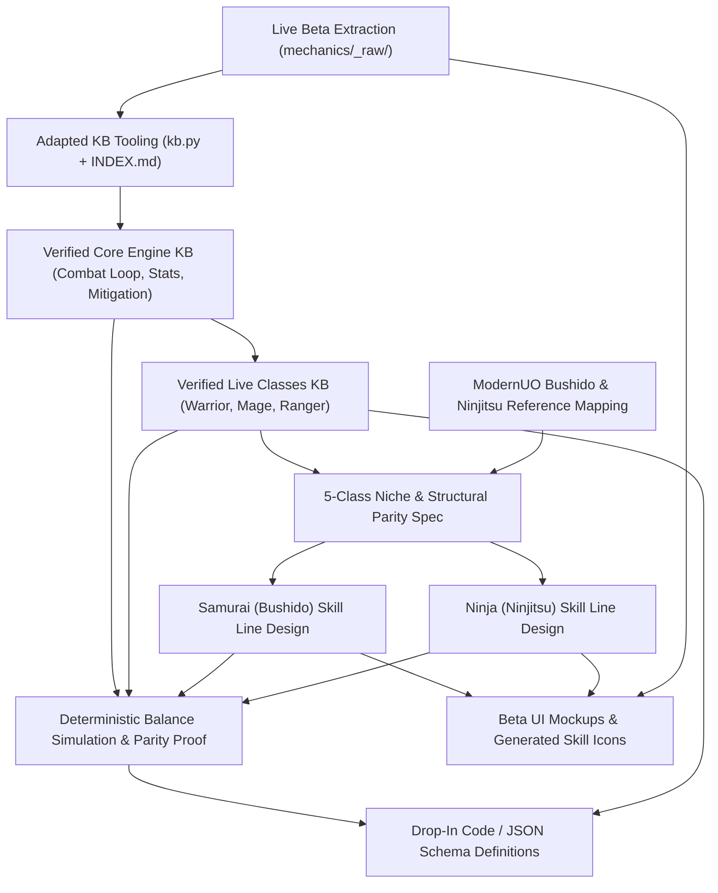

# Feature Research

**Domain:** Reverse-Engineering Mechanics Knowledgebase & Idle RPG Class Skill Line Design (UO Idle + ModernUO Bushido/Ninjitsu)
**Researched:** 2026-11-06
**Confidence:** HIGH (Verified against live `github.com/modernuo/ModernUO` `Projects/UOContent/` C# source and `mudlet-dragonball-evolution/mechanics/` KB reference)

---

## Canonical ModernUO Reference: Bushido & Ninjitsu Mechanics & Formulas

Before categorizing features, every canonical ability and formula from ModernUO (`Projects/UOContent/Spells/Bushido/`, `Projects/UOContent/Spells/Ninjitsu/`, `Projects/UOContent/Engines/Virtues/`, and `Projects/UOContent/Items/Weapons/BaseWeapon.cs`) is documented below alongside its required adaptation for UO Idle's automated tick-based combat loop.

### 1. Canonical Bushido (Samurai) Abilities & Passives

| Ability / Mechanic | Type & Reqs (ModernUO) | Canonical ModernUO Formula & Behavior | UO Idle Adaptation Pattern |
|--------------------|------------------------|---------------------------------------|----------------------------|
| **Bushido Weapon Parry** (`BaseWeapon.CheckParry`) | Passive | **No Shield (1H):** $\text{Chance} = \frac{\text{Parry} \times \text{Bushido}}{48000}$ (+5% if Parry or Bushido $\ge 100$). **No Shield (2H):** $\text{Chance} = \frac{\text{Parry} \times \text{Bushido}}{41140}$ (+5% if $\ge 100$). **With Shield Penalty:** $\text{Chance} = \max\left(0, \frac{\text{Parry} - \text{Bushido}}{400}\right)$. | **Passive Skill / Class Trait:** Grants weapon block/parry chance scaling with skill level/rank (amplified for 2H weapons) that triggers on-parry reactive effects (`Confidence`, `Counter Attack`). |
| **Perfection & Honor** (`HonorContext.cs`) | Passive / Virtue Mechanic (Req: 50 Bushido) | Consecutive hits on Honored target add $\lfloor \frac{\text{Bushido}}{10} \rfloor\%$ damage bonus per hit (max **+100%** at 10 hits / 100 Bushido). Misses subtract **25%**; target switch resets to **0%**. Luck bonus = $\frac{\text{PerfectionBonus}^2}{10}$ (up to +1000 Luck). Kill burst restores $\min\left(10, \frac{\text{Perfection} \times (\text{Fame} + 5000)}{25000}\right)$ HP/Stam/Mana. | **Core Samurai Passive ("Perfection"):** Stacks $+X\%$ damage per consecutive hit against the current target (up to 10 stacks), losing stacks on miss/dodge and resetting on target kill with a small HP/Mana/Resource restore burst. Excels in boss/single-target sustained fights. |
| **Honorable Execution** (`HonorableExecution.cs`) | Special Move (Req: 25.0, Mana: 0) | **Damage Scalar:** $1.0 + \frac{\text{Bushido} \times 20}{10000}$ (+20% at 100 Bushido; scales with Perfection). **On Kill:** Heals $20 + \lfloor \frac{\text{Bushido}^2}{480} \rfloor$ HP and grants Swing Speed Increase $\max\left(1, \lfloor \frac{\text{Bushido}^2}{720} \rfloor\right)\%$ for 20s. **On Survival (Failure Penalty):** $-40$ to all Resistances and $0$ Magic Resist for 7s. | **Active Execute Finisher:** High-multiplier strike or threshold-boosted attack. In an idle rotation (where skills fire on cooldown), replace the punishing 7s $-40$ resist self-sabotage with a **conditional kill reset/buff**: bonus damage vs low-HP targets, granting a 20s attack speed + heal buff if the target dies within $N$ seconds (or on hit if target $<X\%$ HP). |
| **Confidence** (`Confidence.cs`, `BaseWeapon.cs`) | Stance Spell (Req: 25.0, Mana: 10, Cast: 0.25s) | **Duration:** 30s buff. **On Cast Regen (4 ticks over 4s):** $\lfloor \frac{15 + \text{Bushido}^2 / 576}{4} \rfloor$ HP/sec. **On Parry Trigger:** Restores $\text{Rand}(1, \lfloor \frac{\text{Bushido}}{12} \rfloor)$ HP and $\text{Rand}(1, \lfloor \frac{\text{Bushido}}{5} \rfloor)$ Stamina per successful parry. | **Active Defensive Sustain Stance:** Immediate 4s HoT plus a buff window where every parry/dodge/incoming hit restores flat or $\%$-scaled HP and resource. |
| **Counter Attack** (`CounterAttack.cs`, `BaseWeapon.cs`) | Stance Spell (Req: 40.0, Mana: 5, Cast: 0.25s) | **Duration:** 30s stance. On the next successful parry (`CheckParry`), immediately executes `weapon.OnSwing(defender, attacker)` without resetting the swing timer, then consumes the stance. | **Reactive Counter Buff / Passive Proc:** Grants a buff window (or passive proc rate) where parrying or taking an attack immediately fires a free bonus weapon swing at $X\%$ weapon damage. |
| **Lightning Strike** (`LightningStrike.cs`) | Special Move (Req: 50.0, Mana: 5) | **Accuracy Bonus:** Flat **+50% Hit Chance Increase (HCI)**. **Critical / Ignore Armor Chance:** $\text{Chance} = \frac{\text{Bushido}^2}{72000}$ ($13.88\%$ at 100 Bushido, $20.0\%$ at 120 Bushido) to ignore target armor completely (`IgnoreArmor = true`). | **Active Low-Cooldown Precision Strike:** Bread-and-butter low-cost strike with high accuracy/crit bonus and a chance (or guaranteed partial%) to bypass enemy armor/defense. |
| **Evasion** (`Evasion.cs`) | Defensive Spell (Req: 60.0, Mana: 10, CD: 20s) | **Duration:** $3 + \lfloor \frac{\text{Bushido} - 60}{20} \rfloor$ seconds (+1s if GM Anatomy & Tactics and Bushido $>100$; 3–7s total). **Parry Scalar:** Multiplies parry chance by $1.0 + 0.16 + 0.004 \times (\text{Bushido} - 60)$ (+0.10 at GM+ synergy; **1.16x to 1.50x** total) and enables parrying direct-damage spells (`CheckSpellEvasion`). | **Active Major Defensive Cooldown:** 20s cooldown defensive window increasing parry/evasion significantly and allowing mitigation/deflection of magic/boss special damage. |
| **Momentum Strike** (`MomentumStrike.cs`) | Special Move (Req: 70.0, Mana: 10) | **Cleave Transfer:** On hitting primary target, immediately swings at a second combatant in weapon range with $\text{DamageBonus} = \frac{\text{Bushido}}{100}$ ($1.0\times$ at 100, $1.2\times$ at 120). If primary target died from the hit, secondary damage bonus is multiplied by **$1.5\times$** ($1.5\times$ to $1.8\times$). | **Active Two-Target Cleave / Wave Clear:** Strikes primary target and cleaves to a secondary enemy (or deals splash/overflow damage if single-target in UO Idle), amplified by $1.5\times$ on primary target kill. |

### 2. Canonical Ninjitsu (Ninja) Abilities & Passives

| Ability / Mechanic | Type & Reqs (ModernUO) | Canonical ModernUO Formula & Behavior | UO Idle Adaptation Pattern |
|--------------------|------------------------|---------------------------------------|----------------------------|
| **Mirror Image** (`MirrorImage.cs`, `BaseWeapon.cs`) | Ninja Spell (Req: 20.0 ML / 40.0 SE, Mana: 10, Cast: 1.5s) | Summons a 1-HP `Clone` lasting $30 + \frac{\text{Ninjitsu}}{4}$ seconds (up to follower cap). **Attack Intercept Chance:** $\text{Chance} = \frac{\text{Ninjitsu}}{150.0}$ ($66.7\%$ at 100, $80\%$ at 120). Diverts an incoming hit to the clone, destroying it and dealing **0 damage** to the Ninja. | **Signature Ninja Mitigation Buff (Stacking Charges):** Summons $1\text{–}3$ Shadow Clone charges for $N$ seconds; each incoming hit has an $X\%$ chance to consume 1 clone charge and negate 100% (or high $\%$) of the hit's damage. |
| **Focus Attack** (`FocusAttack.cs`) | Ninja Move (Req: 30.0 ML / 60.0 SE, Mana: 10 ML / 20 SE) | Requires melee weapon without shield. **Damage Scalar:** $1.0 + \frac{\text{Ninjitsu}^2}{43636}$ ($+22.9\%$ at 100, $+33\%$ at 120). **Weapon Property / Proc Bonus:** $1.0 + \left(\frac{\text{Ninjitsu}^2}{43636} \times 3 + 0.01\right)$ ($\approx 1.70\times$ at 100, $2.0\times$ at 120) multiplier to on-hit effects. | **Active Proc-Amplifying Strike:** Next attack deals boosted damage and doubles (or greatly increases) on-hit status/poison/leech/crit effect triggers. |
| **Backstab** (`Backstab.cs`) | Ninja Move (Req: 40.0 ML / 20.0 SE, Mana: 30) | Requires Stealth. **Damage Scalar:** $1.0 + \frac{\text{Ninjitsu}}{360} + \frac{\text{StalkingBonus}}{100}$ where $\text{StalkingBonus} = 10 + \frac{\text{Tracking}}{10}$. Applies 5s stealth lockout. | **Stealth Opener / Ambush Burst:** High-damage strike that consumes or scales with a `"Stealthed" / "Shadowed"` status buff (granted by Smoke Bomb, Shadowjump, or passive combat entry). |
| **Smoke Bomb & Stealth** (`SmokeBomb.cs`) | Item / Mechanic (Req: 50.0, Mana: 10) | Sets `Hiding.CombatOverride = true` and immediately hides the Ninja mid-combat, enabling Stealth moves (`Backstab`, `Surprise Attack`, `Shadowjump`) without leaving combat. | **Core State Enabler ("Smoke Bomb"):** Active skill (not a consumable item in idle rotation) that grants the `"Stealthed"` state mid-combat, drops threat/increases dodge briefly, and empowers the next stealth-synergy ability. |
| **Shadowjump** (`ShadowJump.cs`) | Ninja Spell (Req: 50.0, Mana: 15, Cast: 1.0s) | Teleports up to 11 tiles while stealthed and immediately performs a `Stealth.OnUse` check to remain hidden. Allowed while in `Animal Form`. | **Active Gap-Closer / Tempo Reset:** Instead of manual tile-clicking (anti-feature in idle games), functions as an instant shadow-step strike/buff that grants `"Stealthed"` + haste/evasion or resets attack swing timer. |
| **Surprise Attack** (`SurpriseAttack.cs`) | Ninja Move (Req: 60.0 ML / 30.0 SE, Mana: 20) | Requires Stealth. On hit, applies an **8-second Defense Chance Decrease (DCI malus)** to the target: $\text{Malus} = \lfloor \frac{\text{Ninjitsu}_{\text{fixed}}}{60} \rfloor + \text{StalkingBonus}$ ($\text{Ninjitsu}_{\text{fixed}} = \text{Ninjitsu} \times 10$, so $\frac{1000}{60} = 16$ at 100, $20$ at 120, plus up to $22$ from Tracking = **$-36\%$ to $-42\%$ defense**). | **Active Armor/Defense Shred Debuff:** Inflicts an 8s vulnerability/defense-reduction debuff on the target, amplifying all subsequent burst damage (especially `Death Strike` and `Backstab`). |
| **Ki Attack** (`KiAttack.cs`) | Ninja Move (Req: 80.0, Mana: 25) | Must land hit within 2.0s of activation; cannot be stealthed. **Distance Calculation:** $d = \min\left(20.0, \sqrt{\Delta x^2 + \Delta y^2}\right)$. **Damage Scalar (PvM):** $1.0 + \frac{d}{10.0}$ (up to **$3.0\times$ / +200% damage** at 20 tiles). | **Active Momentum / Tempo Burst Strike:** Since idle combat lacks 2D tile running, replace Euclidean distance $\sqrt{\Delta x^2 + \Delta y^2}$ with **Combat Tempo / Combo Velocity** (e.g., scales with attacks landed, dodge/stealth transitions, or haste rating over the last $N$ seconds up to $2.0\text{–}3.0\times$ damage). |
| **Death Strike** (`DeathStrike.cs`) | Ninja Move (Req: 85.0, Mana: 30) | Initial hit deals $0.5\times$ weapon damage. Success chance: $30 + (\text{Ninjitsu}-85) \times 2.2\%$ ($<100$) or $63 + (\text{Ninjitsu}-100) \times 1.1\%$ ($\ge 100$). Applies a **5.0s delayed direct-damage mark**: $\text{Scalar} = \min\left(1.0, \frac{\text{Hiding} + \text{Stealth}}{220}\right)$. **Moving ($\ge 5$ steps):** $\lfloor \min\left(60, \frac{\text{Ninjitsu}}{3}(0.3 + 0.7 \times \text{Scalar}) + \text{StalkingBonus}\right) \rfloor$. **Stationary (5s timer):** $\lfloor \min\left(30, \frac{\text{Ninjitsu}}{9}(0.3 + 0.7 \times \text{Scalar}) + \text{StalkingBonus}\right) \rfloor$. | **Capstone Delayed Detonation Mark:** Strikes the target and plants a 5s Death Mark. Subsequent hits (or stealth attacks) during the 5s window advance "steps" (up to 5 stacks); when the mark detonates after 5s (or at 5 stacks), it deals massive unmitigated/direct burst damage. |
| **Animal Form** (`AnimalForm.cs`) | Ninja Spell (Req: 0–100, Mana: 10) | Success chance: $\frac{\text{Ninjitsu} - \text{ReqSkill}}{37.5}$. Forms grant passive bonuses: Rat/Rabbit (20, +20 Stealth), Cat/Dog (40), Giant Serpent (50, poison on hit), Cu Sidhe (60, auto-heals 20–50 HP every 8s), Bake Kitsune/Wolf (82.5, HP regen/speed), Reptalon (90, fire breath every $\le 10$s), Ki-Rin/Unicorn (100). | **Passive Aspect Mastery or Stance Toggle:** Rather than a popup Gump blocking weapon skills (in UO, Animal Form blocks weapon moves), adapt as a **Passive Aspect Mastery** (e.g., *Aspect of the Serpent/Kitsune/Cu Sidhe* granting passive evasion, poison/bleed proc, and periodic regen) or a dedicated buff skill. |

---

## Feature Landscape

### Table Stakes (Users Expect These)

Features the lead developer and downstream consumers expect by default. Missing any of these invalidates either the verification integrity of the knowledgebase or the drop-in usability of the Ninja & Samurai class designs.

| Feature | Why Expected | Complexity | Notes |
|---------|--------------|------------|-------|
| **Claim-Verified Mechanics KB (`mechanics/`)** | Modeled on `mudlet-dragonball-evolution/mechanics/`; every mechanic claim (`C1`, `C2`, ...) must quote verbatim line ranges from `_raw/` extracts so zero game mechanics are hallucinated. | MEDIUM | Requires adapting `kb.py` (`build`, `check`, `diff`), frontmatter validation, and generated `INDEX.md`. |
| **Verbatim `_raw/` Extraction from Live UO Idle Beta** | You cannot balance new classes or match schemas without exact client bundle JS, network/API payloads, DOM states, and official wiki/docs extracts from `https://uoidle.com/beta`. | MEDIUM | Extracted read-only via Chrome DevTools MCP (`chrome-devtools`) and saved under `mechanics/_raw/`. |
| **Complete Warrior, Mage, and Ranger Reverse-Engineered Index** | The lead developer expects Ninja and Samurai to slot seamlessly alongside the three live classes; every live skill, unlock level, cooldown, resource cost, status effect, and scaling formula must be cataloged first. | HIGH | Covers base stats, combat tick loop, hit/crit/mitigation math, and all active/passive slots for Warrior, Mage, and Ranger. |
| **Structural Parity in Class Progression** | Ninja and Samurai must use the **exact** unlock level tiers, active/passive skill counts, and upgrade/rank rules used by Warrior, Mage, and Ranger. | MEDIUM | Prevents engine refactoring; allows adding Ninja and Samurai purely via data/config definitions and standard effect handlers. |
| **ModernUO-Grounded Samurai (Bushido) Skill Line** | Must include authentic translations of *Honorable Execution*, *Confidence*, *Counter Attack*, *Lightning Strike*, *Evasion*, *Momentum Strike*, and *Perfection/Honor*. | MEDIUM | Must adapt manual UO stances/special moves into UO Idle's automated cooldown/passive architecture. |
| **ModernUO-Grounded Ninja (Ninjitsu) Skill Line** | Must include authentic translations of *Mirror Image*, *Focus Attack*, *Backstab*, *Smoke Bomb/Stealth*, *Shadowjump*, *Surprise Attack*, *Ki Attack*, *Death Strike*, and *Animal Form*. | MEDIUM | Must adapt positional/stealth requirements into state-machine buffs (`Stealthed`, `Clone Charges`, `Death Mark`) that work automatically in idle combat. |
| **Drop-In JSON / Code Skill & Class Definitions** | The lead developer needs copy-pasteable data structures matching UO Idle's live client/server schema (keys, types, enum IDs, effect payloads, icon paths). | MEDIUM | Must validate directly against the reverse-engineered schema in `mechanics/`. |
| **Formal Class Design Specification Document** | Human-readable engineering and game design spec explaining each skill's lore origin, ModernUO formula mapping, UO Idle formula, status interactions, and edge cases. | LOW | Bridges the raw JSON definitions and the mathematical balance proofs. |

### Differentiators (Competitive Advantage)

Features that elevate this deliverable from a generic "class idea doc" into an authoritative, studio-grade engineering and design package for the UO Idle lead developer.

| Feature | Value Proposition | Complexity | Notes |
|---------|-------------------|------------|-------|
| **Protected Combat Niches (5-Class Matrix)** | Prevents Samurai from feeling like a reskinned Warrior and Ninja from feeling like a melee Ranger. Establishes **Samurai = Ramp/Parry-Counter/Execute** (*Perfection* stacking + *Confidence/Counter Attack* + *Honorable Execution*) and **Ninja = Clone-Mitigation/Stealth-State/Delayed-Detonation** (*Mirror Image* charges + *Smoke Bomb -> Backstab/Surprise Attack* + *Death Strike* 5-hit mark). | MEDIUM | Explicitly maps 5-class orthogonal axes: Sustain Mode, Mitigation Mode, Burst Profile, Multi-Target Profile, and Resource Economy. |
| **Deterministic Combat Simulation & Parity Proof** | A runnable Python simulation script modeling UO Idle's exact combat tick engine across level brackets (early, mid, endgame/boss) proving Ninja and Samurai DPS, Effective HP (EHP), and resource sustain fall within $\pm 5\text{–}8\%$ of Warrior, Mage, and Ranger benchmarks. | HIGH | Gives the lead developer immediate mathematical confidence that neither class will break live progression or boss encounters. |
| **Dual Implementation Modes ("Zero-Engine-Change" vs "Native Hook")** | For any Bushido/Ninjitsu mechanic that stretches UO Idle's current status effect vocabulary (e.g., *Mirror Image* hit interception or *Death Strike* 5-step delayed detonation), provide both: (A) a **100% existing-opcode version** requiring zero engine code changes, and (B) a **minimal engine hook specification** (<20 LOC JS/TS) if the developer wants full mechanical fidelity. | MEDIUM | Eliminates adoption friction—the developer can ship Mode A in 5 minutes or Mode B in an afternoon. |
| **In-Situ Beta UI Mockups & Generated Skill Iconography** | Custom-generated Ultima Online / UO Idle-styled skill icons and class portraits (Samurai & Ninja) composited directly into authentic DOM/CSS mockups of `https://uoidle.com/beta`'s class selection, skill tree, and combat log screens. | MEDIUM | Lets the developer immediately visualize how Ninja and Samurai look and feel inside their actual interface. |
| **Cross-Referenced Formula Traceability (`ModernUO <-> UO Idle`)** | Every proposed Ninja and Samurai skill parameter includes a side-by-side derivation table showing the exact ModernUO C# formula (`HonorableExecution.cs` L49–51, `DeathStrike.cs` L136–146, etc.) and the affine transformation used to scale it to UO Idle's stat curves. | LOW | Proves the designs are authentic Ultima Online translations rather than arbitrary numbers. |

### Anti-Features (Commonly Requested, Often Problematic)

Mechanics present in classic Ultima Online / ModernUO that are fundamentally incompatible with an automated idle RPG loop, or project scope traps that degrade deliverable quality.

| Feature | Why Requested | Why Problematic | Alternative |
|---------|---------------|-----------------|-------------|
| **Tile-Distance Movement Requirements (`Ki Attack` 20-tile run, `Death Strike` 5-step enemy walk, `Shadowjump` ground targeting)** | Canonical in ModernUO (`KiAttack.cs` checks $\sqrt{\Delta x^2 + \Delta y^2}$; `DeathStrike.cs` checks `Steps >= 5` of enemy tile movement). | UO Idle combat is an automated idle/tick loop without manual 2D tile kiting or ground-target cursor clicking. Tying damage to tile coordinates makes these skills either non-functional or permanently stuck at minimum damage. | Convert spatial distance into **Temporal / Combo State**: `Ki Attack` scales with *Combat Momentum* (ticks/hits since last damage taken or haste stacks); `Death Strike` triggers full 5-step bonus after **5 subsequent attacks/hits** within 5s; `Shadowjump` acts as an instant stealth/gap-close buff. |
| **Self-Sabotaging Unconditional Failure Penalties (`Honorable Execution` $-40$ All Resists on non-kill)** | Canonical in `HonorableExecution.cs` L67–80: failing to kill the target on the next swing inflicts $-40$ to all 5 resistances and zeroes Magic Resist for 7 seconds. | In an idle game where skills fire automatically on cooldown against high-HP bosses, an unconditional $-40$ resistance penalty every time a skill doesn't one-shot the boss will cause instant, unavoidable player deaths during AFK farming. | Use **Conditional Reward Scaling**: base strike deals reliable damage with zero self-penalty; landing it on a target below $X\%$ HP or killing the target within $N$ seconds triggers the canonical $20 + \lfloor \text{Bushido}^2 / 480 \rfloor$ heal and 20s swing speed buff. |
| **Consumable Item Dependency for Core Rotation (`Smoke Bomb` inventory depletion, `Cu Sidhe` bandage consumption)** | In ModernUO (`SmokeBomb.cs`, `AnimalForm.cs` L557), Ninjas consume physical Smoke Bomb items from their backpack to hide mid-combat, and Cu Sidhe form consumes Bandages. | Requiring a class's core skill rotation (`Stealth` openers) to burn stackable inventory consumables while other classes (Warrior/Mage/Ranger) only use regenerating Mana/Stamina breaks long-term AFK/idle parity. | Implement **Smoke Bomb as a Cooldown Ability** (costing standard class resource/Mana on cooldown) rather than a depletable backpack item. |
| **Weapon-Locking Transformation Gumps (`Animal Form` modal popup & weapon move lockout)** | In ModernUO (`AnimalForm.cs`), casting Animal Form while standing opens a 16-animal modal Gump and blocks all weapon moves except `Mirror Image` and `Shadowjump`. | Modal selection popups halt automated combat, and locking out 75% of the Ninja's weapon skill bar invalidates the rest of the class progression tree. | Model `Animal Form` as a **Passive Stance / Aspect Upgrade** (or a buff that coexists with Ninjitsu strikes) that grants the iconic animal bonuses (e.g., Serpent poison, Wolf haste/leech, Cu Sidhe regen) without disabling weapon skills. |
| **Unverified / Assumed UO Idle Engine Formulas** | Tempting to guess how UO Idle calculates armor, crit, or cooldown haste based on generic RPG conventions. | Violates the core KB integrity rule and guarantees the numerical balance proofs will be wrong against the live beta game. | Enforce strict `kb.py check` verification: extract the exact JS bundle and network state from `https://uoidle.com/beta` into `mechanics/_raw/` first, and cite line numbers for every formula. |
| **Live Server Mutation or Exploitation** | Tempting to test hypothetical skills by injecting packets or mutating server state on `uoidle.com/beta`. | Strictly out of scope and unethical; risks account ban or server disruption. | Perform 100% read-only inspection via Chrome DevTools MCP and run all Ninja/Samurai combat testing in a local offline Python/JS simulation engine replicated from the verified KB formulas. |

---

## Feature Dependencies

### Dependency Notes

- **`Verified Live Classes KB` requires `Live Beta Extraction` and `Adapted KB Tooling`:** We cannot know the unlock levels, active/passive slot counts, or damage scaling curves of Warrior, Mage, and Ranger until the live client bundle and API responses from `https://uoidle.com/beta` are captured in `mechanics/_raw/` and indexed with verifiable claims (`C1..Cn`).
- **`Samurai & Ninja Skill Line Designs` require both `Verified Live Classes KB` and `ModernUO Reference Mapping`:** Structural parity (unlock levels, cooldown brackets, resource costs) comes from the live UO Idle classes, while mechanical identity and scaling ratios come from ModernUO's Bushido and Ninjitsu C# formulas.
- **`Deterministic Balance Simulation` requires `Verified Core Engine KB`, `Verified Live Classes KB`, and `Samurai & Ninja Skill Line Designs`:** To prove numerical parity (DPS, EHP, sustain), the simulator must run Warrior, Mage, Ranger, Samurai, and Ninja through the exact combat formulas verified in the KB.
- **`Drop-In Code / JSON Schema Definitions` require `Deterministic Balance Simulation`:** Final tuned coefficients and cooldowns should only be frozen into drop-in JSON/JS definitions after simulation proves balance across all level brackets.
- **`Beta UI Mockups & Generated Skill Icons` require `Live Beta Extraction` and `Samurai & Ninja Skill Line Designs`:** Mockups must match the live beta DOM/CSS layout and display the finalized skill names, tooltips, unlock levels, and custom icons.

---

## MVP Definition

Because this project is a commissioned research, reverse-engineering, and class design deliverable for the UO Idle lead developer, "MVP (v1)" represents the complete, verifiable deliverable package defined in `PROJECT.md`.

### Launch With (v1 — Complete Deliverable Package)

- [ ] **Adapted `mechanics/` Knowledgebase & `kb.py` Tooling** — Verbatim `_raw/` extracts from `https://uoidle.com/beta`, claim-verified pages (`C1..Cn`), and clean `kb.py check` + generated `INDEX.md`.
- [ ] **Complete UO Idle Systems & Class Index (Warrior, Mage, Ranger)** — Every live combat formula, stat curve, status effect, and class skill progression documented with line-level citations.
- [ ] **ModernUO Bushido & Ninjitsu Technical Reference** — Complete KB topic documenting all canonical ModernUO Bushido and Ninjitsu formulas and their idle-game state adaptations.
- [ ] **Samurai (Bushido) & Ninja (Ninjitsu) Skill Line Specifications** — Full skill trees matching live unlock tiers, featuring protected combat niches, dual implementation modes (Mode A zero-engine-change / Mode B native hook), and level scaling formulas.
- [ ] **Mathematical & Simulated Balance Proof** — Reproducible simulation script + report comparing Warrior, Mage, Ranger, Samurai, and Ninja across level brackets (DPS, EHP, sustain, TTK).
- [ ] **Drop-In Code / JSON Definitions** — Ready-to-import class and skill definitions conforming 1:1 to UO Idle's client/server data schema.
- [ ] **Visual UI Mockups & Generated Skill/Class Iconography** — Custom-generated icons for all Ninja and Samurai skills rendered inside authentic UO Idle beta UI mockups.

### Add After Validation (v1.x — Developer Follow-Up Extensions)

- [ ] **Class-Specific Itemization / Weapon Affix Tables** — Katana, No-Dachi, Wakizashi, Tekagi, Kama, and Fukiya item definitions if the lead developer wants class-themed equipment drops alongside the skill lines.
- [ ] **Interactive Browser Balance Sandbox** — A lightweight local HTML/JS slider tool allowing the lead developer to tweak skill coefficients and watch live DPS/EHP curves update against Warrior/Mage/Ranger baselines.

### Future Consideration (v2+ — Post-Integration Expansions)

- [ ] **Additional ModernUO Skill Lines (Chivalry / Paladin, Necromancy, Spellweaving)** — Extending the same KB + ModernUO adaptation pipeline to additional Ultima Online expansions once Ninja and Samurai are integrated.
- [ ] **Prestige / Mastery Sub-Specializations** — High-level mastery passives (e.g., UO's Level I–III Bushido/Ninjitsu Masteries: *Anticipate Hit*, *Warcry*, *Shadow*, *White Tiger Form*) if UO Idle adds endgame ascension tiers.

---

## Feature Prioritization Matrix

| Feature | User Value | Implementation Cost | Priority |
|---------|------------|---------------------|----------|
| Live Beta Extraction (`mechanics/_raw/`) & `kb.py` Setup | HIGH | MEDIUM | P1 |
| Reverse-Engineered Core Combat & Warrior/Mage/Ranger KB | HIGH | HIGH | P1 |
| ModernUO Bushido & Ninjitsu Formula Mapping | HIGH | LOW | P1 |
| Samurai (Bushido) & Ninja (Ninjitsu) Skill Line Design | HIGH | MEDIUM | P1 |
| Deterministic Combat Simulation & Parity Proof | HIGH | MEDIUM | P1 |
| Drop-In Code / JSON Schema Definitions | HIGH | LOW | P1 |
| Beta UI Mockups & Generated Skill Iconography | HIGH | MEDIUM | P1 |
| Dual Implementation Mode Specs (Zero-Engine vs Native Hook) | MEDIUM | LOW | P2 |
| Class-Themed Weapon / Equipment Definitions (Katana, Tekagi, etc.) | MEDIUM | LOW | P2 |
| Interactive HTML/JS Balance Tuning Sandbox | LOW | MEDIUM | P3 |

**Priority key:**
- **P1:** Must have for the core milestone deliverable (`PROJECT.md` active requirements)
- **P2:** High-value polish that significantly reduces developer integration friction
- **P3:** Nice-to-have extension after core deliverables are verified

---

## Class Niche & Competitor Feature Analysis

To ensure **Samurai** and **Ninja** do not cannibalize **Warrior**, **Mage**, or **Ranger** (or each other), the five classes should occupy distinct mechanical coordinates across UO Idle's combat engine:

| Combat Dimension | Warrior (Live Baseline) | Mage (Live Baseline) | Ranger (Live Baseline) | Samurai (Bushido — Proposed) | Ninja (Ninjitsu — Proposed) |
|------------------|-------------------------|----------------------|------------------------|------------------------------|-----------------------------|
| **Primary Fantasy** | Heavy armor frontliner, consistent physical brawler & mitigation | Arcane spellcaster, high elemental burst & mana-gated AoE/control | Agile marksman, high attack speed, ranged crits & DoT/kiting | Disciplined duelist; builds *Perfection* stacks, parries with weapon to counter-strike, executes wounded foes | Shadow assassin; negates hits with *Mirror Images*, cycles *Stealth* openers, detonates delayed *Death Strikes* |
| **Mitigation Archetype** | Passive Armor / Flat Damage Reduction / Shield Block | Barrier / Mana Shield / Crowd Control | Dodge / Evasion / Range Avoidance | **Active Parry & Counter-Sustain** (*Confidence* HoT + heal-on-parry, *Evasion* spell-parry window) | **Ablative Clone Interception** (*Mirror Image* charges absorb 100% of single hits at $X\%$ proc rate) |
| **Offensive Scaling Profile** | Linear, steady physical DPS | Cooldown/Mana-gated burst spikes | High-frequency attacks + crit/bleed/poison | **Ramp + Execute** (*Perfection* ramps $+10\%$ per hit up to $+100\%$; *Honorable Execution* spikes at low target HP) | **State-Window + Delayed Detonation** (*Smoke Bomb* $\rightarrow$ *Surprise Attack* shred $\rightarrow$ *Backstab* $\rightarrow$ 5-hit *Death Strike* pop) |
| **Multi-Target / Cleave** | Standard melee AoE / Whirlwind | Full AoE spells | Multi-shot / Volley | **Momentum Transfer** (*Momentum Strike* cleaves 2nd target and deals $1.5\times$ bonus if primary target dies) | **Single-Target Priority Assassin** (Weak AoE; excels at deleting priority targets and surviving boss single-target nukes) |
| **Signature ModernUO Hook** | Classic Tactics / Swordsmanship / Parrying | Classic Magery / Eval Int | Classic Archery / Anatomy | `HonorContext` Perfection + `CounterAttack` free swing + `LightningStrike` armor ignore | `MirrorImage` clone intercept + `DeathStrike` 5-step mark + `FocusAttack` proc doubler |

---

## Sources

- **ModernUO Canonical C# Source (`github.com/modernuo/ModernUO`):**
  - Bushido Spells & Moves: `Projects/UOContent/Spells/Bushido/HonorableExecution.cs`, `Confidence.cs`, `Evasion.cs`, `CounterAttack.cs`, `LightningStrike.cs`, `MomentumStrike.cs`, `SamuraiSpell.cs`, `SamuraiMove.cs`
  - Ninjitsu Spells & Moves: `Projects/UOContent/Spells/Ninjitsu/FocusAttack.cs`, `DeathStrike.cs`, `AnimalForm.cs`, `KiAttack.cs`, `SurpriseAttack.cs`, `Backstab.cs`, `ShadowJump.cs`, `MirrorImage.cs`, `NinjaSpell.cs`, `NinjaMove.cs`
  - Ninjitsu Items: `Projects/UOContent/Items/Skill Items/Ninjitsu/SmokeBomb.cs`
  - Virtues & Perfection: `Projects/UOContent/Engines/Virtues/Honor.cs`, `HonorContext.cs`
  - Combat & Parry Resolution: `Projects/UOContent/Items/Weapons/BaseWeapon.cs` (`CheckParry` L1499–1582, `AbsorbDamageAOS` L1584–1626, `OnHit` MirrorImage check L1740–1755)
- **Knowledgebase Architecture Reference:**
  - Local reference repository: `/Users/brbrainerd/dev/mudlet-dragonball-evolution/mechanics/CONTRIBUTING.md` and `tools/kb.py`
- **Live Target Environment:**
  - `https://uoidle.com/beta` (to be extracted into `mechanics/_raw/` during Phase 1)

---
*Feature research for: UO Idle Mechanics Knowledgebase & Ninja/Samurai Class Skill Lines*
*Researched: 2026-11-06*
