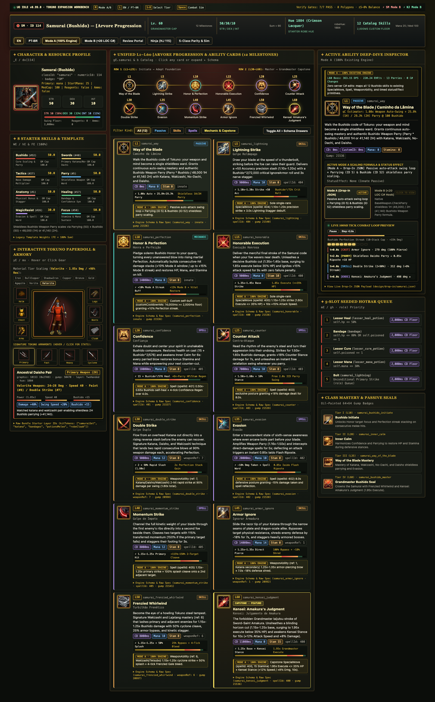
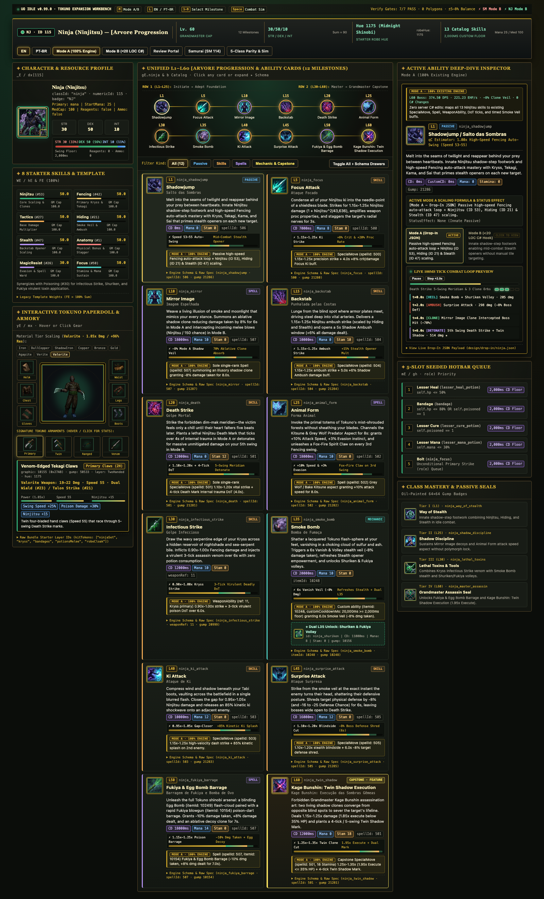
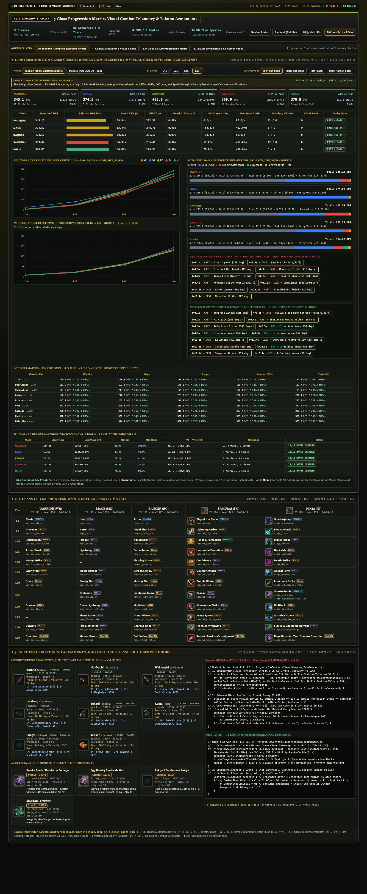
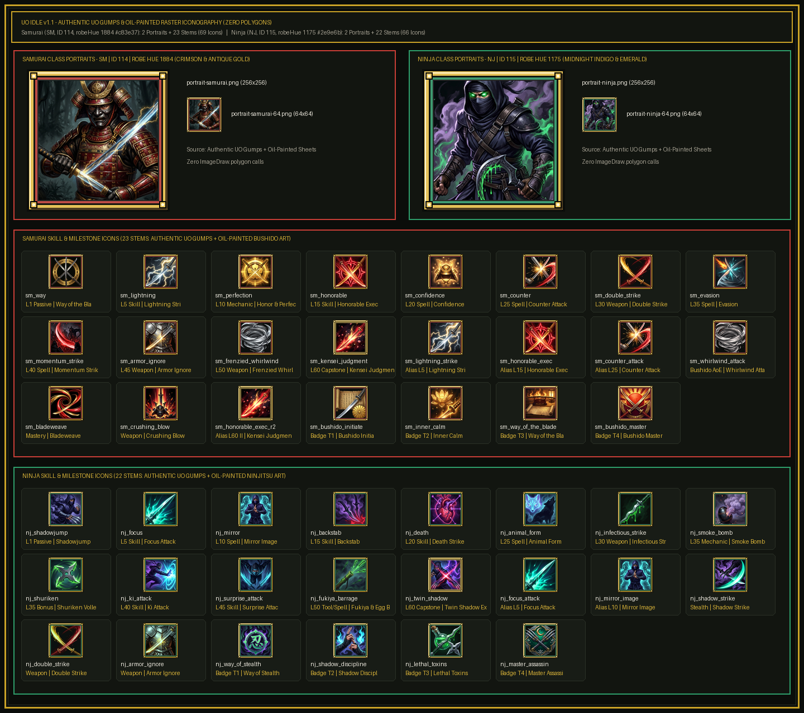

# UO Idle (`v0.99.0`) — Ninja & Samurai Class Skill Lines & Mechanics Knowledgebase

**Milestone `v1.2` Executive Handoff, Live-Codebase Combat Simulator & Interactive Workbench Portal**

> **Live GitHub Pages Review Portal:**
> - **Executive Handoff Portal:** <https://brbrainerd.github.io/uoIdle/>
> - **Samurai (`Bushido`) Skill Tree & Paperdoll:** <https://brbrainerd.github.io/uoIdle/mockups/samurai-skill-tree.html>
> - **Ninja (`Ninjitsu`) Skill Tree & Paperdoll:** <https://brbrainerd.github.io/uoIdle/mockups/ninja-skill-tree.html>
> - **5-Class Parity, Telemetry & Armaments Dashboard:** <https://brbrainerd.github.io/uoIdle/mockups/class-comparison.html>

### Project Scope at a Glance
- **Claim-Verified Mechanics Knowledgebase (`34` KB pages, `28/28` mutation self-tests):** Line-verified against verbatim extracts from the live UO Idle `v0.99.0` bundle (`index-CCYN0Dy6.js`), server/client changelogs, and canonical ModernUO C# (*Bushido*, *Ninjitsu*, *BaseWeapon*, *HonorContext*).
- **Drop-In Samurai & Ninja Class Package (`Mode A` & `Mode B`):** Schema-validated (`Zod` + JSON Schema) `L1–L60` progression trees, starter kits, paperdoll layers, seeded hotbars, Tokuno armaments, and bilingual (`en` / `pt-BR`) strings for **Mode A** (zero engine code changes) and **Mode B** (`<20 LOC` native C# server hooks).
- **Live-Codebase `100ms`-Tick Combat Simulator (`80` parity scenarios, `16` unit test suites):** Unified single-wave and 10-wave tick kernel enforcing live `v0.99.0` attribute/affix caps, `[huntpostura` postures, `+8%/+12%` material tiers (`Iron..Valorite`), `ro(e)` hotbar auto-triggers, `1H/2H/Shield` parry math, and `2.25s / 2.50s / 3.25s` weapon swing speed archetypes.
- **Authentic UO Gump/Item Art & Standalone Workbenches (`0` procedural polygons):** `140` oil-painted/gump skill icons + `37` authentic UO item/paperdoll sprites compiled into `5` zero-CORS HTML workbenches and `4` Retina (`2x` DPI) screenshots.

---

## 1. Repository Architecture & Maintainability Workflow

| Directory / Module | Single Source of Truth For | Build / Regenerate Command | Verification Gate |
|---|---|---|---|
| [`mechanics/`](mechanics/INDEX.md) & [`mechanics/tools/kb.py`](mechanics/tools/kb.py) | `34` claim-verified KB pages (`combat/`, `classes/`, `modernuo/`, `systems/`, `topics/`), `_raw/` extracts, and `_evidence/` captures | `npm run build:kb` | `npm run verify:kb` |
| [`src/schemas/skill.schema.ts`](src/schemas/skill.schema.ts) & [`schemas/*.json`](schemas/class.schema.json) | Canonical `Zod` & JSON Schema contracts for classes, `134` catalog abilities, status effects, and paperdoll layers | — | `npm run verify:skills` |
| [`design/drop-in/`](design/drop-in/) | Drop-in payloads ([`samurai.json`](design/drop-in/samurai.json), [`ninja.json`](design/drop-in/ninja.json), [`items-bushido-ninjitsu.json`](design/drop-in/items-bushido-ninjitsu.json), [`classes-patch.js`](design/drop-in/classes-patch.js)) | — | `npm run verify:skills` |
| [`src/sim/`](src/sim/engine.ts) & [`data/sim-baselines/`](data/sim-baselines/) | Unified `100ms`-tick combat kernel ([`engine.ts`](src/sim/engine.ts)), gear/posture/weapon budgets ([`archetypes.ts`](src/sim/archetypes.ts)), and frozen JSON baselines | `npm run build:sim` | `npm run verify:sim` & `npm run test:sim` |
| [`tools/generate_icons.py`](tools/generate_icons.py) & [`mockups/assets/`](mockups/assets/icons/manifest.json) | `140` multi-res skill icons, class portraits, `37` UO item sprites, and SHA-256 asset manifests | `python3 tools/generate_icons.py` | `npm run verify:icons` |
| [`tools/build_mockups.ts`](tools/build_mockups.ts) & [`tools/ui_components.ts`](tools/ui_components.ts) | `5` self-contained HTML workbenches (`index.html`, `mockups/*.html`) and `4` headless Chrome Retina screenshots | `npm run build:mockups` | `npm run verify:mockups` |

Run the entire 7-gate verification pipeline in `< 5s`:
```bash
npm run verify:all
```

---

## 2. Quick-Start Integration Guide (`Mode A` vs `Mode B`)

| Class | ID & Badge | Robe Hue | Base Stats (`Sum = 90`) | Starter Skills (`50` each, `Magic Resist 30`) | Starter Weapon & Paperdoll Rule | Protected Combat Niche |
|---|---|---|---|---|---|---|
| **Samurai** ([`samurai.json`](design/drop-in/samurai.json), [Spec](design/SAMURAI_SPEC.md)) | `114` (`SM`) | `1884` | `STR 50 / DEX 30 / INT 10` | `Bushido`, `Swords`, `Tactics`, `Parry`, `Anatomy`, `Healing`, `MagicResist (30)`, `Focus` | `Katana` (`5119`), `TwoHanded` slot empty for shieldless Bushido Weapon Parry | Perfection streak ramp, 1H (`48,000`) / 2H (`41,140`) weapon parry-counter, 2-target `Momentum Strike` cleave, `<=35%` HP execute |
| **Ninja** ([`ninja.json`](design/drop-in/ninja.json), [Spec](design/NINJA_SPEC.md)) | `115` (`NJ`) | `1175` | `STR 30 / DEX 50 / INT 10` | `Ninjitsu`, `Fencing`, `Tactics`, `Hiding`, `Stealth`, `Anatomy`, `MagicResist (30)`, `Focus` | `Kryss` (`5121`), off-hand free for `FocusAttack`, `Shuriken`, and `Fukiya` | Ablative `Mirror Image` clone mitigation, mid-combat `Smoke Bomb` stealth openers, 3rd/5th-swing `Death Strike` / `Twin Shadow` detonation |

### Step 1 — Mode A (100% Existing `v0.99.0` Engine, Zero Server Code Changes)
Import [`design/drop-in/classes-patch.js`](design/drop-in/classes-patch.js) and call `applyDropInClassPatch(bundleTables)` to register class metadata (`_E`), starter skills (`WE`), paperdoll kits (`yE`), legacy template weights (`FE`), seeded 5-slot hotbars (`mE`), `[Arvore` `L1–L60` progression trees (`gE`), catalog abilities (`b`), client combat estimators (`qC`), and `en` / `pt-BR` localization strings (`i18n`).

### Step 2 — Mode B (Optional `<20 LOC` ModernUO C# Server Hooks)
For shards running the ModernUO C# backend that want native event-driven triggers in `Projects/UOContent/Items/Weapons/BaseWeapon.cs`:
- **Samurai (`17 LOC` C# — [`design/SAMURAI_SPEC.md` §4](design/SAMURAI_SPEC.md)):** Auto-binds `PerfectionTarget` on hit (`+4%/hit` up to `+15%` boss cap, restoring `+8` HP/Stam/Mana on kill) and triggers `CounterAttack` / `Iaido` free retaliation swings and `Confidence` heals on parry (`2,000ms` ICD).
- **Ninja (`16 LOC` C# — [`design/NINJA_SPEC.md` §4](design/NINJA_SPEC.md)):** Intercepts incoming hits with active `MirrorImage` clones (`70%` ablative mitigation, `10.0s` sim / `1.5s` server ICD), advances `DeathStrike` pressure-point steps on connected melee swings, and consumes `CombatStealthUntil` windows on `Backstab` and `SurpriseAttack`.

---

## 3. Simulator Mathematical Fidelity (`v1.2`) & 5-Class Balance Proof

Full derivations and citations are in [`mechanics/topics/simulator-fidelity-audit.md`](mechanics/topics/simulator-fidelity-audit.md) and [`design/BALANCE_REPORT.md`](design/BALANCE_REPORT.md):

| Law | Live UO Idle `v0.99.0` / ModernUO Rule Enforced in [`src/sim/engine.ts`](src/sim/engine.ts) | Source Provenance |
|---|---|---|
| **1. Hard Affix Caps** | `SDI <= 50%` (+`INT/10`), `DI <= 100%` (skill flattens `>100`), Gear `SSI <= 60%` + tree `Speed` (`1,000ms` floor), `HCI/DCI <= 45%`, `LMC <= 40%`, `EnhancePotions <= 50%`, `ReflectPhysical` | `i18n-en-abilities.js:2616`, `changelog-server-dev.md:338` |
| **2. `[huntpostura` Postures** | `agressivo` (`1.20x` dealt / `1.40x` taken), `equilibrado` (`1.00x / 1.00x`), `defensivo` (`0.60x` dealt / `0.80x` taken) | `i18n-en-abilities.js:1574-1579` |
| **3. Material Tier Ladder** | `9` tiers (`Iron..Valorite`, `step = 0..8`): `+8%` weapon damage (`1.64x` max) & `+12%` armor resist (`1.96x` max) per step | `changelog-server-dev.md:58` |
| **4. Cleave `splashRatio`** | Primary target takes `100%`; secondary cleave targets (`targetIdx > 0`) scale by `splashRatio` (`0.50`–`0.85`) | `combat-estimators-and-hotbar.js:116-148` |
| **5. `ro(e)` Auto-Triggers** | Heal potions (`<=50% / 32% / 18%` HP), Bandage (`<=80%` HP), `mage_heal` (`<=50%`), `am` heals (`<=55%`), Mana potions (`<=40% / 28%`), `GE` AoE (`>=3` targets) | `abilities-loader-and-hotbar.js:609-695` |
| **6. 1H / 2H / Shield Parry** | Shield + Bushido penalty (`(parry - bushido) / 400`), pure Shield (`parry / 400 + 5%` GM), Bushido `1H` (`48,000`) vs `2H` (`41,140`) divisor | `BaseWeapon.cs:1505-1570` |
| **7. Unified Tick Kernel** | `simulateScenarioDetailed` and `simulateMultiWavePull` share `createUnifiedKernelContext` & `stepKernelCombatActions` | `src/sim/engine.ts:555-960` |
| **8. Weapon Speed Families** | `fast_1h` (`2.25s`, `0.90x`), `balanced_1h` (`2.50s`, `1.00x`), `heavy_2h` (`3.25s`, `1.30x`) capture `1,000ms` floor clipping, cooldown burst scaling, and `1H/2H` parry coupling | `src/sim/archetypes.ts:194-315` |

### `L60` 5-Class Parity & Weapon Speed Archetype Snapshot (`Mode B`)

| Class | Standard (`2.50s`) Boss DPS | High-Def Boss DPS | Pack DPS | Trash TTK | EHP/sec | `fast_1h` (`2.25s`) Swings / Boss DPS | `heavy_2h` (`3.25s`) Swings / Boss DPS |
|---|---:|---:|---:|---:|---:|---:|---:|
| `warrior` *(Live)* | 345.15 | 154.99 | 383.58 | 2.89s | 331.99 | `54` sw / `331.19` | `39` sw / `408.03` *(no shield, `322.66` EHP)* |
| `mage` *(Live)* | 374.52 | 191.26 | 713.23 | 2.99s | 370.67 | `60` sw / `357.11` | `43` sw / `379.40` |
| `ranger` *(Live)* | 403.59 | 226.54 | 731.67 | 2.72s | 327.00 | `59` sw (`1000ms` floor) / `375.25` | `41` sw / `437.66` |
| **`samurai`** | **367.22** | **193.60** | **460.99** | **2.81s** | **328.52** | **`57` sw / `361.85`** *(fast Perfection)* | **`44` sw / `416.80`** *(`41,140` 2H parry, `335.62` EHP)* |
| **`ninja`** | **364.22** | **183.57** | **408.59** | **2.54s** | **336.54** | **`60` sw (`1000ms` floor) / `349.00`** *(fast procs)* | **`43` sw / `408.29`** |

---

## 4. Visual Workbenches & Screenshot Previews

| Surface | Local HTML (`file://` Ready) | Retina Screenshot | Key Interactive Components |
|---|---|---|---|
| **Executive Review Portal** | [`index.html`](index.html) / [`mockups/index.html`](mockups/index.html) | [`mockups/screenshots/portal-index.png`](mockups/screenshots/portal-index.png) | Architecture cards, live benchmark strip, direct workbench launcher |
| **Samurai Workbench** | [`mockups/samurai-skill-tree.html`](mockups/samurai-skill-tree.html) | [`mockups/screenshots/samurai-skill-tree.png`](mockups/screenshots/samurai-skill-tree.png) | Interactive paperdoll tooltips, `Mode A`/`Mode B` & `EN`/`PT-BR` toggles, `L1–L60` tree, telemetry drawer |
| **Ninja Workbench** | [`mockups/ninja-skill-tree.html`](mockups/ninja-skill-tree.html) | [`mockups/screenshots/ninja-skill-tree.png`](mockups/screenshots/ninja-skill-tree.png) | Interactive paperdoll tooltips, dual `L35` `Smoke Bomb` + `Shuriken` node, 13 ability cards, telemetry drawer |
| **5-Class Comparison** | [`mockups/class-comparison.html`](mockups/class-comparison.html) | [`mockups/screenshots/class-comparison.png`](mockups/screenshots/class-comparison.png) | 5-class `L1–L60` matrix, `Iron->Valorite` & Tokuno affix charts, 10-wave endurance, `<20 LOC` C# hook viewer |
| **Icon & Sprite Sheet** | [`mockups/assets/icons/manifest.json`](mockups/assets/icons/manifest.json) | [`mockups/assets/icons/contact-sheet.png`](mockups/assets/icons/contact-sheet.png) | `140` skill/portrait PNGs + `37` authentic UO item sprites ([`items-contact-sheet.png`](mockups/assets/items/items-contact-sheet.png)) |









---

## 5. Requirement Traceability Index (`v1.0` – `v1.2`)

| Req IDs | Milestone | Scope | Primary Verified Artifacts |
|---|---:|---|---|
| **`KB-01..04`** | `v1.0` | Secret sanitizer, `kb.py` engine (`28` mutation tests), AST bundle slicer (`13` slices), ModernUO C# fetcher (`19` files) | [`mechanics/tools/kb.py`](mechanics/tools/kb.py), [`tools/bundle_extract.mjs`](tools/bundle_extract.mjs), [`tools/fetch_modernuo.py`](tools/fetch_modernuo.py), [`mechanics/_raw/manifest.json`](mechanics/_raw/manifest.json) |
| **`KB-05..06`** | `v1.2` | Multi-source `[verified]` promotion across `34` KB pages + bestiary, hunt-bot, progression-tree & sim-fidelity pages | [`mechanics/INDEX.md`](mechanics/INDEX.md), [`mechanics/systems/bestiary-and-monsters.md`](mechanics/systems/bestiary-and-monsters.md), [`mechanics/systems/hunting-bot-and-dungeons.md`](mechanics/systems/hunting-bot-and-dungeons.md), [`mechanics/systems/progression-and-stats.md`](mechanics/systems/progression-and-stats.md), [`mechanics/topics/simulator-fidelity-audit.md`](mechanics/topics/simulator-fidelity-audit.md) |
| **`INDEX-01..04`** | `v1.0` | Core combat/progression KB, 3-Tier Engine Capability Matrix, live Warrior/Mage/Ranger KB & Zod schemas | [`src/schemas/skill.schema.ts`](src/schemas/skill.schema.ts), [`tools/validate_skills.ts`](tools/validate_skills.ts), [`mechanics/topics/engine-capability-matrix.md`](mechanics/topics/engine-capability-matrix.md), [`mechanics/topics/class-structural-parity.md`](mechanics/topics/class-structural-parity.md) |
| **`SIM-01..05`** | `v1.0–v1.1` | ModernUO idle state-machine mapping, `100ms`-tick simulator, 5-class parity, material/affix curves & 10-wave pulls | [`design/MODERNUO_MAPPING.md`](design/MODERNUO_MAPPING.md), [`design/BALANCE_REPORT.md`](design/BALANCE_REPORT.md), [`data/sim-baselines/parity-5class-v0.99.0.json`](data/sim-baselines/parity-5class-v0.99.0.json), [`data/sim-baselines/gear-and-waves-v1.1.json`](data/sim-baselines/gear-and-waves-v1.1.json) |
| **`SIM-06..09`** | `v1.2` | Live attribute/affix caps, `[huntpostura`, `+8%/+12%` material ladder, `ro(e)` triggers, unified tick kernel, weapon speed archetypes & `16` unit tests | [`src/sim/engine.ts`](src/sim/engine.ts), [`src/sim/archetypes.ts`](src/sim/archetypes.ts), [`src/sim/types.ts`](src/sim/types.ts), [`tools/sim_balance.ts`](tools/sim_balance.ts), [`tools/test_sim.ts`](tools/test_sim.ts) |
| **`CLASS-01..04`**, **`IDLE-01..02`** | `v1.0–v1.1` | Samurai & Ninja specs, idle-tuned mechanics, bilingual lore blurbs, drop-in JSON/JS patch & Tokuno armaments | [`design/SAMURAI_SPEC.md`](design/SAMURAI_SPEC.md), [`design/NINJA_SPEC.md`](design/NINJA_SPEC.md), [`design/drop-in/samurai.json`](design/drop-in/samurai.json), [`design/drop-in/ninja.json`](design/drop-in/ninja.json), [`design/drop-in/items-bushido-ninjitsu.json`](design/drop-in/items-bushido-ninjitsu.json), [`design/drop-in/classes-patch.js`](design/drop-in/classes-patch.js) |
| **`VISUAL-01..02`**, **`ART-01..02`**, **`UI-01..04`**, **`PORTAL-01`** | `v1.0–v1.2` | `140` oil-painted/gump icons, `37` UO item sprites (`zeroPolygons: true`), interactive paperdoll/telemetry UI, executive portal & GitHub Pages sync | [`tools/generate_icons.py`](tools/generate_icons.py), [`tools/build_mockups.ts`](tools/build_mockups.ts), [`tools/ui_components.ts`](tools/ui_components.ts), [`index.html`](index.html), `mockups/*.html` |
